> 이 연재는 1편 **기획과 준비**, 2편 **메인 의뢰**, 3편 **추가 의뢰**로 구성됩니다. 이 글에서는 기획 배경과 준비·운영 경험을 다룹니다. [2편: 메인 의뢰](/posts/roomescape-ctf-part-2/) · [3편: 추가 의뢰](/posts/roomescape-ctf-part-3/)

현장과 온라인에서 얻은 단서를 연결해 사건을 해결하는 방탈출 CTF 대회의 기획과 운영 경험을 소개합니다.

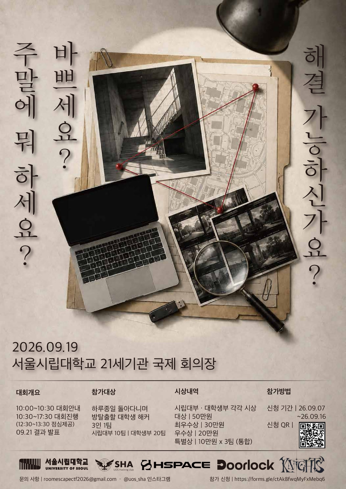

*그림 1. 방탈출 CTF 대회 포스터.*

여러 건물에서 동시에 조사를 진행하는 만큼, 문제 제작과 함께 현장 운영을 준비해야 했습니다. 팀별 이동과 대기, 입장 안내, 제한 시간, 다음 팀을 위한 소품 복구가 대회 진행에 영향을 줍니다. 같은 시나리오를 두 조사실에서 운영할 때는 어느 방에 들어가더라도 같은 조건을 제공해야 했습니다.

**약 3개월 동안** 시나리오와 문제를 제작하고, 조사 공간과 소품, 참가자·운영진 가이드, 대회 사이트와 큐 시스템을 준비했습니다. 이 글에서는 대회의 구성과 규칙, 현장 운영 방식, 그리고 사이트와 큐 시스템을 어떻게 활용했는지 소개합니다.

**목차**

1. [기획 의도](#motivation)
   - [방탈출과 CTF의 결합](#escape-ctf)
   - [협업과 정보 공유](#team-collaboration)
2. [대회 소개](#event)
   - [대회 개요](#event-overview)
   - [시나리오와 증거의 구성](#content-design)
   - [대회 준비](#event-preparation)
   - [데모 진행 과정](#preparation)
3. [게임 구성과 규칙](#rules)
   - [메인 의뢰와 추가 의뢰](#challenge-types)
   - [다섯 시나리오와 조사 공간](#field-rules)
   - [점수](#scoring)
   - [수사보고서](#report)
4. [대회 사이트와 참가자 안내](#platform)
   - [대회 사이트](#contest-site)
   - [참가자 OT와 문의 대응](#operations-checklist)
5. [큐 시스템 운영](#queue-system)
   - [현장 대기와 이동](#queue-overview)
   - [팀 단위 대기 등록](#queue-registration)
   - [조사실 병렬 운영](#queue-assignment)
   - [입장과 퇴장 관리](#queue-entry)
6. [설문 결과와 개선 사항](#results)
   - [좋았던 점](#what-went-well)
   - [아쉬웠던 점](#what-could-be-better)

## 1. 기획 의도

### 방탈출과 CTF의 결합

이번 대회는 현장에서 확보한 정보를 온라인 문제의 분석에 활용하는 팀 단위 CTF로 기획했습니다. 여러 보안 분야의 문제를 하나의 사건 안에 배치하고, 공간 탐색과 증거 수집을 문제 풀이에 연결했습니다. 참가자가 현장을 조사하고, 팀원과 정보를 공유하며, 분석 결과로 다음 단서를 찾는 흐름을 구성했습니다.

문제 해결에 필요한 정보를 온라인 파일과 실제 공간에 나눠 배치했습니다. 현장에서 얻은 단서를 디지털 자료와 대조해야 다음 단계로 이어질 수 있도록 구성해, 공간을 탐색하는 행동에도 분석의 목적을 부여했습니다.

LLM 등 분석 도구를 활용하는 환경도 기획에 반영했습니다. 현장에서 직접 확인해야 하는 정보, 관찰 결과를 정확히 설명하는 과정, 서로 다른 출처의 증거를 연결하는 판단에 비중을 두었습니다. 도구의 사용 여부와 함께, 팀이 어떤 정보를 확보하고 어떻게 공유하는지가 진행에 영향을 주는 구성을 목표로 했습니다.

### 협업과 정보 공유

단서를 발견하는 일과 분석하는 일을 팀원이 나누어 맡도록 해, **정보를 정확히 기록하고 전달하는 과정도 문제 풀이의 일부**가 되게 했습니다. 자료를 촬영해 보내는 대신 필요한 내용을 판단해 기록하도록 한 이유도 여기에 있습니다.

정보가 빠져 있으면 팀원과 논의해 다음 조사에서 확인할 항목을 정해야 합니다. 각자 확보한 정보를 연결하고 부족한 근거를 찾아가는 과정이 팀의 전략에 포함되도록 했습니다.

## 2. 대회 소개

### 대회 개요

2026년 9월 19일, 서울시립대학교 보안 동아리 SHA는 암호 동아리 도어락과 함께 방탈출 CTF 대회 〈주말에 뭐 하세요? 바쁘세요? 해결 가능하신가요?〉를 개최했습니다. AI의 발전으로 기존 Jeopardy CTF를 AI가 사실상 대신 플레이하는 듯한 상황을 아쉽게 여겨, 참가자가 직접 이동하고 장치를 조작하는 경험을 대회에 담고자 했습니다.

처음에는 방탈출 요소 없이 참가자가 이동하며 하드웨어 장치를 조작하는 대회를 구상했습니다. 하지만 준비 기간과 예산을 고려해 방탈출 CTF 형태로 구체화했습니다. 그 결과 참가 장벽이 낮아져 서울시립대학교 구성원뿐 아니라 일반 참가자도 많이 참여했습니다.

참가자들은 팀별 탐정사무소를 꾸려 캠퍼스의 수사 현장을 조사하고, 현장에서 얻은 단서와 온라인 CTF 문제를 연결해 사건을 해결했습니다. 서울시립대학교 21세기관 국제회의장을 수사 본부로 삼고 교내 5개 건물의 조사 공간을 오갔으며, 실제 대회 시간은 오전 10시 30분부터 오후 5시 30분까지 총 7시간이었습니다.

| 항목 | 내용 |
| --- | --- |
| 대회명 | 주말에 뭐 하세요? 바쁘세요? 해결 가능하신가요? |
| 개최일 | 2026년 9월 19일 |
| 대회 시간 | 10:30–17:30, 총 7시간 |
| 장소 | 서울시립대학교 21세기관 국제회의장 및 교내 5개 건물 |
| 참가 단위 | 3인 1팀, 시립대부·대학부 |
| 공동 주최 | 서울시립대학교 보안 동아리 SHA · 암호 동아리 도어락 |
| 후원 | HSPACE · Knights · 서울시립대학교 컴퓨터과학부 |

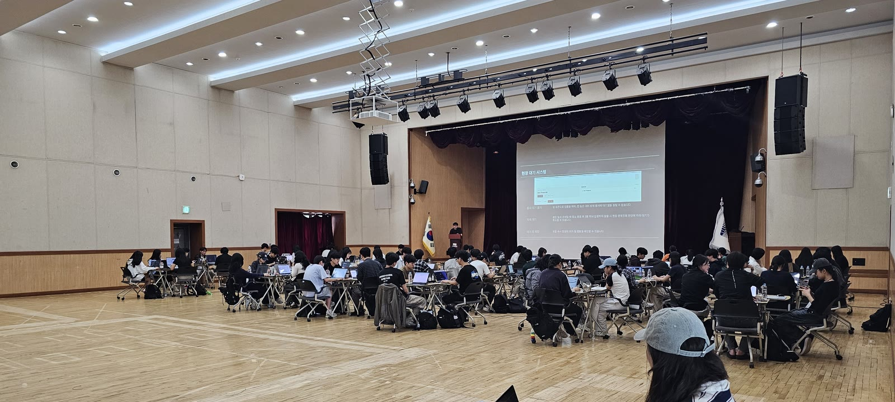

*그림 2. 참가자들이 모인 국제회의장. 대회 시작 전, 현장 대기 시스템을 안내하던 모습입니다.*

각 팀은 하나의 탐정사무소입니다. 경찰 내부자로부터 전달된 메인 사건을 수사하면서, 탐정사무소에 접수된 추가 의뢰도 해결합니다. 최종적으로는 확보한 증거를 종합한 수사보고서를 제출합니다.

이 설정은 웹사이트의 화면 구성에도 적용했습니다. 문제 목록은 의뢰, 공지는 수사 기록, 장소 안내는 수사 지도라는 형태로 제공했습니다. 참가자가 사용하는 명칭과 게임의 진행 단위를 맞춰, 화면에서 선택한 의뢰가 실제 조사 활동으로 이어지도록 구성했습니다.

### 시나리오와 증거의 구성

메인 시나리오는 교내에서 발생한 사망 사건을 조사하는 이야기입니다. 기획 문서에는 인물별 배경과 관계, 사건 전후의 시간대, 공간별 증거를 정리했습니다. 참가자는 진술과 실제 기록을 대조하고, 서로 다른 장소에서 확보한 정보를 연결해 사건을 해석합니다.

공간마다 다루는 자료의 성격을 나눴습니다. 수사자료실에는 사건 문서와 진술 기록, 사이버수사대에는 디지털 활동의 흔적, 학교전산망에는 교내 시스템의 기록, CCTV 관리실에는 영상과 관련 자료를 배치하는 구성입니다. 전공강의실에서 시작하는 시나리오에서는 연구실 자료로 이어지는 단서를 다뤘습니다.

한 공간에서 얻는 정보는 해당 문제의 해결에 쓰이면서 사건 전체를 설명하는 근거로도 사용됩니다. 따라서 플래그를 제출한 뒤에도 문서의 출처와 내용을 보존해야 합니다. 여러 시나리오의 증거를 비교하는 작업을 최종 수사보고서로 연결한 이유입니다.

문제를 만들 때는 온라인에 제공할 파일과 현장에 배치할 문서·소품을 함께 준비했습니다. 운영진이 입장 전에 안내할 내용과, 한 팀의 조사가 끝난 뒤 자료와 잠금장치를 원래 상태로 돌려놓는 방법도 정리했습니다.

### 대회 준비

대회 준비에는 시나리오와 문제 제작, 현장 구성, 대회 사이트와 큐 시스템 개발, 안내 문서 작성이 포함됐습니다.

| 구분 | 준비한 내용 |
| --- | --- |
| 시나리오 | 사건 개요, 인물 관계, 장소별 증거 |
| 문제와 현장 | 문제 파일, 문서·소품, 장비와 초기 세팅 |
| 대회 사이트 | 문제 트리, 지도, 의뢰 목록, 스코어보드 |
| 큐 시스템 | 대기 등록, 조사실 배정, 타이머, 운영 콘솔 |
| 안내 문서 | 플레이어 가이드(대회 안내, 게임 안내, 자물쇠 사용), 운영진 가이드 |

교내에는 대회 포스터도 붙였습니다. 사건 자료를 펼쳐 놓은 듯한 포스터의 분위기는 대회 사이트와도 이어졌습니다. 온라인 화면과 실제 공간에서 같은 대회를 만날 수 있도록 준비했습니다.

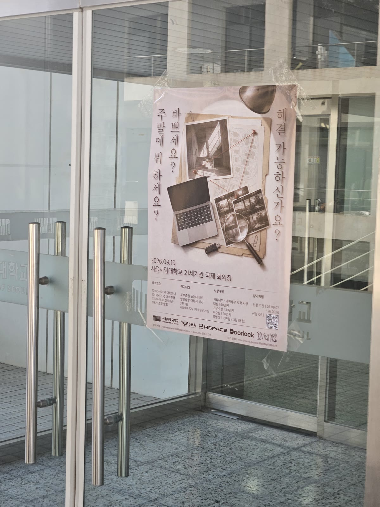

*그림 3. 교내에 붙인 대회 포스터.*

### 데모 진행 과정

대회를 앞두고 **총 네 차례의 데모**를 진행했습니다.

#### 1차 데모(대회 4주 전)

첫 번째 데모는 방탈출 문제만 대상으로 진행했습니다. 데모 참여자의 피드백을 바탕으로 난도가 적절한지 판단하고, 과도한 부분을 줄였습니다.

#### 2차 데모(대회 3주 전)

두 번째 데모에서는 방탈출 문제와 현장팀 문제를 함께 진행했습니다. 실제로 참여자들이 대회 당일 범인을 잡을 수 있는지, 방탈출 문제를 주어진 시간 안에 해결할 수 있는지를 중심으로 평가했습니다.

#### 3차 데모(대회 2주 전)

세 번째 데모에서는 대회 사이트를 포함한 상태에서 진행을 확인했습니다. 대회 사이트의 UI 사용 중 불편했던 점에 대한 피드백을 반영해 수정했습니다.

#### 4차 데모(대회 1주 전)

네 번째 데모는 실제 대회에서 사용할 환경의 세팅을 모두 마친 뒤, 최종 점검을 위해 진행했습니다.

## 3. 게임 구성과 규칙

참가자는 3인 1팀으로, 현장을 조사하는 **현장팀**과 수사 본부에서 분석하는 **수사팀**으로 역할을 나눴습니다. 수사 본부에는 **수사팀을 최소 1명** 남기도록 했습니다.

### 메인 의뢰와 추가 의뢰

문제는 **메인 의뢰**와 **추가 의뢰**로 나눴습니다. 메인 의뢰는 현장 조사와 온라인 CTF 문제가 연결된 사건입니다. 추가 의뢰는 원하는 문제를 선택해 푸는 Jeopardy 방식이며, 메인 사건과 독립적으로 진행합니다.

| 구분 | 메인 의뢰 | 추가 의뢰 |
| --- | --- | --- |
| 진행 단위 | 사건에 연결된 다섯 시나리오 | 독립된 개별 문제 |
| 플레이 | 현장 조사 → 기록 공유 → 온라인 분석 | 원하는 문제 선택 → 풀이 → 플래그 제출 |
| 정보의 의미 | 다음 단계의 단서이자 수사보고서의 근거 | 해당 의뢰를 해결하기 위한 정보 |
| 메인 사건과의 관계 | 확보한 증거를 모아 사건을 해석 | 정답과 풀이 결과를 메인 사건의 단서로 사용하지 않음 |
| 제출 자료 | 메인 의뢰 수사보고서 | 추가 의뢰 라이트업 |

메인 의뢰를 진행하기 위해 추가 의뢰를 풀어야 하는 것은 아닙니다. 현장팀이 조사하거나 이동하는 동안 수사 본부의 수사팀이 추가 의뢰를 선택할 수 있지만, 어느 작업에 시간을 쓸지는 팀이 결정합니다. 두 문제군의 관계를 명시해 사건의 증거와 독립적인 기술 문제를 구분했습니다.

CTF 분야는 Web, Pwnable, Reversing, Crypto, Forensics, AI, Misc를 포함했습니다.

추가 의뢰의 구성과 문제별 내용은 [3편: 추가 의뢰](/posts/roomescape-ctf-part-3/)에서 더 자세히 소개하겠습니다.

*이하의 사이트 화면 이미지는 대회 종료 후 촬영한 기능 소개용 자료입니다. 화면의 점수와 계정 상태는 촬영 시점을 기준으로 합니다.*

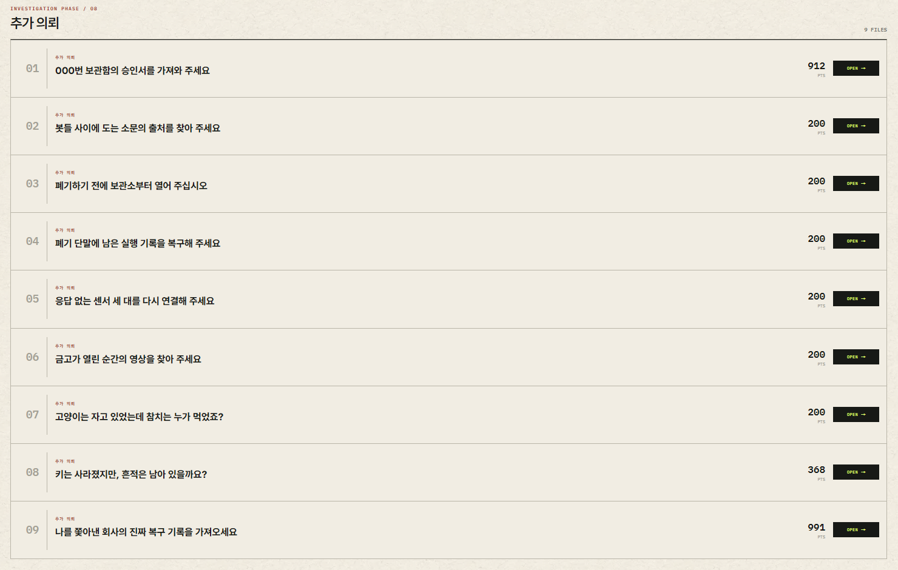

*그림 4. 참가자가 선택해서 해결하는 추가 의뢰 목록.*

### 다섯 시나리오와 조사 공간

현장 조사는 **다섯 시나리오**를 기준으로 운영했습니다. 시나리오 수와 실제 조사실 수는 다릅니다. 1–4번 시나리오는 각각 두 조사실을, 5번 시나리오는 한 조사실을 사용해 총 아홉 개의 조사 공간을 구성했습니다.

| 시나리오 | 조사실 수 | 1회 제한 시간 |
| --- | ---: | ---: |
| 수사자료실 | 2 | 15분 |
| 사이버수사대 | 2 | 15분 |
| 학교전산망 | 2 | 15분 |
| CCTV 관리실 | 2 | 15분 |
| 전공강의실 | 1 | 10분 |

현장 조사와 분석은 다음 순서로 진행됩니다.

1. 대회 사이트에서 진행 중인 문제와 필요한 정보를 확인합니다.
2. 조사할 시나리오를 선택하고 해당 현장의 QR 코드로 대기를 등록합니다.
3. 차례를 배정받으면 운영진의 입장 확인을 거쳐 조사를 시작합니다.
4. 제한 시간 동안 자료를 확인하고 제공된 공책에 단서를 기록합니다.
5. 퇴장 후 기록을 수사팀과 공유하고 온라인 분석을 진행합니다.
6. 얻은 플래그는 대회 사이트에 제출하고, 증거와 출처는 보고서용으로 정리합니다.

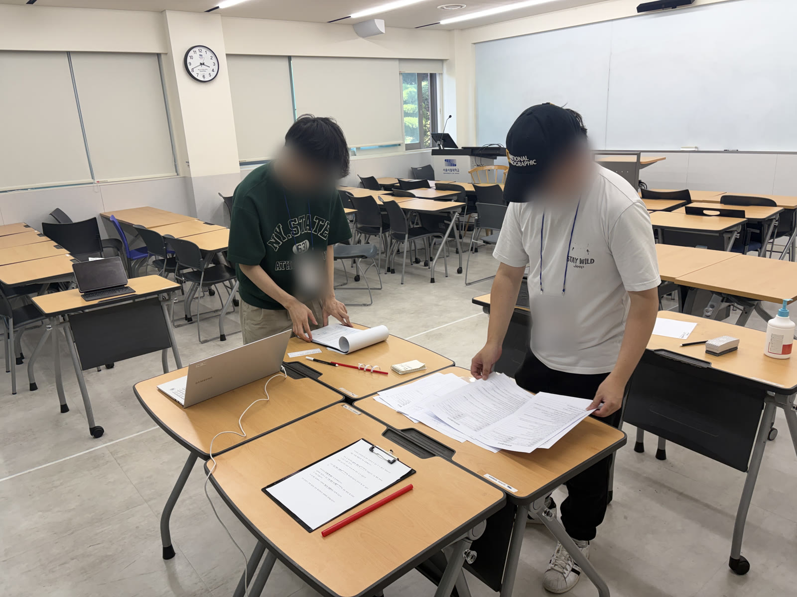

*그림 5. 책상 위의 문서를 함께 살펴보는 참가자들.*

### 점수

점수는 개별 문제 해결, 메인 의뢰 진행, 수사보고서 평가를 함께 반영했습니다.

| 항목 | 배점과 조건 |
| --- | --- |
| 메인 의뢰 플래그 | 문제당 200점 |
| 수사 현장 5곳 전체 해결 | 1,000점 |
| 시나리오별 퍼펙트 클리어 | 200–500점(다이내믹 스코어링) |
| 일반 추가 의뢰 | 200–1,000점(다이내믹 스코어링) |
| 수사보고서 | 최대 3,000점 |
| UOSINT | 서로 다른 8개 플래그, 각 100점, 최대 800점 |
| 힌트 | 메인 의뢰에서 제공하며 열람 시 안내된 점수 차감 |

다이내믹 스코어링은 해결 팀 수에 따라 배점이 조정되는 방식입니다. 해결 팀이 늘어 배점이 내려가면 이미 해결한 팀의 점수에도 현재 배점이 반영됩니다. 팀은 문제의 난도와 예상 소요 시간, 현재 배점을 함께 고려해 의뢰를 선택할 수 있습니다.

퍼펙트 클리어는 **동점자가 많아질 가능성을 줄이고, 방탈출 문제 해결 능력이 뛰어난 팀에 추가 점수를 주기 위해** 도입했습니다. 힌트 사용 여부와 현장 입장 횟수를 퍼펙트 클리어 조건에 포함해, 같은 시나리오를 완료한 팀 사이에서도 해결 과정에 따라 점수 차이가 생기도록 했습니다.

퍼펙트 클리어는 **시나리오별로 다음 조건을 모두 충족**해야 합니다.

1. **해당 시나리오의 다섯 문제를 모두 해결**합니다.
2. 그중 **‘방탈출’ 태그가 붙은 문제를 힌트 없이 해결**합니다.
3. **해당 현장에 한 번만 입장한 상태**에서 시나리오를 완료합니다.

‘방탈출’ 태그가 없는 문제의 힌트 사용은 두 번째 조건과 구분했습니다. 재방문은 허용하지만 시나리오 완료 전에 재입장하면 1회 입장 조건을 만족하지 못합니다. 문제 해결 여부만으로 계산할 수 없는 조건이므로 실제 입장 기록이 필요합니다.

특별 의뢰인 UOSINT는 사진 속 캠퍼스 장소를 찾아 플래그를 수집하는 문제입니다. 팀원들의 제출 결과를 합산하되 같은 플래그에는 중복 점수를 주지 않았습니다.

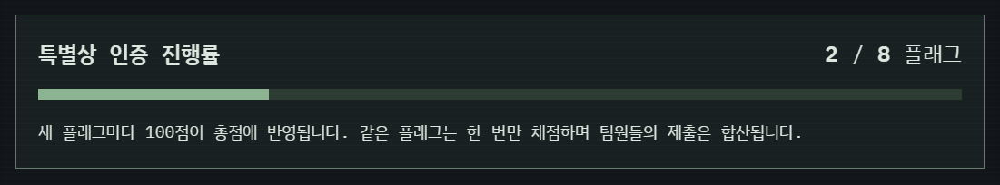

*그림 6. 발견한 장소 수와 획득 점수를 표시하는 UOSINT 진행 화면.*

아래는 UOSINT에서 찾아야 했던 장소와 실제 플래그의 예시입니다. 사진 속 장소를 찾아 플래그를 제출하면, UOSINT 진행률이 올라갑니다.

  

    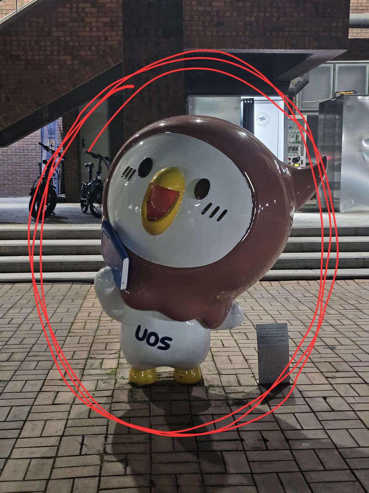
    
장소 예시

  

  

    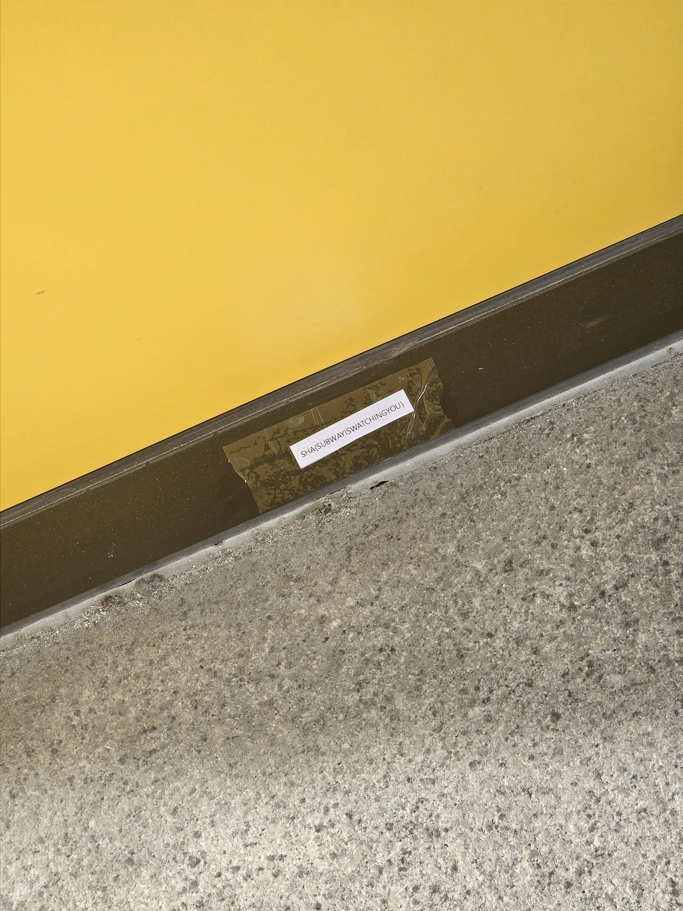
    
플래그 예시

  

*그림 7. UOSINT 장소 예시(왼쪽)와 플래그 예시(오른쪽).*

### 수사보고서

메인 의뢰의 최종 제출물은 수사보고서입니다. 참가자는 사건에 대한 결론, 결론을 뒷받침하는 증거, 각 증거의 출처를 정리해야 합니다. 추론과 증거가 맞지 않거나 출처가 빠진 경우에는 감점될 수 있습니다.

최대 3,000점의 보고서 배점은 개별 플래그를 확보하는 과정과 사건 전체를 설명하는 과정을 함께 평가하기 위한 구성입니다. 모든 단계를 마치지 못한 팀도 확보한 자료를 바탕으로 보고서를 작성할 수 있습니다. 참가 팀은 대회 종료 시각인 17시 30분까지 메인 의뢰 수사보고서와 추가 의뢰 라이트업을 제출했습니다.

증거의 출처를 확인할 수 있도록 현장 기록에는 방 이름과 문서·물품·화면의 이름, 발견 위치를 함께 남겨야 했습니다. 수사팀은 이 기록을 근거별로 정리해 보고서에 활용해야 했습니다.

추가 의뢰의 라이트업은 기술 문제의 풀이 과정을 설명하는 자료입니다. 메인 사건의 결론을 설명하는 보고서와 목적이 다르므로 제출 범위를 분리해 안내했습니다.

## 4. 대회 사이트와 참가자 안내

### 대회 사이트

대회 사이트는 CTFd를 기반으로 구성했습니다. 문제 확인, 플래그 제출, 점수 확인을 중심으로 지도와 시나리오 트리, 의뢰 목록, 수사 기록을 배치했습니다. 탐정사무소라는 설정에 맞춰 문서와 사건 기록의 시각적 표현을 사용하면서, 참가자가 해야 할 행동을 화면별로 구분했습니다.

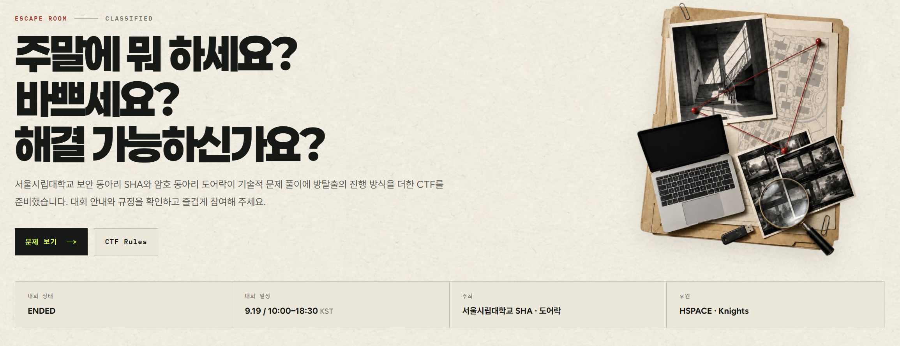

*그림 8. 대회 정보와 의뢰 진입점을 제공하는 메인 화면.*

#### 현장 지도와 시나리오 트리

현장 지도는 온라인 문제와 캠퍼스의 공간을 연결하는 화면입니다. 지도에 표시된 지점을 선택해 관련 정보를 확인하고 해당 수사 구역의 사건으로 이동할 수 있도록 구성했습니다. 수사 본부에 있는 팀원과 이동 중인 팀원이 같은 장소 이름을 기준으로 소통할 수 있습니다.

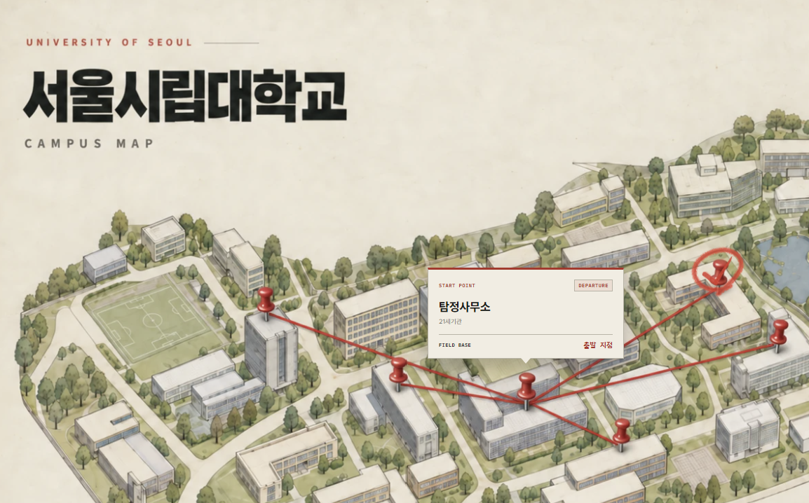

*그림 9. 조사 장소와 해당 시나리오를 연결하는 현장 지도.*

시나리오 화면은 문제를 트리 형태로 배치했습니다. 개별 문제의 해결 여부와 문제 간 연결을 함께 보여 줘, 참가자가 현재 확보한 자료로 진행할 수 있는 부분을 파악하도록 했습니다. 상단에는 조사 제한 시간과 운영 중인 조사실 수를, 하단에는 퍼펙트 클리어의 조건별 달성 상태를 표시했습니다.

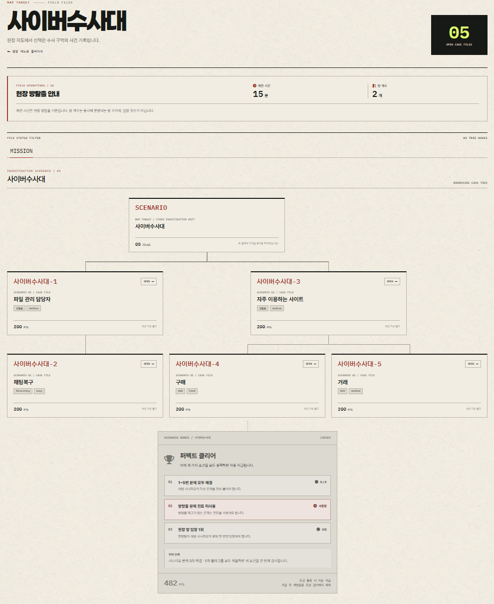

*그림 10. 문제 트리와 조건별 달성 상태를 보여 주는 사이버수사대 화면.*

#### 스코어보드

스코어보드에는 총점과 순위 외에 문제별 상태를 함께 표시했습니다. First Blood, 힌트 없이 해결한 문제, 사용한 힌트 수, 일부 플래그만 확보한 상태 등을 구분했습니다.

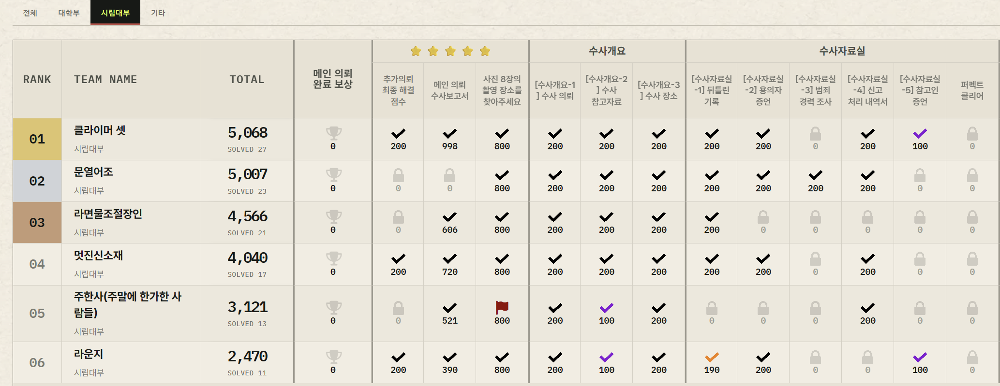

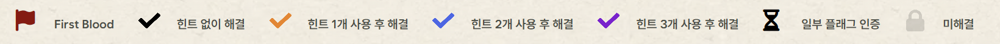

*그림 11. 스코어보드와 상태 범례. 총점과 문제별 진행 정보를 함께 제공합니다.*

#### 추가 의뢰

추가 의뢰가 공개되면 새로운 의뢰인이 방문했다는 형식으로 안내하되, 공지 시각과 내용을 확인할 수 있도록 했습니다. 참가자가 놓친 안내를 다시 찾는 기능을 사건 기록의 형식에 담았습니다.

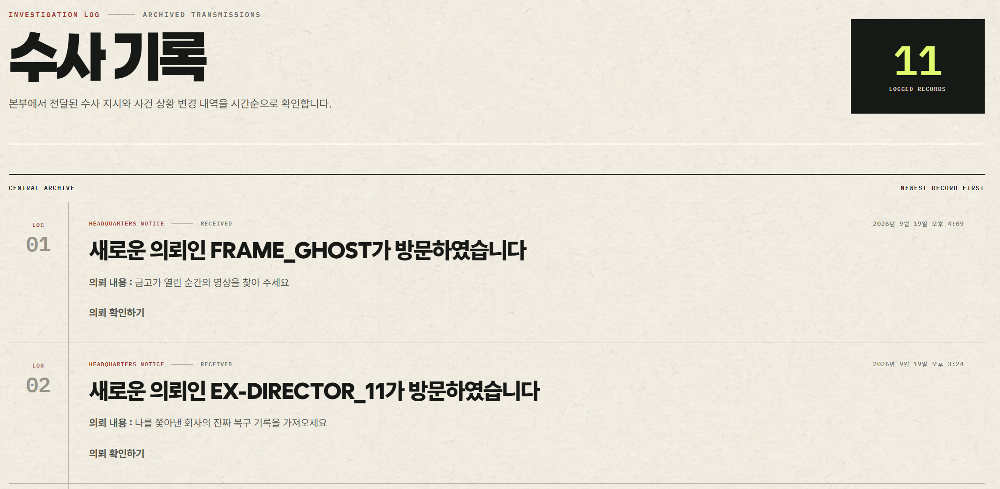

*그림 12. 공지와 새 의뢰 안내를 모은 수사 기록 화면.*

### 참가자 OT와 문의 대응

대회 시작 전에는 수사 본부인 21세기관 국제회의장에서 약 15분간 참가자 오리엔테이션(OT)을 진행했습니다. 메인·추가 의뢰와 팀 역할을 설명한 뒤, 대회 사이트 이용, 현장 조사와 대기 등록, 점수와 제출 규정 순서로 안내했습니다.

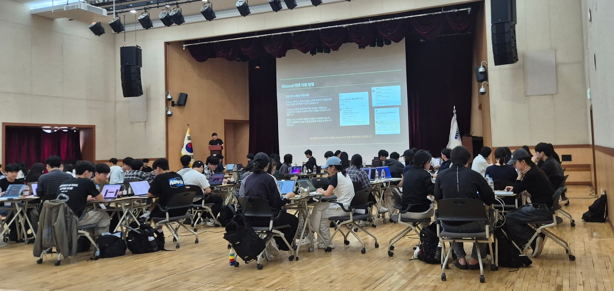

*그림 13. 참가자 OT에서 Discord 티켓 이용 방법을 안내하는 모습.*

팀원 간의 온라인 소통에는 Discord 팀 전용 채널을 사용했습니다. 참가자가 `#verify` 채널에서 대회 계정의 인증 토큰으로 인증하면 팀 채널이 생성되고, 해당 팀의 참가자 3명과 운영진에게만 접근 권한을 부여하는 방식입니다. 단서와 풀이 내용은 이 채널 안에서 공유하도록 안내했습니다.

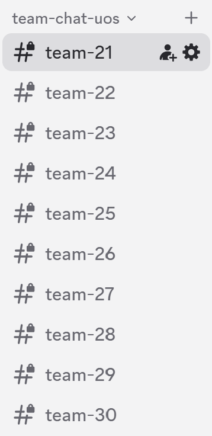

*그림 14. 시립대부 팀 전용 Discord 채널 목록.*

공지와 문의, 힌트도 이용 경로를 구분했습니다.

- **전체 공지**는 Discord와 대회 사이트에서 확인합니다.
- **운영 문의**나 문제 이용 범위가 불분명한 경우에는 Discord 티켓을 사용하도록 했습니다.
- **풀이 힌트**는 지정된 대회 사이트에서 열람하며 감점이 적용됩니다.

운영 문의를 보내는 것과 점수를 사용해 힌트를 여는 것을 참가자가 구분할 수 있도록 안내했습니다.

OT에서는 복도에서 뛰지 않기, 출입구를 막지 않기, 소품과 현장 장비를 임의로 분해하거나 설정을 바꾸지 않기 등 이동과 공간 이용 수칙도 설명했습니다.

분산된 현장에서는 이 공통 안내가 방 앞의 설명과 일치해야 합니다. 참가자 가이드는 대회 중 규칙을 다시 확인할 수 있는 자료로, 운영진 가이드와 FAQ는 입장 안내와 예외 상황을 처리하는 기준으로 활용했습니다. OT 이후에도 필요한 순간에 같은 규칙을 다시 찾을 수 있도록 안내 자료와 현장 설명을 연결했습니다.

## 5. 큐 시스템 운영

### 현장 대기와 이동

여러 건물의 대기와 입장을 관리하기 위해 대회 사이트와 별도로 큐 사이트를 마련했습니다. 참가자는 현황판에서 **시나리오별 위치와 운영 상태, 대기 팀 수**를 확인하고 조사 순서를 정할 수 있었습니다.

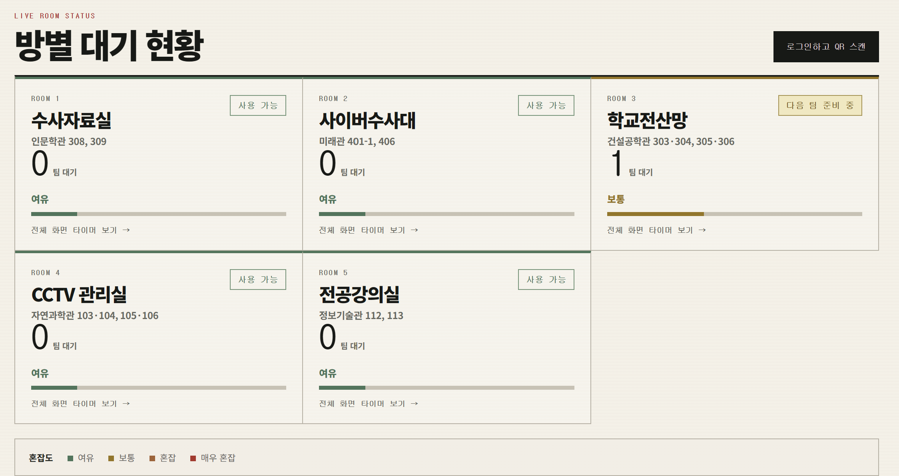

*그림 15. 다섯 시나리오의 위치와 현재 대기 상황을 확인하는 큐 현황판.*

대기 등록 후에는 자신의 순번을 확인하고, 입장 차례가 되면 화면 알림을 받을 수 있도록 했습니다.

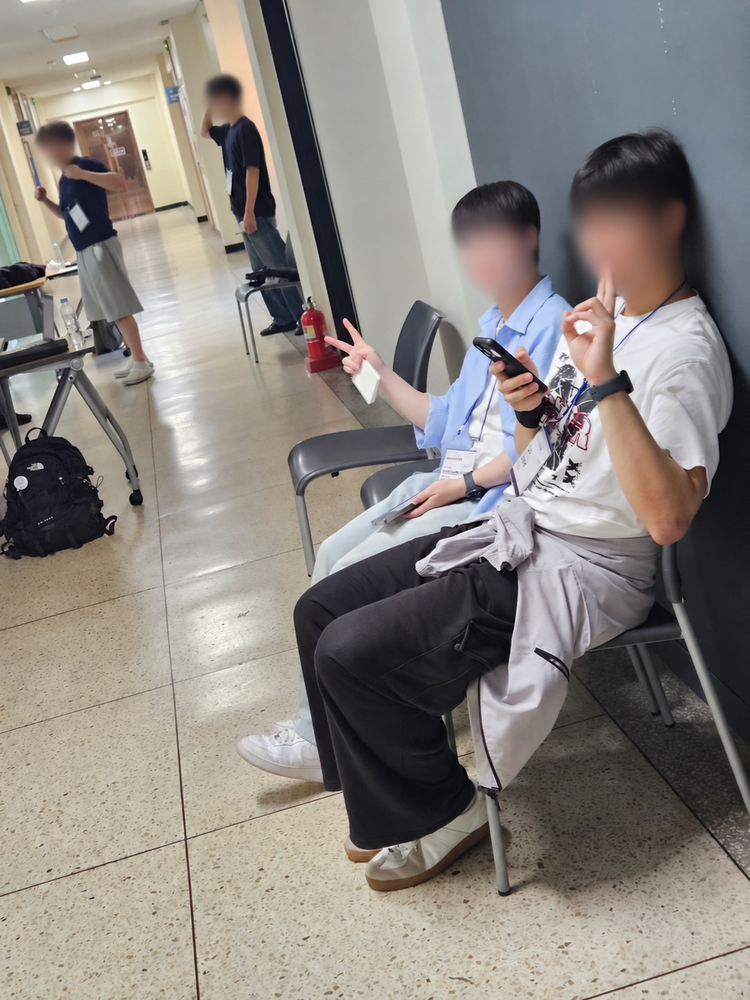

*그림 16. 조사실 앞 복도에서 남긴 한 컷. 문제를 살펴보는 모습과는 또 다른 현장의 모습입니다.*

### 팀 단위 대기 등록

참가자는 대회 사이트에서 발급받은 개인 인증 토큰(Access Token)으로 로그인하고, 현장의 QR 코드를 스캔해 대기를 등록했습니다. 인증은 개인 계정으로 하지만, **대기 순서와 입장 상태는 팀 단위로 공유**하도록 했습니다.

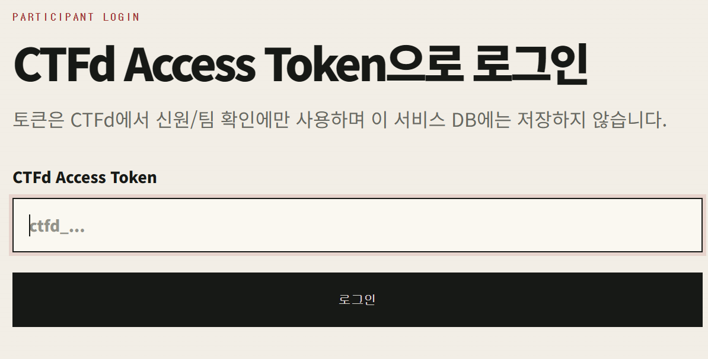

*그림 17. 대회 계정의 인증 정보를 이용해 소속 팀을 확인하는 로그인 화면.*

- 같은 팀에서 여러 번 등록해도 **대기 순번이 추가되지 않도록** 했습니다.
- 한 팀은 전체 조사 공간을 통틀어 **한 곳에서만 대기하거나 조사**할 수 있도록 했습니다.
- 대기 중 다른 시나리오로 옮길 때는 기존 등록을 취소하고 전환하도록 했습니다.

### 조사실 병렬 운영

두 조사실을 사용하는 1–4번 시나리오에서는 여러 팀이 동시에 조사할 수 있도록 병렬로 운영했습니다. **두 방은 하나의 대기열을 공유**하며, 방이 비면 다음 순서의 팀을 배정했습니다.

운영진은 하나의 화면에서 방별 사용 팀과 남은 시간, 공용 대기열을 확인할 수 있었습니다.

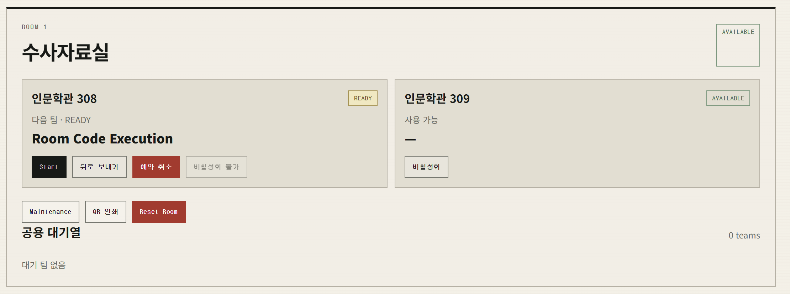

*그림 18. 수사자료실의 두 조사실을 개별 관리하고 다음 대기 팀을 확인하는 운영 콘솔.*

예를 들어 A팀이 먼저 조사를 마치면 그 방에 대기 중인 C팀을 배정하고, 다른 방의 B팀은 그대로 조사를 이어갑니다.

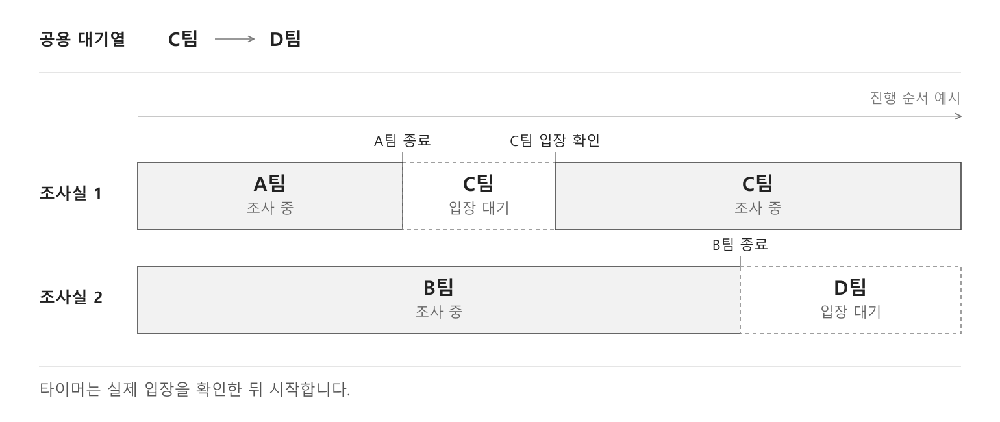

*그림 19. 공용 대기열을 공유하는 두 조사실의 운영 흐름. 막대 길이는 실제 소요 시간을 나타내지 않습니다.*

어느 방에 배정되더라도 같은 조건에서 조사할 수 있도록 문서와 소품, 제한 시간, 입장 안내를 맞췄습니다.

### 입장과 퇴장 관리

1. **차례 배정:** 큐 화면의 READY는 입장할 차례가 정해진 상태입니다. 아직 타이머가 시작되지는 않습니다.
2. **조사 시작:** 담당 운영진이 실제 입장을 확인한 뒤 타이머를 시작했습니다. 이동이나 입장 안내에 걸리는 시간이 조사 시간을 줄이지 않도록 했습니다.
3. **퇴장과 다음 팀 준비:** 운영진이 실제 퇴장을 확인해 종료 처리하고, 문서와 소품을 원래 상태로 돌려 다음 팀의 입장을 준비했습니다.

운영진이 확인한 실제 입장 기록은 퍼펙트 클리어의 **‘1회 입장’ 조건**을 판단하는 데에도 사용했습니다. QR 코드를 여러 번 스캔하거나 입장 전에 대기를 취소한 것은 방문 횟수에 포함하지 않았습니다.

## 6. 설문 결과와 개선 사항

대회 종료 후 제출된 만족도 조사 48건에서는 전체 대회에 ‘만족’ 또는 ‘매우 만족’을 선택한 응답이 45건(93.8%), 비슷한 형식의 대회에 재참가할 의향이 있다는 응답이 46건(95.8%)이었습니다. 방탈출 형식이 문제 풀이에 재미를 더했다는 문항에는 48건 모두가 긍정적으로 답했습니다.

| 항목 | 집계한 응답 | 해당 응답 수 / 문항별 응답 수 | 비율 |
| --- | --- | --- | --- |
| 전체 만족도 | 만족·매우 만족 | 45 / 48 | 93.8% |
| 재참가 의향 | 어느 정도 있다·매우 있다 | 46 / 48 | 95.8% |
| 방탈출 형식이 재미를 더함 | 그렇다·매우 그렇다 | 48 / 48 | 100.0% |
| 공간 탐색과 풀이가 자연스럽게 연결됨 | 그렇다·매우 그렇다 | 44 / 48 | 91.7% |
| 행사 진행·운영 방식 만족도 | 만족·매우 만족 | 47 / 48 | 97.9% |
| 메인 의뢰의 전체 시간 부족 | 모자람·매우 모자람 | 24 / 48 | 50.0% |
| 메인 의뢰의 난도 | 어려움·매우 어려움 | 34 / 48 | 70.8% |
| 문제의 의도와 목표를 이해하기 쉬움 | 그렇다·매우 그렇다 | 31 / 46 | 67.4% |

자유 의견에는 직접 이동하며 탐색하는 재미, 방탈출과 CTF의 연결, 사건의 의뢰를 해결하는 구성을 긍정적으로 평가한 내용이 있었습니다. 동시에 대기와 이동에 비해 조사 시간이 짧다는 의견, 안내와 소품 세팅에 관한 의견도 나왔습니다. 이 의견을 바탕으로 검토할 운영 개선 사항은 다음과 같습니다.

| 설문에 나타난 경험 | 검토할 개선 사항 |
| --- | --- |
| 대기와 이동에 비해 조사 시간이 부족함 | 시나리오별 조사·복구·이동 시간을 포함한 수용량과 동선 검토 |
| 긴 문자열을 옮겨 적는 데 조사 시간을 사용 | 직접 기록할 정보와 퇴장 시 제공할 수 있는 자료의 범위 구분 |
| 개요·지도·보고서의 목적을 늦게 이해 | 시작 전 필수 진행 경로 확인, 지도와 제출 위치의 노출 강화 |
| 개인 인증 정보를 ‘팀 토큰’으로 이해 | 개인 계정 토큰으로 인증하고 팀 상태를 공유한다는 설명 |
| 소품 누락·세팅 문제 또는 팀별 안내 차이 | 기준 사진을 포함한 복구 점검과 입장 안내 문구 통일 |
| 도구 설치나 힌트 이용에서 어려움 | 사전 환경 확인 예제와 단계별 힌트·이용 경로 점검 |

표의 개선 항목은 응답을 바탕으로 정리한 제안이며 이미 적용된 변경을 의미하지 않습니다. 소품 누락이나 세팅 문제에 관한 내용도 설문에 보고된 경험을 요약한 것입니다.

큐 시스템이 순서를 정확히 관리하더라도 공간의 수와 이동 거리는 그대로 남습니다. 따라서 시간 부족을 모두 큐의 문제로 해석하거나, 상태 표시 기능만으로 대기 시간을 해결했다고 평가할 수는 없습니다. 운영 규모를 검토할 때는 대기 등록부터 READY 배정, 실제 시작과 종료까지의 시간을 구분해서 살펴보고, 여기에 복구와 이동 시간을 함께 고려해야 합니다.

### 좋았던 점

세 달 동안 정말 열심히 준비한 대회였는데, 다들 재밌게 참여해 주셔서 뿌듯했습니다.

특히 참가자들이 현장을 부지런히 돌아다니며 **증거를 모으고 사건을 풀어 가는 모습**이 좋았습니다. 직접 현장을 살피고 단서를 찾아가는 경험을 만들고 싶었는데, 참가자들이 저희가 바라던 방식으로 대회를 즐겨 주시는 걸 보니 준비한 보람이 느껴졌습니다.

**CTF가 처음인 분들도 재미있게 참여**할 수 있었으면 했습니다. 설문에서 첫 참가자들도 대회에 만족했다고 답해 주셔서, 처음 만난 CTF가 좋은 기억으로 남은 것 같아 반가웠습니다.

무엇보다 **중간에 돌아가지 않고 끝까지 함께해 주셔서** 고마웠습니다. 현장을 오가며 문제를 풀다 보면 지칠 법도 한데, 마지막까지 남아 참여해 주신 모습이 오래 기억에 남을 것 같습니다.

### 아쉬웠던 점

#### 예상보다 적었던 올클리어

준비 과정에서는 올클리어 팀이 많이 나올 것으로 예상했지만, 실제 결과는 그 기대에 미치지 못했습니다. 대회 형식에 대한 높은 만족도는 반가웠지만, 준비한 문제와 사건을 더 많은 팀이 끝까지 해결하기를 바랐던 만큼 아쉬움도 남았습니다. 네 차례의 데모를 거쳤음에도 참가자가 대회 시간 안에 어디까지 진행할 수 있을지 예상하는 일은 쉽지 않았습니다.

설문에서 나온 난도와 시간 부족에 대한 의견도 이 결과와 함께 돌아볼 부분입니다. 참가자는 문제를 푸는 동안 현장을 오가고, 차례를 기다리고, 단서를 기록해 팀원에게 전달해야 했습니다. 마지막에는 확보한 증거를 모아 보고서도 작성해야 했습니다. 개별 문제를 해결할 수 있는지와 이 모든 과정을 대회 시간 안에 마칠 수 있는지를 함께 살펴볼 필요가 있었습니다.

#### 먼저 드러난 수사 공간

UOSINT를 풀며 캠퍼스를 돌아다니다가, 수사 공간의 위치를 알려 주는 문제를 풀기도 전에 그 장소를 먼저 알아버리는 경우도 있었습니다. 문제를 통해 수사 장소를 알아내는 재미를 넣고 싶었는데, 예상과 다른 경로로 위치가 드러난 셈입니다. 참가자가 이동하면서 어떤 공간을 마주치게 될지까지 더 생각했으면 좋았겠다 싶었습니다.

#### 넣지 못한 경찰 NPC

넣고 싶었지만 끝내 못 넣은 요소도 있었습니다. 참가자들이 ‘불법 탐정’이라는 설정에 맞춰, 학교를 돌아다니는 경찰 NPC를 두고 싶었습니다. 수사하러 다니다 경찰에게 걸리면 5분 정도 ‘감옥’에 머물러야 하는 식으로 구상했습니다. 단서를 찾으러 다니면서 경찰까지 피해 다녔다면 꽤 재미있었을 것 같은데, 아쉽게도 인력이 부족해 이번에는 넣지 못했습니다.

#### 생각보다 적었던 힌트 사용

힌트도 생각만큼 많이 쓰이지는 않았습니다. 막히는 부분이 있더라도 더 많은 분들이 방탈출을 즐길 수 있었으면 해서 준비했는데, 힌트를 사용하지 않은 팀이 많았습니다. 막혔을 때 힌트를 좀 더 편하게 활용할 수 있도록 안내했으면 어땠을까 싶습니다.

#### 다음에 보완하고 싶은 점

다음 대회를 준비하게 된다면, 데모에서 전체 진행에 걸리는 시간을 더 중점적으로 확인하고자 합니다. 여러 팀이 동시에 참여하는 상황에서 어느 단계에 시간이 오래 걸리는지, 문제 풀이와 이동·대기가 전체 진행 시간에 각각 얼마나 영향을 주는지 살펴보려 합니다. 이를 바탕으로 문제 수와 난도, 힌트 제공 방식, 현장 조사 시간을 함께 검토하고 싶습니다. 현장에서 단서를 찾고 팀원과 함께 분석하는 재미를 유지하면서, 더 많은 팀이 사건을 끝까지 해결할 수 있는 구성을 만드는 것이 다음에 보완하고 싶은 방향입니다.

준비한 공간을 직접 돌아다니며 문제를 풀어 준 참가자들이 있었기에, 세 달 동안 만든 시나리오와 문제도 하나의 대회가 될 수 있었습니다.

대회를 후원해 주신 HSPACE, Knights, 서울시립대학교 컴퓨터과학부에 감사드립니다. 시나리오와 문제 제작부터 공간 준비, 개발과 현장 운영까지 함께해 주신 모든 분, 그리고 각자의 방식으로 사건을 해결하고 의견을 남겨 주신 참가자 여러분께도 감사드립니다. 이번 운영 경험이 방탈출과 CTF를 결합한 대회를 준비하는 분들께 구체적인 참고가 되기를 바랍니다.

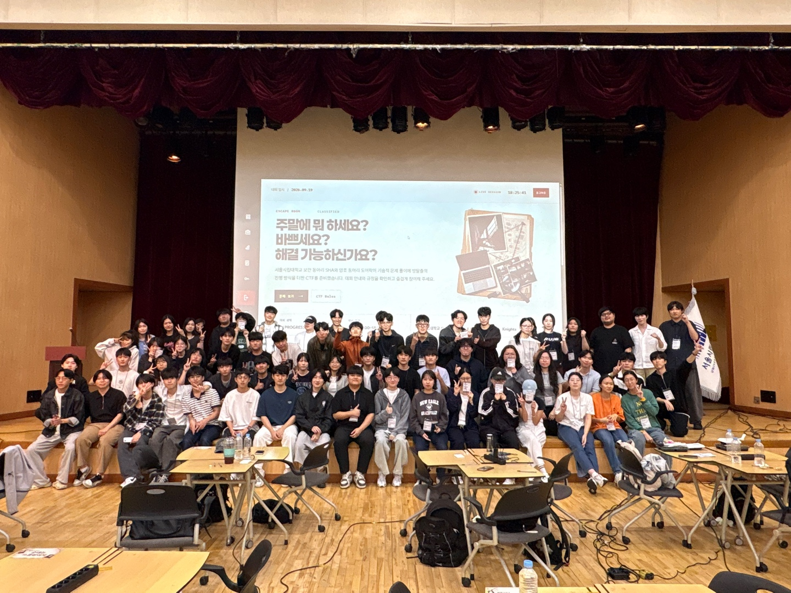

*그림 20. 방탈출 CTF를 함께한 참가자와 운영진의 단체 사진.*

